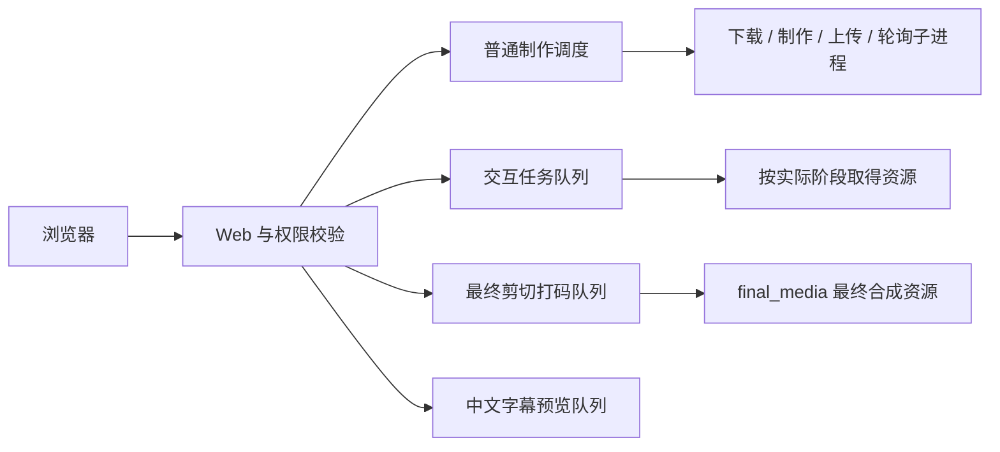

# 当前架构与处理流程

核对范围：`main` 合并提交 `9002646` 的产品代码，2026-11-04。本文描述代码能力；实际启用功能与容量由实例配置决定，部署版本见[线上变更索引](production-change-log.md)。

## 服务与后台任务

一个 Web 服务处理登录、项目编辑、媒体读取及任务提交。后台调度器推进持久任务，浏览器轮询只读取进度；关闭标签页不会停止已经接收的任务。

普通 worker 由 `EXACTCUT_WORKER_ENABLED` 控制。交互、最终剪切打码和字幕预览有各自调度生命周期，不能用普通 worker 关闭推断全部后台处理均已关闭。维护与停服会排空正在执行的任务，具体能力另受功能开关约束。

## 从项目到成片

1. 用户在网页创建项目并填写素材。保存会检查草稿修订；确认操作校验输入并固定本次制作内容。
2. 准备引用原片及需要的帧索引；原片、底片和派生资源按其身份校验后复用。
3. 后台制作剧情、字幕、水印与结尾，通过格式、时长、音频等技术质检后提供预览。
4. 启用素材纳管的项目按候选版本执行；校验成功后才更新当前成片，失败候选不会代替已有可用版本。
5. 剪切打码先产生处理结果，用户检查并确认替换后才变为项目使用版本。
6. 用户预览并确认交付。上传、飞书记录和平台状态分别留存证据；完成判断须包含就绪状态与 Facebook 视频 ID。

启用素材纳管需要 production 环境及 `material_lifecycle.enabled`。已纳管项目由登记与状态文件共同识别；关闭开关不会使旧写入路径重新获得修改权限。

## 数据与权威来源

代码与持久数据分开。数据根由 `EXACTCUT_DATA_ROOT` 指定，环境归属记录防止误用其他环境数据。

| 位置（相对数据根） | 用途 |
| --- | --- |
| `.web-state/accounts.sqlite3` | 账号与会话 |
| `.web-state/batches/<项目ID>/` | 草稿、控制状态、制作记录、预览和交付相关文件 |
| `.web-state/batches/<项目ID>/media-state.json` | 纳管项目的权威素材、草稿与版本状态 |
| `.web-state/media-registry/` | 独立纳管登记，保护父项目不被旧路径重写 |
| `.web-state/jobs/` | 普通持久任务 |
| `.web-state/execution-locks/` | 交互媒体执行资源租约 |
| `sources/` | 未另行配置源目录时的原片缓存 |
| `title-assets/` | 需要随数据保留的剧名资产 |
| `logs/` | 应用诊断 JSONL |

未纳管兼容流程仍有 `draft.json`、确认清单和制作结果。纳管项目应读取对外详情或权威素材状态，不能拿遗留草稿、某个内部 child 的完成标记或队列终态代替父项目业务结果。持久数据兼容版本仍为 1。

## 并发与资源

以下为当前源码默认值，**不是对线上运行配置的读取**：

| 任务或资源 | 默认容量 | 定义 |
| --- | ---: | --- |
| 普通 fetch / render / upload / poll | 2 / 3 / 2 / 4 | `concurrency` 配置段 |
| 普通子进程总量 | 车道之和 11 | 可用 `max_active_children` 另设总上限 |
| Hook / 单帧定位 | 3 / 2 | `editor_resources.hook_tasks / locate_tasks`；未显式配置时使用代码默认 |
| preview / scan / preprocess / frame | 各 2 | 独立交互角色 |
| media / final_media | 5 / 1 | 真实媒体阶段与最终合成 |
| 最终剪切打码 active | 1 | `mosaic_queue.max_active_tasks` |
| 中文字幕预览 active / pending | 2 / 30 | 功能默认关闭，容量由 `preview_subtitles` 配置 |
| 使用共享 AI 桶的调用 | 每分钟 60、burst 5 | `concurrency.ai`；不代表所有模型入口都使用此桶 |

普通任务按账号轮转并结合车道、项目/素材冲突和持久退避决定准入。交互提交先持久接收，实际执行阶段才取得资源，避免预占之后才会使用的媒体资源。

短探测、单帧抽取、抽音和 mux 等已标记轻操作不占共享媒体名额。最终剪切打码由持久队列和 final_media 控制。全局 transfer 资源已移除，OSS 仍保留按对象锁及内容/回执校验。各类容量不应直接当作机器 CPU 容量；Linux 部署限制需要独立验收。

## 暂停、取消与恢复

- 控制状态与制作状态分开保存。发信号前验证数据实例、PID、进程组及随机进程 token，避免误操作其他实例或复用 PID。
- 媒体命令超时扣除执行器暂停时间，真实超时仍清理整个进程组。
- failed 候选可以退出并归还执行槽位；旧代际和失效候选仍受准入、提交保护。
- 创建替代 render 执行器前检查持久 `not_before`，避免绕过退避。
- 可取消作用域内的资源等待不设固定 1800 秒截止；仍定期检查取消。停服等待未结束任务，因此可能需要较久。

## 配置与代码地图

集中配置由 [util.load_config](../source/exactcut/util.py) 读取：默认 JSON 加显式文件或 `EXACTCUT_CONFIG_FILE` 指定的覆盖文件。功能凭据与执行开关的环境边界见 [runtime.py](../source/exactcut/runtime.py)。

| 行为 | 代码 |
| --- | --- |
| HTTP、普通 worker、调度器生命周期 | [webserver.py](../source/exactcut/webserver.py) |
| 制作编排与候选执行器 | [workflow.py](../source/exactcut/workflow.py)、[material_workers.py](../source/exactcut/material_workers.py) |
| 素材状态、纳管与版本提交 | [material_versions.py](../source/exactcut/material_versions.py) |
| 普通车道与账号轮转 | [concurrency.py](../source/exactcut/concurrency.py) |
| 交互队列与阶段资源 | [interactive_queue.py](../source/exactcut/interactive_queue.py)、[editor_resources.py](../source/exactcut/editor_resources.py) |
| 最终剪切打码 | [mosaic_queue.py](../source/exactcut/mosaic_queue.py)、[mosaic_render.py](../source/exactcut/mosaic_render.py) |
| 控制、取消及子进程身份 | [batch_control.py](../source/exactcut/batch_control.py)、[processing_cancel.py](../source/exactcut/processing_cancel.py) |
| OSS 预览与共享预算 | [preview_oss.py](../source/exactcut/preview_oss.py)、[ai_rate.py](../source/exactcut/ai_rate.py) |

历史设计的字段和时序可能已被后续实现替代，查阅时以对应提交及当前代码、测试为准。
