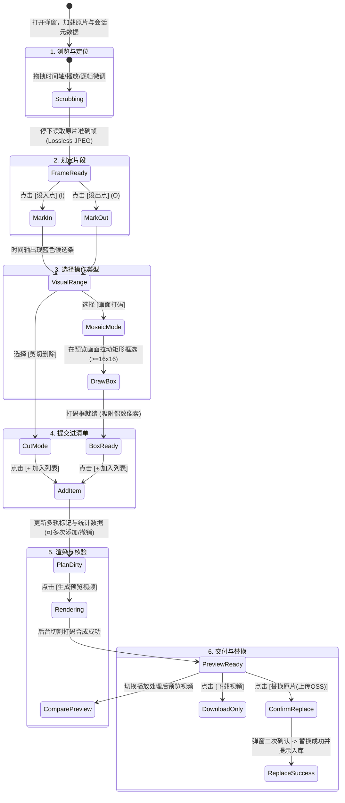

# exact-cut 剪切打码弹窗（cutDialog）简洁专业 UI 设计方案

> 历史归档（2026-11-04）。正文保留当时的方案或执行状态，不代表当前版本；日常操作见[文档入口](../../README.md)。

本方案为只读设计方案（不直接修改现有代码仓库），针对短剧出海制作工具 `exact-cut` 的视频成片剪切与打码弹窗（`#cutDialog`），参考剪映专业版（CapCut Pro）桌面端暗色界面，重构为高效率、高易用性、专业直观的单体全屏剪辑工作台。

---

## 1. 目标与设计原则

1. **工作台化（接近全屏暗色）**：从表单式纵向长页面，转变为类似剪映的暗黑工作台（`#18191c` / `#222429`），核心视区锁定视口高宽，杜绝弹窗内部无限向下滚动。
2. **预览紧贴时间轴**：画面预览区位于中央上方，正下方直接紧贴走带条、帧微调与多轨时间轴，目光移动距离最短。
3. **清晰标准交互时序**：
   $$\text{时间轴定入出点/划段} \longrightarrow \text{选择【删除】或【打码】} \longrightarrow \text{打码则在画面拉框} \longrightarrow \text{加入操作清单}$$
4. **AI 擦边仅做辅助建议**：AI 识别出的高风险时间段在时间轴与右侧面板直观呈现，支持“一键采用剪切”、“一键采用打码”或“定位排查/忽略”，绝不自动替用户修改。
5. **完整闭环与替换防错**：生成预览 $\rightarrow$ 效果核验 $\rightarrow$ 可选【下载视频】或【替换原片（上传 OSS）】并附带关键防错提示。
6. **无额外分支版本（单套统一设计）**：提供一套成熟、收敛的高生产力方案。

---

## 2. 整体布局设计（Layout Architecture）

### 2.1 界面三栏架构图

```
+---------------------------------------------------------------------------------------------------+
|  [顶部栏] 剪切打码 · 101626-EP6.mp4 (1080x1920 · 30fps)        [识别尺度: 常规 v] [重新识别] [ ✕ ] |
+-------------------------------------------------------------------+-------------------------------+
|  【左侧：主剪辑工作台 (占宽 ~72%)】                                | 【右侧：编排面板 (占宽 ~28%)】 |
|  +-------------------------------------------------------------+  | [ 📋 操作清单 (3) ] [ 🤖 擦边建议 (2) ]
|  |                                                             |  |-------------------------------|
|  |                   画面预览区 (深色舞台)                       |  | [第一步：选范围]               |
|  |                    <video> + 准确帧采样                       |  |   入点: 00:03.12 (96帧)        |
|  |                   [ 拖拽矩形框选打码区域 ]                    |  |   出点: 00:06.00 (180帧)       |
|  |                                                             |  |   [ 设入点 (I) ] [ 设出点 (O) ] |
|  |                                                             |  |   [ 选单帧 ]                   |
|  +-------------------------------------------------------------+  |-------------------------------|
|  | [走带栏] 00:03.12 / 01:51.27  [上一帧] [ 播放 ] [下一帧] [跳到帧] | [第二步：定动作]               |
|  +-------------------------------------------------------------+  |   (●) 剪切删除   ( ) 画面打码  |
|  | [时间轴标尺] | 00:00  | 00:10  | 00:20  | 00:30  | 00:40    |  |   [ 打码框: 320x180 (已框选) ] |
|  | [游标指针] ------------------▼----------------------------- |  |-------------------------------|
|  | [当前选区]                 [=======选区范围=======]          |  | [ + 加入操作列表 ]            |
|  | [删除轨]       [###删###]                                   |  |-------------------------------|
|  | [打码轨]                          [***码***]                |  | [已加操作项]                   |
|  | [AI建议轨]            [!!疑似擦边!!]                         |  |   1. 剪切: 第 45~90 帧    [移除]|
|  +-------------------------------------------------------------+  |   2. 打码: 第 120~180 帧  [移除]|
|                                                                   |   [ 撤销一步 ]   [ 全部清空 ]   |
+-------------------------------------------------------------------+-------------------------------+
|  【底部动作栏】 原片 01:51.27 · 已删 3.4秒 · 打码 1处 · 预期 01:47.87        [ 生成预览视频 ] [ 替换原片(上传OSS) ] |
+---------------------------------------------------------------------------------------------------+
```

### 2.2 视觉与规格细节
- **弹窗尺寸**：`width: 96vw; height: 92vh; max-width: 1600px; max-height: 980px; margin: auto; border-radius: 12px;`。
- **色彩设计**：
  - 背景基底：`#121316`（最深背景），主工作区卡片：`#1c1d22`，边框线：`#2b2e36`。
  - 删除特征色（红）：`#ef4444`（删除轨道区块、红标签）。
  - 打码特征色（绿/青）：`#10b981`（打码标记条、十字准星、8 点缩放锚点选框）。
  - AI 疑似擦边（橙）：`#f59e0b`（风险时间段、预警徽标）。
  - 当前选区高亮（蓝）：`#3b82f6`（入出点区间候选高亮）。
- **空间流线**：
  - 画面居中自适应：无论是 9:16 竖屏（短剧主流）还是 16:9 横屏，均居中等比贴合，并在外框标定安全边界。
  - 走带控制与标尺吸附：用户拖拽进度条时吸附关键帧或入出点，右上角显示毫秒与帧序号联动。

---

## 3. 核心状态流（State Machine & Interaction Flow）



### 3.1 AI 疑似擦边协同流程（仅建议模式）
1. 打开弹窗后后台异步拉取/触发识别接口（`/scan`）。
2. 识别结果返回后：
   - 时间轴的 **AI 建议轨** 绘制橙色高光片段。
   - 右侧选项卡提示徽标（如 `🤖 擦边建议 (2)`）。
3. 用户在右侧建议卡片或时间轴点击橙色段：
   - 播放头瞬时跳至对应帧，画面展示该帧画面并显示 AI 给出的风险标签（如“衣着暴露/亲吻”）。
   - 提供 3 个快捷按钮：
     - **【采用剪切】**：直接将该 AI 建议的 `start ~ end` 追加进删除列表。
     - **【采用打码】**：自动设置入出点为该段，并自动激活拉框模式，提示用户在画面上拉框。
     - **【忽略此段】**：淡化该建议标记，不影响制作。

---

## 4. 界面短中文按钮文案对照表

遵循“短促、直觉、动词前置、专业剪辑习惯（2~4字）”：

| 功能区 | 现有文案（过于冗长/表单化） | 剪映风短中文文案 | 快捷键/说明 |
| :--- | :--- | :--- | :--- |
| **走带控制** | `上一帧` / `下一帧` / `播放原片` | `上一帧` / `下一帧` / `播放`（切换为`暂停`） | `←` / `→` / `Space` |
| **入出点设置** | `当前帧填开始` / `当前帧填结束` | **`设入点`** / **`设出点`** | `I` / `O` 键（行业通用标定） |
| **单帧选取** | `把当前帧加入` | **`选单帧`** | 仅选中当前一帧作为范围 |
| **操作切换** | 下拉框 `<select> 剪切 / 打码` | 分段式按钮：**`剪切`** / **`打码`** | 选中时高亮态清晰切换 |
| **加入列表** | `加入片段` | **`+ 加入列表`** | 高亮主操作按钮 |
| **列表维护** | `撤销上一步` / `清空片段` | **`撤销`** / **`清空`** | `Ctrl/Cmd+Z` |
| **单项移除** | `移除` | `删除` 或 图标 `✕` | 单行右侧小按钮 |
| **AI 识别操作** | `重新识别` / `定位` / `剪切这段` / `打码这段` | **`重新识别`** / **`定位`** / **`采用剪切`** / **`采用打码`** | 突出“建议”与“采纳”语义 |
| **生成与保存** | `生成预览` / `保存` | **`生成预览`** / **`保存配置`** | 后台合成渲染 |
| **成果交付** | `下载处理后的视频` | **`下载视频`** | 辅助动作 |
| **原片替换** | （原先无一键替换入库） | **`替换原片 (上传OSS)`** | 显目主操作，带警示色边框 |

---

## 5. 操作防错与交互保护机制

1. **帧范围逻辑约束**：
   - 自动纠偏：若用户设置的 `出点 <= 入点`，系统自动将出点后移 1 帧或阻断提交并给出轻量悬浮提示（Toast）。
   - 自动合并（Auto Merge）：若添加的删除范围与已有删除范围相交或相邻，后台与前端自动融合为一段，防止生成重叠空指令。
   - 保底校验：删除总帧数必须小于视频总帧数，禁止删除全部视频画面（至少保留 1 帧）。
2. **打码框物理限制与偶数对齐**：
   - 尺寸下限：框选面积必须 $\ge 16 \times 16$ 像素。
   - 像素偶数化约束（FFmpeg 要求）：拖动坐标与宽高自动执行 `round(x/2)*2`，防止产生 YUV 采样错位。
   - 画面越界吸附：选框限制在实际视频内容区域内（`contentRect`），不能绘制到舞台黑边之外。
   - 空选框拦截：在打码模式下，若用户尚未在画面拉框就点击 `[+ 加入列表]`，画面区域出现呼吸脉冲闪烁，并提示“请在画面上框选打码位置”。
3. **渲染脏数据提示（Dirty State Guard）**：
   - 只要用户在生成预览后再次变动片段（添加、删除、撤销），旧预览区立即打上水印遮罩：`⚠️ 列表已变更，需重新生成预览`，同时禁用 `[替换原片]` 按钮，杜绝将未经核验的旧视频替换上传。
4. **替换原视频二次防错确认（Destructive Action Guard）**：
   - 点击 `[替换原片 (上传OSS)]` 触发确认浮层：
     > **确认替换原成片并准备上传 OSS？**
     > • 原片时长：`01:51.27` $\rightarrow$ 替换后：`01:47.87`（减少 3.4 秒）
     > • 已应用：剪切 2 处，打码 1 处
     > • 替换后，后续平台上传及交付将默认使用此剪辑版本（原片仍留存备份）。
     > `[ 返回检查 ]` `[ 确认替换 ]`

---

## 6. 适合现有 DOM 与 JS 架构的平滑改造建议

为了保持代码质量，确保与 `source/exactcut/web/cutting.js`、`source/exactcut/web/index.html` 以及后端 API 的最小改动兼容，建议采取**结构归位、ID 完全保留、CSS Grid 重排**策略。

### 6.1 DOM 容器结构重排（不改坏原有 ID）

```html
<!-- 改造后的 #cutDialog 结构示例（保留现有 ID 便于 cutting.js 挂载） -->
<dialog id="cutDialog" class="cut-studio">
  <!-- 顶部栏 -->
  <header class="cut-studio-header">
    <div class="cut-studio-title">
      <h2 id="cutTitle">剪切与打码</h2>
      <span id="cutSourceInfo" class="cut-spec-pill"></span>
    </div>
    <div class="cut-studio-actions">
      <select id="cutScanPolicy" aria-label="识别尺度">
        <option value="standard">常规尺度</option>
        <option value="strict">严格尺度 (吻戏/床戏/泳装)</option>
      </select>
      <button id="cutScan" class="secondary-btn" type="button">重新识别</button>
      <button id="cutClose" class="icon-close-btn" type="button" title="关闭">✕</button>
    </div>
  </header>

  <div id="cutStatus" class="notice-bar" role="status"></div>

  <!-- 主编辑工作区 -->
  <div id="cutEditor" class="cut-studio-body" hidden>

    <!-- 左侧：主视区与时间轴 -->
    <main class="cut-main-workbench">
      <!-- 预览舞台 -->
      <div class="cut-stage-wrapper">
        <div class="cut-stage">
          <video id="cutSource" playsinline preload="auto"></video>
          
          <div id="cutBoxes"></div>
          <div id="cutDraw"></div>
          <!-- 悬浮模式指示 -->
          <div id="cutStageModeBadge" class="cut-stage-badge" hidden>拖拽框选打码区</div>
        </div>
      </div>

      <!-- 走带控制栏 -->
      <div class="cut-transport-bar">
        <div class="cut-timecode-group">
          <strong id="cutPosition">00:00:00:00</strong>
          <span id="cutFrameHint" class="cut-hint-text"></span>
          <button id="cutFrameRetry" class="link-btn" type="button" hidden>重试读取</button>
        </div>
        <div class="cut-play-group">
          <button id="cutPrevious" class="icon-btn" type="button" title="上一帧 (←)">⏮ 上一帧</button>
          <button id="cutPlay" class="play-btn" type="button" title="播放/暂停 (Space)">▶ 播放</button>
          <button id="cutNext" class="icon-btn" type="button" title="下一帧 (→)">下一帧 ⏭</button>
        </div>
        <div class="cut-jump-group">
          <label>帧号 <input id="cutFrameNumber" type="number" min="1" value="1"></label>
        </div>
      </div>

      <!-- 专业多轨时间轴 -->
      <div class="cut-timeline-container">
        <!-- 时间刻度标尺 -->
        <div class="cut-timeline-ruler" id="cutTimelineRuler"></div>
        <!-- 进度滑块与游标 -->
        <div class="cut-timeline-track">
          <input id="cutSeek" type="range" min="0" value="0" step="1">
          <!-- 选区候选高亮 -->
          <div id="cutSelectionMarker" class="marker-lane selection-lane"></div>
          <!-- 删除标记轨 (红) -->
          <div id="cutMarkers" class="marker-lane delete-lane"></div>
          <!-- 打码标记轨 (绿) -->
          <div id="cutMosaicMarkers" class="marker-lane mosaic-lane"></div>
          <!-- AI风险标记轨 (橙) -->
          <div id="cutRiskMarkers" class="marker-lane risk-lane"></div>
        </div>
        <div class="cut-timeline-legend">
          <span class="legend-item red">■ 剪切删除</span>
          <span class="legend-item green">■ 画面打码</span>
          <span class="legend-item orange">■ 疑似擦边</span>
        </div>
      </div>
    </main>

    <!-- 右侧：属性编排与 AI 建议面板 -->
    <aside class="cut-sidebar">
      <!-- 选项卡切换：操作编排 / AI建议 -->
      <div class="cut-sidebar-tabs">
        <button type="button" class="tab-btn active" data-tab="ops">✂ 操作编排</button>
        <button type="button" class="tab-btn" data-tab="ai">🤖 AI建议 <span id="cutRiskBadge" class="badge">0</span></button>
      </div>

      <!-- 选项卡 1：操作编排 -->
      <div class="cut-tab-pane" id="paneOps">
        <!-- 步骤 1：选范围 -->
        <section class="cut-tool-section">
          <div class="section-header">1. 选定片段范围</div>
          <div class="cut-range-inputs">
            <div class="range-field">
              <label>开始帧</label>
              <input id="cutStart" type="number" min="1" value="1">
              <button id="cutMarkStart" type="button" class="mini-btn">设入点 (I)</button>
            </div>
            <div class="range-field">
              <label>结束帧</label>
              <input id="cutEnd" type="number" min="1" value="1">
              <button id="cutMarkEnd" type="button" class="mini-btn">设出点 (O)</button>
            </div>
          </div>
          <button id="cutSingle" type="button" class="secondary-btn w-full mt-2">选当前单帧</button>
        </section>

        <!-- 步骤 2：选动作 -->
        <section class="cut-tool-section">
          <div class="section-header">2. 设定操作动作</div>
          <div class="cut-op-selector">
            <!-- 视觉上呈现为双按钮 Segmented Control，值同步到底层 select 或单选 -->
            <select id="cutOp" class="segmented-hidden-select">
              <option value="cut">剪切删除</option>
              <option value="mosaic">画面打码</option>
            </select>
            <div class="cut-op-pills">
              <button type="button" class="op-pill active" data-op="cut">✂ 剪切删除</button>
              <button type="button" class="op-pill" data-op="mosaic">⬛ 画面打码</button>
            </div>
          </div>
          <p id="cutBoxInfo" class="cut-box-status" hidden>未框选打码区。请在画面上拖拽拉框。</p>
          <button id="cutAdd" type="button" class="primary-btn w-full mt-3">+ 加入操作列表</button>
        </section>

        <!-- 步骤 3：已加片段清单 -->
        <section class="cut-tool-section flex-grow">
          <div class="section-header">
            <span>已加操作清单</span>
            <div class="list-tools">
              <button id="cutUndo" type="button" class="link-btn" disabled>撤销</button>
              <button id="cutClear" type="button" class="link-btn" disabled>清空</button>
            </div>
          </div>
          <div class="cut-queue-scroll">
            <ul id="cutRanges" class="cut-chip-list"></ul>
            <ul id="cutMosaics" class="cut-chip-list"></ul>
          </div>
        </section>
      </div>

      <!-- 选项卡 2：AI 建议面板 -->
      <div class="cut-tab-pane" id="paneAI" hidden>
        <div class="ai-scan-banner">
          <span class="hint">AI 疑似擦边仅供排查参考，不会自动应用。</span>
          <p id="cutScanStatus" class="ai-status"></p>
        </div>
        <ul id="cutRisks" class="ai-risk-list"></ul>
      </div>
    </aside>

  </div>

  <!-- 底部固定栏：汇总统计与最终确认 -->
  <footer class="cut-studio-footer">
    <div class="cut-summary-text" id="cutSummary">原片准备就绪</div>

    <!-- 处理后产物（渲染完成后内嵌或弹出预览） -->
    <div class="cut-footer-actions">
      <section id="cutResult" class="inline-result" hidden>
        <h3 id="cutOutputLabel" hidden>预览结果</h3>
        <video id="cutOutput" playsinline preload="metadata" hidden></video>
        <a id="cutDownload" class="secondary-btn" download>下载视频</a>
      </section>

      <button id="cutRender" class="primary-btn" type="button">生成预览视频</button>
      <button id="cutSave" class="accent-btn" type="button" disabled>替换原片 (上传OSS)</button>
    </div>
  </footer>
</dialog>
```

### 6.2 现有 JS 逻辑适配与升级建议
1. **现有事件绑定 100% 兼容**：
   - `#cutPlay`、`#cutPrevious`、`#cutNext`、`#cutSeek`、`#cutStart`、`#cutEnd`、`#cutAdd`、`#cutUndo`、`#cutClear`、`#cutRender` 等事件监听代码在 `cutting.js` 中无需更名。
2. **入出点与分段按钮极小增强**：
   - 增加键盘快捷键监听：`I`（触发 `cutMarkStart.click()`）、`O`（触发 `cutMarkEnd.click()`）、`Space`（触发 `cutPlay.click()`）、`←` / `→`（上一帧 / 下一帧）。
   - 在选择“打码”标签时，自动为 `.cut-stage` 叠加虚线聚焦边框，给用户明显的“正在等待拉框”视觉暗示；拉框完成后更新文案为“已框选 320×180 像素”。
3. **替换原视频（上传 OSS）打通建议**：
   - 现有 `cutting.js` 的 `cutSave` 仅调用了 `/api/batches/.../cuts/.../save`，该接口会将剪辑后的 mp4 标记为 `saved` 并留存在工作区。
   - 为实现用户期望的“可选替换原视频（上传 OSS）”，可在保存成功后增加一个二次确认动作，调用原片更新接口（或将 `job.output_sha256` 回写至对应 `asset` 的 `sha256` 并触发更新），使当前项目列表卡片直接使用该处理后的文件参与后续一键上传 FBBM。

---

## 7. 方案实施步骤（Implementation Roadmap）

| 阶段 | 实施任务 | 重点与回归防范 |
| :--- | :--- | :--- |
| **阶段 1：CSS 样式升级** | 引入 `.cut-studio` 现代暗色网格样式表，定义全屏宽高、弹性两栏分布。 | 验证在 13~16 寸 MacBook 及不同显示缩放下的全屏适配，防止视口溢出。 |
| **阶段 2：HTML 模板重构** | 调整 `#cutDialog` 内部 DOM 层级（画面+时间轴在上、编排与 AI 在右侧）。 | 保留全部原有元素 ID，确保现有 `cutting.js` 脚本不报错。 |
| **阶段 3：交互细腻化** | 接入快捷键（I/O/Space）、分段按钮与时间轴当前选区高亮色块。 | 检查打码拉框在高清屏幕（Retina）下的坐标等比缩放准确度。 |
| **阶段 4：替换原视频对接** | 为 `cutSave` 增加确认替换原片交互与提示，对接交付流。 | 确保原视频备份不丢失，新生成成片校验通过后才允许执行替换。 |
