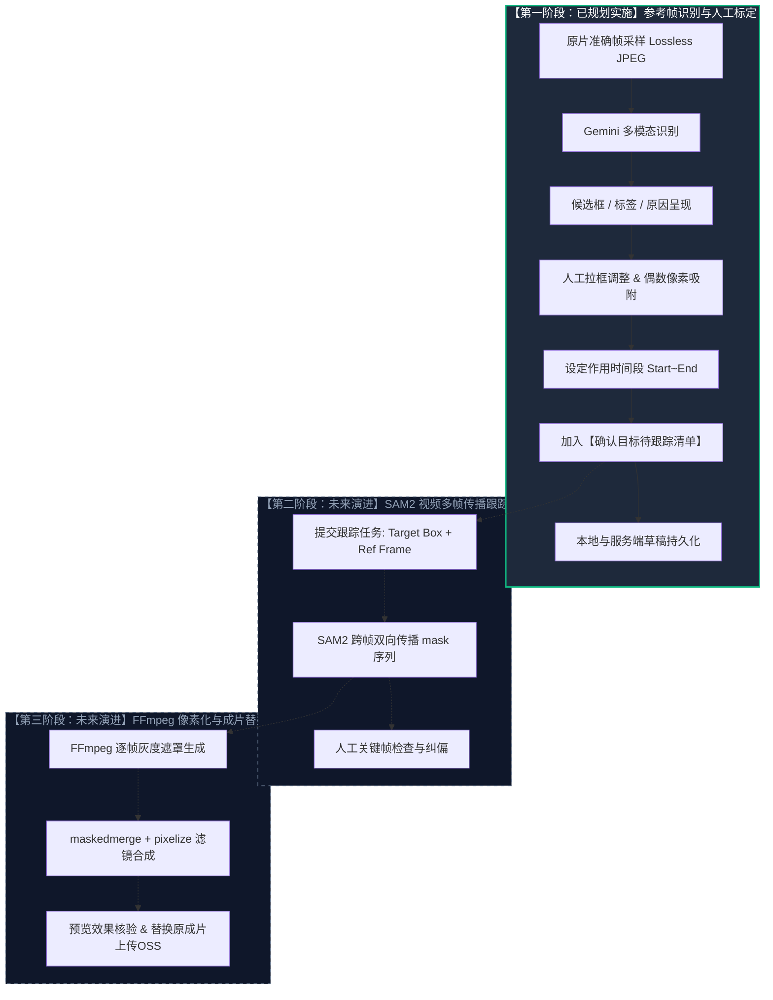
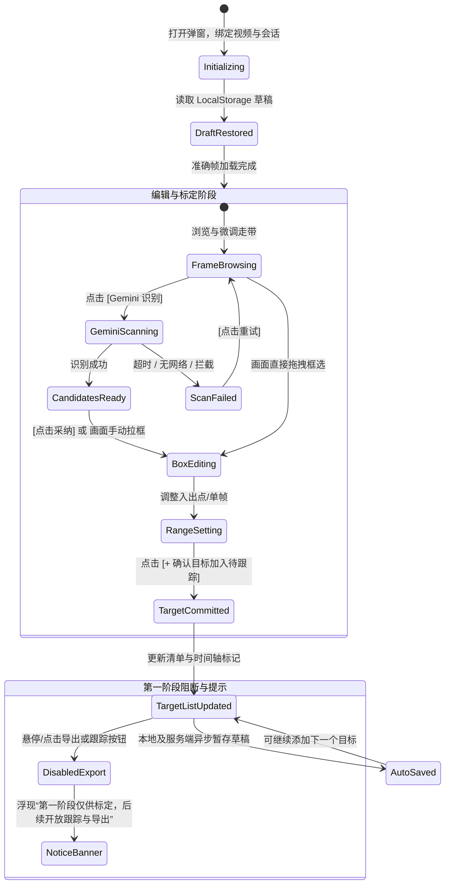

> 历史归档（2026-11-04）。正文保留当时的方案或执行状态，不代表当前版本；日常操作见[文档入口](../../README.md)。

> 实施校正（2026-10-16）：以下保留 agy 原始设计供后续阶段参考。首阶段采用独立入口、工作台与会话；接口实际为 `/locate`，返回 `label/reason/box_2d/x/y/w/h`，没有置信度字段。准确帧使用 JPEG 代理，并非无损原图。不提前对区域取偶数或自动修改时间范围。手工支持重画和像素输入调整，8 点拖拽、撤销、服务端草稿、更多识别策略留待后续；已确认草稿当前仅保存在本浏览器。没有跟踪/导出占位按钮，使用阶段文字说明。模型只识别疑似敏感身体区域，不宣称支持文中其他类别。

# 视频马赛克独立工作台实现方案（第一阶段：Gemini参考帧识别与人工确认）

> [!IMPORTANT]
> **设计基石与铁律**：
> 1. **彻底解耦**：视频剪切（删除片段）与视频马赛克（局部遮挡/跟踪）在产品形态、交互工作台、后端会话及数据契约上**完全分开**，杜绝任何概念混用。
> 2. **剪切工作台零污染**：严禁向现有剪切工作台（`#cutDialog`）添加任何打码选框、打码按钮或打码清单；彻底清理原有测试性的“添加打码片段”残余控件。
> 3. **第一阶段能力边界明确**：
>    - 技术全景为 `Gemini识别 → SAM2跟踪 → FFmpeg像素化`。
>    - **第一阶段仅实现**：基于原片准确帧的 Gemini 敏感区域识别、人工交互框选与微调、时间段划定以及**确认目标待跟踪清单**的编排与草稿持久化。
>    - **严正告知**：单帧候选框只是参考帧提示，**绝非动态跟踪效果**；第一阶段**不能导出视频，亦不能替换成片**。跟踪与导出入口作为渐进演进点在界面以阶段提示形式预留。

---

## 1. 目标与背景概述

在短剧出海制作中，视频画面的擦边/敏感内容处理包含两种截然不同的诉求：
1. **剪切删除（Cutting）**：直接把整段违规画面在时间轴上剪除，视频总时长缩短。此能力已在 `#cutDialog` 中稳定运行。
2. **画面打码（Mosaic）**：保留该时间段内的背景和动作，仅对特定局部（如敏感身体部位、商标Logo、露骨画面）进行动态遮挡或像素化。

由于打码涉及**二维空间定位（Bounding Box / Mask）**、**跨帧运动轨迹（SAM2 跟踪）**与**时间区间映射**，与时间轴纯删帧逻辑截然不同。将两者强行合并在同一工作台会导致界面拥挤、撤销与图层混乱、概念认知负荷过大。

因此，本方案遵循最新决策：**从卡片入口、工作台弹窗、数据草稿到处理脚本彻底独立**，打造专业的【马赛克工作台】（`#mosaicDialog` / `mosaic.js`）。

---

## 2. 整体技术路线与三阶段演进



### 阶段定义与边界
| 阶段 | 核心任务 | 输入 | 输出 | 用户可见能力 |
| :--- | :--- | :--- | :--- | :--- |
| **第一阶段（本次设计）** | **参考帧识别与人工确认** | 原视频、准确帧采样 | 确认目标配置（包含参考帧号、矩形框坐标、时间段、类别名称） | 识别候选框、人工框选/微调、时间段设置、目标清单管理、草稿存取。<br>**不可导出或替换视频**。 |
| **第二阶段（后续）** | **SAM2 动态跟踪** | 第一阶段确认目标 | 逐帧 Mask 序列 / 动态 Bounding Box 轨迹 | 播放头回放跟踪轨迹预览、关键帧点选纠偏。 |
| **第三阶段（后续）** | **FFmpeg 合成与交付** | 轨迹序列 + 原视频 | 打码后成片 MP4 | 导出下载、成片预览、替换项目原片并交付。 |

---

## 3. 入口设计：卡片操作栏完全分离

### 3.1 资产卡片（Asset Card）入口布局
在成片预览标签页（`#reviewTab`）的每个素材卡片（`.asset`）中，当前只有【✂ 剪切】按钮。
改造方案：在操作行（`.cut-media-row` 或 `.cut-tools`）中并列加入【⬛ 马赛克】按钮，两者地位均等、各自触发独立弹窗。

```
+------------------------------------------------------------------+
| [.asset 素材卡片]                                                 |
|  +------------------------------------------------------------+  |
|  |                     视频预览画面                           |  |
|  +------------------------------------------------------------+  |
|  | 101626-EP6.mp4 · 01:51.27 · 1080x1920                      |  |
|  | [下载视频]                                                  |  |
|  | [ ✂ 剪切 ]   [ ⬛ 马赛克 ]                                    |  |
|  | (打开剪切弹窗) (打开独立马赛克弹窗)                             |  |
+------------------------------------------------------------------+
```

### 3.2 剪切工作台反向清理（Zero Pollution）
- 现有 `source/exactcut/web/index.html` 第 197 行存在遗留按钮：
  `<button id="cutMosaic">添加打码片段</button>`
  并在 `cutting.js:293` 挂载了提示。
- **本次决策规范**：彻底移除 `#cutMosaic` 控件与相关提示代码。`#cutDialog` 纯化为仅处理 **“勾选删除片段”**，不保留任何马赛克字样。

---

## 4. 独立马赛克工作台界面布局（Layout Architecture）

马赛克工作台采用接近全屏的**专业暗色工作台风格**（底色 `#121417`，工作区 `#181b20`，边框 `#2d323b`，马赛克主题特征色为翡翠绿/青绿 `#10b981` / `#34d399`，与剪切的品红/红区别）。

### 4.1 界面三栏/两栏工作台架构

```
+---------------------------------------------------------------------------------------------------------------+
| [顶部栏] 视频马赛克 · 101626-EP6.mp4 (1080x1920 · 30fps)     [草稿状态: 自动保存]  [ ✕ 关闭 ]                   |
+-------------------------------------------------------------------------------+-------------------------------+
| 【左侧：主画面与时间段标定工作台 (占宽 ~70%)】                                  | 【右侧：目标编排与识别面板 (~30%)】|
| +--------------------------------------------------------------------------+  | [ 🤖 AI 参考帧识别 ]           |
| |                                                                          |  | 模式: [常规敏感区域 (露胸/Logo) v] |
| |                    画面参考舞台 (#mosaicStage)                            |  | [ ⚡ Gemini 识别当前参考帧 ]   |
| |               <video> + 准确帧采样                                  |  |-------------------------------|
| |                                                                          |  | [识别候选框 (2)]               |
| |   [ 候选框1: 领口过低 (88%) - 蓝色虚线框 ]                                 |  | 1. 领口过低 [采用] [定位]      |
| |   [ 人工编辑框: 320x180 - 绿色实线 + 8点拉伸把手 ]                         |  |    原因: 画面中央有大面积浅色皮肤 |
| |                                                                          |  | 2. 品牌Logo [采用] [定位]      |
| |   [ 悬浮提示：单帧候选框不是动态效果；需确认后加入待跟踪清单 ]             |  |    原因: 衣服左侧有商业标识     |
| +--------------------------------------------------------------------------+  |-------------------------------|
| | [走带栏] 00:03.12 (96帧) / 01:51.27  [⏮ 上一帧] [ ▶ 播放 ] [下一帧 ⏭]      | [ 🎯 目标标定与确认 ]          |
| +--------------------------------------------------------------------------+  | 目标名称: [ 主角胸口遮挡    ]   |
| | [时间轴与作用段]                                                         |  | 参考帧: 00:03.12 (第 96 帧)   |
| | 标尺: | 00:00   | 00:10   | 00:20   | 00:30   | 00:40                     |  | 时间段: 00:02.00 ~ 00:05.10   |
| | 游标: ----------------------▼------------------------------------------  |  | 坐标: [320, 180, 120, 80]     |
| | 作用段手柄:           [====当前作用时间段====]                              |  | [设入点] [设出点] [选当前单帧]|
| | 已确认目标轨:         [---目标1---]        [---目标2---]                  |  | [+ 确认目标，加入待跟踪清单]  |
| +--------------------------------------------------------------------------+  |-------------------------------|
|                                                                               | [ 📋 待跟踪目标清单 (2) ]      |
|                                                                               | 1. 主角胸口 (96帧, 2.0s~5.1s) |
|                                                                               | 2. 品牌Logo (140帧, 4.5s~6.0s)|
|                                                                               | [ 撤销一步 ]    [ 全部清空 ]   |
+-------------------------------------------------------------------------------+-------------------------------+
| 【底部状态与阶段指引栏】                                                                                       |
|  [阶段说明] 第一阶段仅供配置参考帧目标与时间段；第一阶段不能导出或替换视频。                                   |
|  (右侧) [ 开始 SAM2 跟踪 (第二阶段开放) ]  [ 导出打码视频 (第三阶段开放) ]              [ 保存草稿 ]  [ 完成关闭 ] |
+---------------------------------------------------------------------------------------------------------------+
```

---

## 5. 核心交互机制与详细设计

### 5.1 准确帧参考选择（Accurate Frame Reference Selection）
1. **为什么需要“准确帧”而非 HTML5 `<video>` 截图**：
   浏览器 HTML5 `<video>` 解码存在色度抽样模糊（YUV420 到 RGB 转换损失）与跨关键帧寻道时间偏移（Seek Drift）。对于模型识别和边界定位，必须基于后端的精确帧服务（复用现有的 `/frame/<frame_number>` 接口，生成无损 Lossless JPEG）。
2. **走带与定位**：
   - 播放头在拖拽或暂停时，走带栏瞬时显示当前帧时间码（`分:秒:帧`）和绝对帧序号。
   - 停下 200ms 后，自动异步拉取该帧的高清原画准确帧（`#mosaicFrame`），并隐藏 `<video>`，保证用户在拉框、看边缘时看到的是逐像素精准的静态参考图。
3. **设定参考帧（Reference Frame Locking）**：
   - 每个马赛克目标需要选定一个“最佳可见帧”作为 SAM2 跟踪的输入提示（Prompt Frame）。
   - 用户停在最清晰无遮挡的画面时，点击 `[设为参考帧]`，当前帧号即绑定为该目标的 Prompt Frame。

### 5.2 作用时间段设定（Time Segment / Interval）
动态打码不是作用于整部片子，必须限定作用时间段 $[t_{start}, t_{end}]$：
- **时间段标定方式**：
  - **方式 A（时间轴拖拽）**：时间轴上提供可拖动的区间滑块（两端把手 `#mosaicHandleStart` 与 `#mosaicHandleEnd`），支持鼠标拖动和键盘方向键微调。
  - **方式 B（快捷键打点）**：走带到位置时，按 `I`（设入点）与 `O`（设出点），或点击按钮 `[设入点]`、`[设出点]`。
  - **方式 C（单帧模式）**：若只是某个瞬时穿帮，提供 `[选当前单帧]`，自动设置 $end = start + 1$ 帧。
- **与参考帧的关系**：参考帧通常落在 $[start, end]$ 区间内。若参考帧超出入出点，界面自动给出温和纠正：“参考帧已自动扩展入出点范围”。

### 5.3 Gemini 识别候选框、标签与原因呈现
1. **触发识别**：
   - 用户停在某帧后，点击 `[⚡ Gemini 识别当前参考帧]`（或对当前时间段抽样发起识别）。
   - 支持尺度下拉选择：`常规敏感区域 (露胸/吻戏/Logo)`、`严格全目标 (含轻微裸露/纹身)`。
2. **模型契约（输出格式）**：
   Gemini 视觉检测返回标准化结构体（归一化坐标 $0 \sim 1000$）：
   ```json
   {
     "frame_number": 96,
     "candidates": [
       {
         "id": "cand_1",
         "label": "领口低胸暴露",
         "box_2d": [420, 280, 560, 460], // [ymin, xmin, ymax, xmax]
         "confidence": 0.89,
         "evidence_zh": "画面中央女性角色领口偏低，可见明显胸部皮肤阴影，建议遮挡。"
       },
       {
         "id": "cand_2",
         "label": "道具商业标识",
         "box_2d": [750, 810, 820, 930],
         "confidence": 0.82,
         "evidence_zh": "右下角道具表面印有未授权商业 Logo。"
       }
     ]
   }
   ```
3. **视觉呈现**：
   - **画面覆盖层（#mosaicBoxes）**：在准确帧上方绘制高亮矩形框（蓝色虚线描边，左上角浮动标签徽章 `🏷️ 领口低胸暴露 (89%)`）。
   - **右侧候选卡片**：展示模型给出的中文原因（`evidence_zh`）。
   - **快速采纳与定位**：
     - 点击 `[采用此框]`：将该候选框直接转化为当前激活的编辑框，支持用户进一步拉动把手微调。
     - 点击 `[定位]`：画面聚焦闪烁提示该框位置。

### 5.4 人工框选与微调（Manual Bounding Box Selection）
1. **自由拉框**：
   - 在画面舞台按住鼠标左键拖拽，即可随时绘制全新的绿色矩形框。
2. **8 点锚点缩放与平移**：
   - 激活的选框具有 8 个方向拉伸把手（上、下、左、右、四角），支持鼠标拖动平移与等比/非等比缩放。
3. **物理约束与偶数像素吸附（FFmpeg 兼容性准备）**：
   - 最小尺寸限制：$\ge 16 \times 16$ 像素，防止误触生成极小噪点。
   - 坐标与宽高自动吸附偶数：$x, y, w, h$ 自动执行 `round(v / 2) * 2`，以适配后续 YUV420 视频滤镜标准。
   - 越界吸附：限制在实际视频内容区域内，不穿透到黑边之外。

### 5.5 确认目标待跟踪（Confirmed Targets Pending Tracking）
用户调整好选框、参考帧和时间段后，执行“目标固化”：
1. **加入清单动作**：
   - 填写目标备注名称（如“女一领口”、“车牌”）。
   - 点击 `[+ 确认目标，加入待跟踪清单]`。
2. **待跟踪目标数据结构**：
   ```json
   {
     "target_id": "tgt_001",
     "label": "女一领口",
     "category": "body_exposure",
     "ref_frame": 96,
     "ref_timecode": "00:03.12",
     "start_frame": 60,
     "end_frame": 150,
     "duration_ms": 3000,
     "box": { "x": 302, "y": 454, "w": 194, "h": 152 },
     "source": "gemini_adjusted", // 或 "manual"
     "status": "pending_track"   // 第一阶段固化状态：待跟踪
   }
   ```
3. **清单卡片交互**：
   - 清单以紧凑卡片排列，每项显示小缩略图、参考帧时间码、作用时长、框选尺寸。
   - 支持 `[点击回看]`（画面跳转至参考帧并呈现该框）、`[编辑]`（重新载入进行微调）以及 `[删除 ✕]`。
   - 底部提供 `[撤销一步]`（`Ctrl/Cmd+Z`）与 `[清空全部]`。

---

## 6. 异常边界、状态机与草稿恢复

### 6.1 状态流转状态机



### 6.2 异常情况与防御策略
| 异常场景 | 前端表现与反馈 | 防御与恢复机制 |
| :--- | :--- | :--- |
| **空结果（Zero Detection）** | 识别完成但 Gemini 未检测到符合尺度的敏感部位。 | 呈现轻量状态提示：“当前帧未检测到高风险区域。你可以直接在画面拖拽手动框选，或切换到其他关键帧重新识别。”，界面不报错。 |
| **识别失败 / 超时 / 熔断** | 请求超时或模型服务返回 503/429。 | `#mosaicStatus` 显示红色告警：“识别超时，请检查网络后重试”；候选区域保留上次结果不强行清空，提供显目的 `[重试识别]` 按钮。 |
| **忙碌状态（Busy State）** | Gemini 识别中或准确帧读取中。 | 触发按钮进入 disabled 并带转圈 spinner；画面覆盖半透明遮罩与进度条：“正在截取高质画面并调用 Gemini 分析...”；拦截重复点击。 |
| **意外关闭 / 重开草稿恢复** | 用户误按 ESC、关闭浏览器标签或切换项目。 | 采用 `exactcut.mosaic.draft.v1.${username}.${batch}.${session_id}` 作为 key 实时写入 `localStorage`。重新打开弹窗时自动恢复已确认的目标清单、未提交的选框以及入出点，并在状态栏提示：“已恢复上次编辑草稿”。 |
| **跨界入出点防错** | 用户把入点设得比出点大，或时间超出视频总长。 | 自动交换入出点或阻断并提示：“出点不能早于入点，已自动修正为后 1 帧”。 |

---

## 7. 第一阶段边界警示与未来演进入口（渐进式集成）

> [!WARNING]
> **必须向用户和界面操作者明确**：
> - **单帧候选框不是动态跟踪效果**：在参考帧上画出的框仅代表该静止瞬间的位置，不会随着视频播放自动跟动物体。
> - **第一阶段不能导出或替换成片**：第一阶段产出的是**标准化的待跟踪清单（Tracking Spec）**，为第二阶段输入。

### 7.1 渐进加入未来入口的设计
在 `#mosaicDialog` 的底部操作栏（`#mosaicFooterActions`）中：
- 渲染两个具有未来感的按钮，但处于禁用或提示态：
  1. `<button id="mosaicRunTracking" class="secondary-btn" disabled title="第二阶段接入：自动跨帧传播跟踪">⚡ 开始 SAM2 跟踪 (第二阶段)</button>`
  2. `<button id="mosaicExportVideo" class="primary-btn" disabled title="第三阶段接入：FFmpeg合成打码视频并替换成片">🎬 导出打码视频 (第三阶段)</button>`
- 当鼠标悬停在上方时，弹出优雅 Tooltip 提示具体的上线规划；避免用户疑惑“为什么点了没反应”。
- 当前第一阶段的主操作是 **`[保存草稿]`** 与 **`[完成并关闭]`**。

---

## 8. 控件 ID 与 DOM 命名规范建议

为保证命名整洁、语义清晰且**与现有 `#cut*` 命名 100% 隔离**，所有控件均以 `mosaic` 前缀命名：

| 模块区域 | 建议控件 ID | 控件类型 / 标签 | 功能说明 |
| :--- | :--- | :--- | :--- |
| **工作台宿主** | `#mosaicDialog` | `<dialog>` | 独立马赛克全屏工作台容器 |
| **顶部栏** | `#mosaicTitle` | `<h2>` | 视频标题与元信息 |
| | `#mosaicSourceInfo` | `<span>` | 分辨率、帧率与原片时长 |
| | `#mosaicDraftBadge` | `<span>` | 草稿保存状态指示灯（已保存/未保存） |
| | `#mosaicClose` | `<button>` | 关闭工作台按钮 |
| **全局通知** | `#mosaicStatus` | `<div>` | 错误/进度/成功通知栏 |
| **画面视区** | `#mosaicStage` | `<div>` | 画面舞台容器（等比自适应视口） |
| | `#mosaicSource` | `<video>` | 原片播放流组件 |
| | `#mosaicFrame` | `` | 逐帧精准无损原图展示层 |
| | `#mosaicBoxes` | `<div>` | 候选框与人工框的交互浮层 |
| | `#mosaicStageBadge` | `<div>` | 舞台浮动模式指示器（“参考帧模式 / 播放中”） |
| **走带控制** | `#mosaicPrevious` | `<button>` | 上一帧（快捷键 `←`） |
| | `#mosaicPlay` | `<button>` | 播放 / 暂停（快捷键 `Space`） |
| | `#mosaicNext` | `<button>` | 下一帧（快捷键 `→`） |
| | `#mosaicPosition` | `<strong>` | 当前播放头时间码与帧序号 |
| | `#mosaicFrameNumber`| `<input>` | 直接输入跳转时间码或帧号 |
| | `#mosaicFrameRetry` | `<button>` | 准确帧读取失败重试按钮 |
| **时间轴与时间段** | `#mosaicSeek` | `<input range>` | 全局进度滑轨 |
| | `#mosaicTrack` | `<div>` | 作用时间段主轨道 |
| | `#mosaicHandleStart`| `<button>` | 作用段开始手柄（快捷键 `I`） |
| | `#mosaicHandleEnd` | `<button>` | 作用段结束手柄（快捷键 `O`） |
| | `#mosaicTargetMarkers`| `<div>` | 时间轴上已确认目标的色块标记轨 |
| **AI 识别面板** | `#mosaicPolicySelect` | `<select>` | 识别尺度选项（常规/严格） |
| | `#mosaicScanBtn` | `<button>` | 触发 Gemini 识别按钮 |
| | `#mosaicScanSpinner`| `<span>` | 识别中加载旋转图标 |
| | `#mosaicCandidates`| `<ul>` | 候选区域列表容器 |
| **标定与调整** | `#mosaicTargetName` | `<input>` | 目标名称输入框 |
| | `#mosaicMarkRef` | `<button>` | 锁定当前帧为参考帧 |
| | `#mosaicMarkStart` | `<button>` | 设当前帧为开始入点 |
| | `#mosaicMarkEnd` | `<button>` | 设当前帧为结束出点 |
| | `#mosaicSingleFrame`| `<button>` | 设为仅当前单帧 |
| | `#mosaicAddTargetBtn`| `<button>` | 主操作：**[+ 确认目标，加入待跟踪清单]** |
| **目标清单面板** | `#mosaicTargetList` | `<ul>` | 已确认目标待跟踪卡片列表 |
| | `#mosaicUndo` | `<button>` | 撤销上一步操作（`Ctrl+Z`） |
| | `#mosaicClear` | `<button>` | 清空所有目标 |
| **底部与演进栏** | `#mosaicSummary` | `<div>` | 目标总数与覆盖时长统计 |
| | `#mosaicRunTracking`| `<button>` | 渐进入口：SAM2 跟踪（第二阶段，disabled） |
| | `#mosaicExportVideo`| `<button>` | 渐进入口：导出打码视频（第三阶段，disabled） |
| | `#mosaicSaveDraft` | `<button>` | 保存当前标定草稿 |
| | `#mosaicToast` | `<div>` | 居中浮动轻量反馈 Toast |

---

## 9. 涉及改动点归纳（只读方案，不执行文件修改）

> [!NOTE]
> 本规划遵照用户要求，**仅输出设计方案，不修改现有文件、不安装任何依赖、不重启服务**。以下为未来实施时所需的改动清单：

1. **HTML 模板扩展 (`source/exactcut/web/index.html`)**：
   - 在 body 底部新增独立 `<dialog id="mosaicDialog">` 结构（参考第 8 节 ID）。
   - 移除现有 `#cutDialog` 内遗留的 `<button id="cutMosaic">添加打码片段</button>`。
2. **新增马赛克交互脚本 (`source/exactcut/web/mosaic.js`)**：
   - 编写独立的马赛克工作台交互逻辑：包含走带、准确帧读取、Gemini 识别结果绑定、交互式 SVG/Canvas 框选与 8 点拉伸缩放、待跟踪清单维护与 LocalStorage 草稿存取。
   - 暴露 `window.Mosaic = { mount, open };`。
3. **资产卡片入口挂载 (`source/exactcut/web/cutting.js` 或独立挂载器)**：
   - 在卡片渲染时，于 `data-open-cut`（剪切）旁添加 `data-open-mosaic`（马赛克）按钮，点击调用 `window.Mosaic.open(batch, asset)`。
4. **后端接口适配（后续实施）**：
   - 独立路由 `/api/batches/{id}/mosaics/{session_id}`，第一阶段提供 `/ref_scan`（调用 Gemini 识别单帧 Bounding Box）与 `/draft`（保存标定清单）。

---

## 10. 验证与测试方案

### 10.1 交互与视觉验收
1. **入口独立性验证**：
   - 打开素材工作台成片预览卡片，检查是否并列存在【✂ 剪切】与【⬛ 马赛克】。
   - 点击【剪切】：打开原有 `#cutDialog`，确认内部无任何马赛克字样或控件。
   - 点击【马赛克】：打开全新 `#mosaicDialog` 暗色工作台，两者互不干扰。
2. **准确帧与走带测试**：
   - 在马赛克工作台中前后逐帧微调，验证停下时准确帧图片无缝加载且尺寸居中对齐。
3. **拉框与偶数像素对齐测试**：
   - 在画面上随意拉动选框，查看选框坐标与宽高是否始终保持偶数（如 $320 \times 180$）。
   - 拖动 8 个锚点测试等比缩放、反向翻折与边界限制。
4. **待跟踪目标清单测试**：
   - 添加 2 个目标，验证时间轴上是否正确绘制对应的绿色时间段色块。
   - 点击目标可回溯到对应参考帧和选框；测试撤销与删除操作。
5. **草稿恢复测试**：
   - 框选目标后直接关闭弹窗，刷新页面重新点击【马赛克】，验证目标列表完整恢复。
6. **边界警示检查**：
   - 确认工作台底部存在显目的“第一阶段仅供标定，不能导出视频”说明；跟踪与导出按钮处于合理的预留禁用状态。
