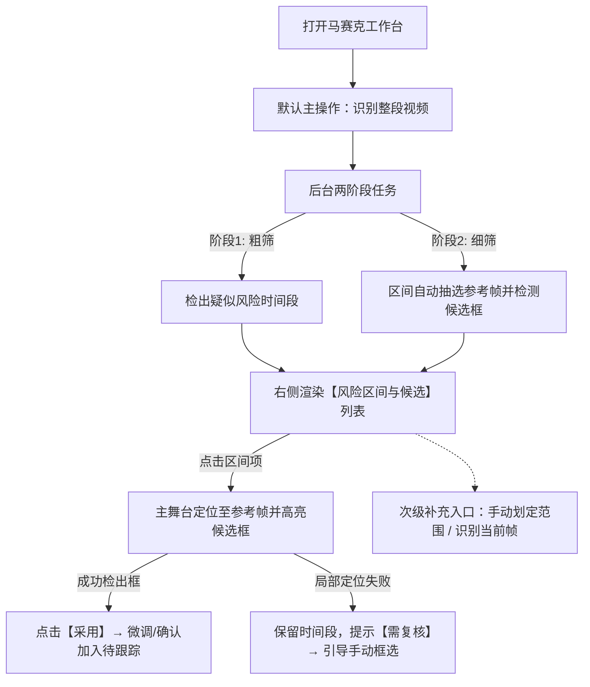

> 历史归档（2026-11-04）。正文保留当时的方案或执行状态，不代表当前版本；日常操作见[文档入口](../../README.md)。

基于 `docs/archive/design/2026-10-16-agy-independent-mosaic.md`、`source/exactcut/web/mosaic.js` 及用户纠正，整理出**只读交互修正方案**（不修改代码，最小调整布局与交互）：

---

# 视频马赛克工作台交互修正方案（只读规划）

## 一、 核心纠偏与设计原则

1. **AI 扫描先行，解放人工找帧**：用户进入马赛克工作台后，不再手工设入出点寻帧，第一步默认由 Gemini 自动扫描整段视频，输出“风险时间段 + 自动抽帧定位候选框”。
2. **局部定位失败保全原则**：若整段扫描识别到了风险区间，但局部关键帧未检测出候选框（或定位接口报错），**必须保留该风险时间段**，状态标记为 `需复核`，绝对禁止丢弃区间。
3. **严格与剪切工作台解耦**：马赛克工作台（`#mosaicDialog`）保持独立入口与独立会话，与剪切删除（`#cutDialog`）完全隔离。
4. **去伪置信度（No Mock Confidence）**：严禁展示任何虚构的置信度百分比（如 88%），严格基于真实 `label` 与可见事实 `reason`。
5. **阶段边界明确**：保持“第一阶段仅标定参考帧与时间段，SAM 跟踪与导出后续接入”的清晰文案，不留假功能按钮。

---

## 二、 核心交互主流程



### 交互步骤详解
1. **触发识别**：打开工作台即展示【识别整段视频】主按钮（已存在草稿或扫描结果时直接展示列表）。
2. **智能编排**：识别完成后，右侧生成按时间排序的风险区间列表，每个条目自动绑定抽取的参考帧与候选框。
3. **审片与采纳**：
   - 审片员在右侧点击某项，左侧视频与准确帧立即跳至该区间的参考帧，并在画面上叠放候选框。
   - 点击【采用】，候选框转为可编辑状态，点击【确认目标】加入底部待跟踪列表。
4. **未检出框的兜底保全**：
   - 某段存在风险但单帧未检出矩形框时，列表项标记 `需复核`，点击后跳至该区间中位帧，提示审片员“模型检测该段有风险但未圈定局部，请手动框选”。
5. **补充与修正**：在列表底部或折叠区保留“手动框选”与“识别当前单帧”，仅作为模型漏网或换帧时的辅助补充手段。

---

## 三、 最小化界面布局调整方案

保持原有两栏结构（左侧 70% 舞台走带，右侧 30% 编排侧栏），仅调整右侧栏信息结构：

```
+----------------------------------------------------------------------------------------------------+
| 视频马赛克 · 片名.mp4 (1080x1920)              [① 确认区域 → ② 跟踪 → ③ 导出]            [ 关闭 ] |
+------------------------------------------------------------------+---------------------------------+
| 【左侧：主画面与走带】                                             | 【右侧：智能检测与目标编排】    |
| +--------------------------------------------------------------+ | [ ⚡ 识别整段视频 (主操作) ]    |
| | 画面参考舞台 (#mosaicStage)                                  | | 状态：扫描完成，检出 3 处风险   |
| | (展示原片/准确帧/候选框/8点微调)                             | |---------------------------------|
| +--------------------------------------------------------------+ | [ AI 检出区间与候选 ]           |
| | 走带栏: 00:03:12 / 01:51:27  [‹] [播放] [›]  跳到 [00:03:12] | | > ① 00:02:00–00:05:10  [已定位] |
| +--------------------------------------------------------------+ |     敏感身体部位 · [采用此框]   |
|                                                                  |   ② 00:15:00–00:18:24  [需复核] |
|                                                                  |     露骨画面 (未定位框，需手绘)   |
|                                                                  |   ③ 00:32:10–00:36:00  [已定位] |
|                                                                  |     商标Logo · [采用此框]         |
|                                                                  |---------------------------------|
|                                                                  | [ ＋ 手工补充与微调 (次级收起) ] |
|                                                                  |   [手动框选] [识别当前帧] [范围]  |
|                                                                  |---------------------------------|
|                                                                  | [ 📋 待跟踪目标清单 (1/8) ]     |
|                                                                  |   1. 敏感身体部位 (00:02~00:05) |
+------------------------------------------------------------------+---------------------------------+
| 底部提示：当前仅支持参考帧标定；动态跟踪与视频导出将在后续阶段开放。                               |
+----------------------------------------------------------------------------------------------------+
```

### 侧边栏 DOM 语义最小调整（对标当前 `mosaic.js` / `index.html`）
* **替换 Section 1**：原“1 选择范围”从顶层必须操作，改为**主操作按钮 `[识别整段视频]`**及**`#mosaicRiskRanges` 风险区间列表**。
* **精简 Section 2**：原“识别当前帧”与“手动框选”收拢至“手工修正”补充栏。候选框展示区绑定至当前选中的区间卡片。
* **保留 Section 3**：`#mosaicTargets` 待跟踪列表保持不变（上限 8 个，浏览器本地草稿）。

---

## 四、 状态流转与边界异常设计

| 状态场景 | 交互表现 | 提示文案与操作入口 |
| :--- | :--- | :--- |
| **未开始** | 主操作高亮可用，右侧展示空态说明 | 文案：“点击‘识别整段视频’，AI 将自动分析敏感区间与候选框。” |
| **整段扫描中** | 主按钮处于 loading/disabled，走带与列表显示占位骨架 | 文案：“正在智能扫描整段视频风险区间并提取参考帧…”（禁用重复点击） |
| **全片无风险** | 列表为空，不产生任何默认区间 | 文案：“整段视频未检测到疑似敏感内容。如有特定区域需遮挡，可使用下方手工框选。” |
| **全片扫描失败** | 弹出错误提示，提供重试机制 | 文案：“整段视频识别失败（网络或服务超时），请点击重试，或使用手工框选。”操作：`[重试识别]` |
| **局部定位成功** | 列表项打标 `已定位`（绿色徽标） | 列表显示类别与简要 evidence，点击直接在画面加载准确帧和矩形框，提供 `[采用]` 按钮。 |
| **局部定位失败（核心）** | **绝对保留该区间**，打标 `需复核`（黄色徽标） | 列表项文案：“AI 检出该段疑似风险，但未能自动锁定目标区域”。点击后走带跳至该段中位帧，提示：“请在画面中手动拖拽框选或点击‘换帧重试’”。 |

---

## 五、 字段与文案契约规范

1. **去虚构字段**：
   - 数据对象中禁止引入 `confidence`。
   - 界面严格使用模型真实字段：`label`（简短类别）与 `reason`（可见事实依据）。
2. **状态命名统一**：
   - 区间状态：`已定位`（已有候选框） / `需复核`（未检出候选框但保留区间）。
   - 目标状态：`待跟踪`（人工确认后加入清单）。
3. **阶段说明固定文案**：
   - “当前开放参考帧区域识别与确认。框仅对应参考帧静态标定，SAM 动态跟踪与视频合成将在后续接入。”
