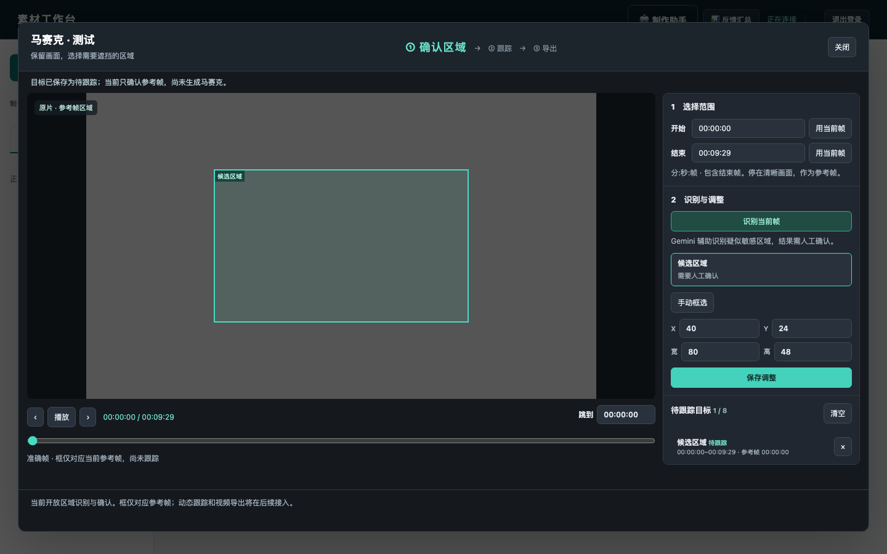

# 独立马赛克：Gemini 区域识别首阶段验收

> 历史归档（2026-11-04）。正文保留当时的方案或执行状态，不代表当前版本；日常操作见[文档入口](../../README.md)。

分支：`feat/mosaic-gemini`。基线：`f147248`。没有重启、修改共享开发服务或部署生产。

## 已实现

- 成片卡片独立“马赛克”入口、工作台和 `mosaic.js`；剪切工作台移除原有打码占位按钮。
- 独立 `mosaics/{session_id}` 原片快照、帧缓存、识别任务；剪切的删除配方、放弃操作和重置状态不影响马赛克。
- 选择时间范围和参考帧，Gemini 候选区域列表及画面矩形；支持手动重画、像素输入修正、最多 8 个待跟踪目标。
- 已确认目标按用户、项目、原片版本、会话重置版本保存在本浏览器。切换帧和播放隐藏参考框；失效模型响应不会覆盖新选择。
- 异步工作线程、来源校验、权限、重启中断恢复、失败重试与空结果区分。无 SAM、渲染、导出、替换。

## 接口与配置

- `POST /api/batches/{bid}/mosaics/open`：`request_id, source_sha256`。会话提供 `capabilities.region_recognition`，不返回剪切任务。
- `GET /api/batches/{bid}/mosaics/{sid}`、`/source`、`/frame/{n}`：会话和原片准确帧。
- `POST .../{sid}/locate`：`start, end, seed_frame, reset_at`，源帧号从 0 开始，范围 `[start,end)`。返回任务。
- `GET .../{sid}/locate/{job_id}`：`running/completed/failed`。候选包含 `id,label,reason,box_2d,x,y,w,h`。`box_2d` 为 0～1000 的 yxyx；其余为原片像素矩形。
- 复用中央 `cutting.scan` 的模型、超时和启用设置，以及现有 `EXACTCUT_CUT_SCAN_ENV` 开发凭据入口。界面草稿可在模型未启用时手工编辑。不需要 SAM 权重或新依赖。

## 验证证据

指定 Python：`~/miniconda3/envs/py3.12/bin/python3.12`。

```sh
python3.12 -m pytest tests/test_mosaic_locate.py tests/test_mosaic_ui.py tests/test_cutting.py tests/test_cutting_api.py tests/test_cutting_scan.py tests/test_cutting_replace.py tests/test_cutting_ui.py -q -ra
```

91 项测试全部通过（新增后端 7、前端 7；相关剪切回归 77）。`node --check source/exactcut/web/mosaic.js` 和 `git diff --check` 通过。

浏览器测试覆盖多个候选独立确认、人工拉框坐标映射、参考帧切换隐藏旧框、关闭重开恢复、空结果/异常重试、迟到响应丢弃及工作台控件边界。修复了多候选覆盖目标、迟到 close 事件清空新会话，以及全局 main/aside 样式导致的布局溢出。

独立规格审查与代码质量审查均未留下阻断问题。



## 验证限制

Gemini 网络调用在自动化测试中替换为模拟响应；SDK 请求构造和拒绝响应清理已测试，但未调用真实模型，未验证实际素材的识别质量、耗时和费用。准确帧是 JPEG 代理，不是无损原图。草稿仅本浏览器保存，未做跨设备同步；8 点拖拽、撤销、多帧识别、SAM 跟踪和视频输出属于后续阶段。
