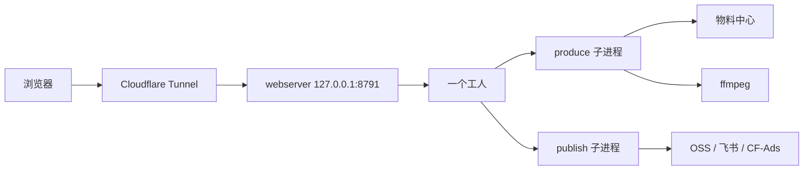
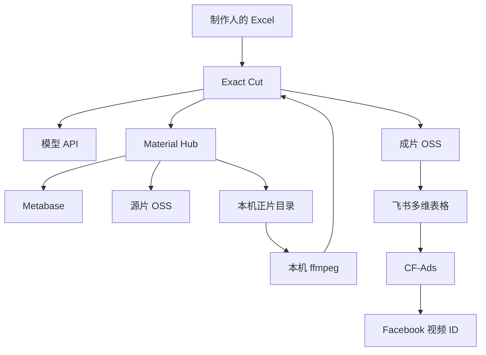

# Exact Cut 现行架构与处理流程

> 历史归档（2026-11-04）。正文保留当时的方案或执行状态，不代表当前版本；日常操作见[文档入口](../README.md)。

这份文档记录历史 Mac 线上系统，对应交接库源码，线上身份是 `v0.3.3-phase4`（提交 `23e303c`）。本文的系统字体、textutil 和 LaunchAgent 描述仅适用于该历史版本；当前服务器已部署 Docker 版本，入口由部署方维护（新代码默认 `/home/`，尚未部署），实际部署见 [服务器部署记录](server-deployment-2026-10-09.md)。本文保留历史处理流程，不作为当前安装步骤。

> **与当前仓库代码的差异（2026-10-09 核对）**：本文记录历史 Mac 版本，阅读时以当前代码为准。以下已确认不同：
> - **子进程不止三种**：除 `workflow produce/preview/publish`，还有 `source_prefetch`（提前准备正片）、`material_download`（旧下载）、`catalog`，以及旧版 `/api/jobs` 的 `exactcut prepare/compile/validate/execute`（见 `webserver.py`）。
> - **进程身份用随机令牌，不是启动时间**：每次启动在命令行注入 `-X exactcut_process_token=<32位hex>`，配合 `instance_marker`（数据根摘要）与 `ps` 核对；见 `batch_control.py` 与 [code-review-2026-10-09](code-review-2026-10-09.md)。
> - **外部调用按功能分开关**：除 `EXACTCUT_ALLOW_EXTERNAL_WRITES`，还有 `EXACTCUT_ALLOW_PUBLISH`、`EXACTCUT_ALLOW_MATERIAL_FETCH`（development 也允许）、`EXACTCUT_ALLOW_AI`（见 `runtime.py`）。
> - **生产已迁到 Linux/Docker**：美东 16 vCPU / 约 30 GiB，容器 14 CPU / 24 GiB；见 [美东部署记录](us-east-deployment-2026-10-09.md) 与 [服务器规格](server-sizing.md)。文中"整台机器同时只做一件"在当前代码中仍成立（单执行位），[并发改造计划](concurrency-refactor-plan.md) 将改变它。
> - **数据格式版本 1**，见 `source/deploy/data-schema.json`（本文路径正确）。

一条成片从 Excel 进来，经过整理、下载正片、三次正式编码、质检、一次预览转码，再由人确认后上传，最后拿到 Facebook 视频 ID。整台机器同时只做一件这样的事。

## 跑在哪里

| 项 | 值 |
| --- | --- |
| 机器 | 邹璐的 Mac，用户 `admin`。需要开机、联网、不睡眠、用户已登录 |
| 页面 | `https://cut.oulagrowth.com` |
| 进程 | Python `exactcut.webserver`，只听 `127.0.0.1:8791` |
| 公网 | Cloudflare Tunnel 把域名转到 8791。本进程不对外监听 |
| 拉起方式 | macOS LaunchAgent，登录后自动启动。发布和回滚走 `/Users/admin/Desktop/codex/exact-cut-fbbm-ops/bin/ops` |
| 代码 | `/Users/admin/Desktop/codex/exact-cut-fbbm-dev` |
| 数据 | 独立数据根，由 `EXACTCUT_DATA_ROOT` 指向。代码目录和业务目录分开 |
| 开发口 | 8792。验收口 8793。旧的 8790 不再作为现行生产端口 |

开发启动是 `source/bin/dev-web`，听 `127.0.0.1:8792`，用自己的数据目录，关掉执行器和一切外部调用。那只是看页面，不会下载、压片或上传。

依赖：Python 3.11（线上记录 3.11.15）、FFmpeg / ffprobe（线上记录 8.1.1）。Python 运行依赖在 `source/requirements.lock.txt`（生产镜像只装这份）；测试工具另在 `source/requirements-dev.lock.txt`。

## 一个进程里有什么

浏览器只和这一个 Python 进程说话。进程做三件事：

1. 提供登录页和制作页（`exactcut/web/`）。
2. 处理 `/api/*`：导入 Excel、保存草稿、确认、预览、上传。
3. 起一个后台工人线程。工人每 0.5 秒看一次队列，一次只新启动一个子进程。已有子进程在跑时，不再启动下一个。

子进程只有三种，命令都是 `python -m exactcut.workflow`：

| 子命令 | 何时启动 | 做完什么才退出 |
| --- | --- | --- |
| `produce` | 制作人确认一批 | 这一批的正片下载、每条成片的编码、质检、预览转码都做完 |
| `preview` | 补做轻量预览 | 给还没有预览文件的成片转一次 |
| `publish` | 制作人勾选一条成片上传 | 传到 OSS、写入飞书，然后轮询直到 Facebook 就绪或超时 |

`produce` 内部是串行的：先下载，再第一条片子的全部编码，再第二条。下载和编码不会并行。`publish` 的轮询最长约 30 分钟（`wait_timeout_seconds` 1800，每 15 秒查一次）。这段时间工人名额被占着，别的批次不能下载，也不能压片。

工人用 `ps` 认自己的子进程。暂停、归档、删除时按进程的启动时间核对，避免 PID 被系统复用后打错进程。



## 磁盘上有什么

数据根由环境变量 `EXACTCUT_DATA_ROOT` 决定。生产环境还要 `EXACTCUT_ENVIRONMENT=production` 和 `EXACTCUT_ALLOW_EXTERNAL_WRITES=1`，否则下载和上传会被拒绝。数据格式版本是 1，记在 `source/deploy/data-schema.json`。

```text
数据根/
  .env                          上传和 AI 的密钥，不进 Git
  .web-state/
    accounts.sqlite3            用户、会话、登录失败计数
    password                    仅开发副本的初始管理员密码
    batches/<32位id>/           一个批次
    jobs/<id>.json              排队或正在跑的子进程
    catalog.json                剧目候选缓存
    worker.lock                 同一数据根只能有一个执行器
  projects/<剧号>/
    project.json
    source/videos/EP1.mp4 ...   这部剧的正片
    cache/render-base/          无字幕底片缓存
    requests/import-<批次id>/   导入时留下的表和标准化结果
  feedback/                     制作人反馈
```

一个批次目录里，按时间出现的文件是：

| 文件 | 何时写下 | 含义 |
| --- | --- | --- |
| `source.xlsx` | 上传时 | 原始表。确认之后不再改 |
| `draft.json` | 上传时，保存时更新 | 可编辑草稿。含 `revision`，防止两个页面互相覆盖 |
| `access.json` | 导入时 | 这条批次属于哪个登录用户 |
| `runtime.json` | 全程 | 状态、当前步骤、给页面看的消息 |
| `confirmed.json` | 第一次点确认 | 冻结的制作清单。之后要改，只能复制成新草稿 |
| `production/results.json` | 制作中 | 每条片子的阶段、耗时、SHA-256、质检结果 |
| `production/.staging/` | 编码中 | 还没通过质检的临时文件 |
| `production/videos/` | 质检通过后 | 正式片。上传只用这里的文件 |
| `production/previews/` | 预览转码后 | 给页面播放的小文件 |
| `production/failed/` | 质检或编码失败 | 隔离出去的半成品 |
| `publications.json` | 点上传时 | 这条片子确认过的哈希、飞书记录、Facebook 视频 ID |
| `download.log` | 下载时 | 物料脚本的输出 |

正片不放在批次目录里。同一剧号的批次共用 `projects/<剧号>/source/videos/`。

## 从上传到出片

页面上的一条批次，状态大致按这个顺序走：`draft` → `queued` → `downloading` → `producing` → `review`。有失败条目时是 `partial`。上传阶段是 `publishing`，全部就绪后是 `complete`。执行被打断是 `interrupted`，整批出错是 `failed`。

### 1. 登录

账号在 `accounts.sqlite3`。密码用 PBKDF2-SHA256 保存。登录成功发 cookie `exactcut_session`，有效 7 天，只存哈希。连续失败会暂时锁这个用户名。

角色只有两种：`admin` 能看全部批次，`producer` 只能看 `access.json` 里归自己的批次。成片文件名里的编导姓名来自账号的 `name`，重名会被拒绝，避免两个人压出同一个文件名。

### 2. 上传 Excel

`POST /api/batches/import`。只收 10 MB 以内、以 PK 开头的 `.xlsx`。

`llm_intake.read_excel` 把表交给模型整理（`EXACTCUT_INTAKE_MODEL`，没有就用 `EXACTCUT_HELP_MODEL`，默认名 `gpt-5.6-sol`）。同时只允许一张表在整理。模型必须带回单元格引用；引用对不上原文，这次导入失败，不留下半张草稿。一次最多 200 条素材。

一张表里如果有多部剧，会拆成多个批次，共用同一份 `source.xlsx`。每个批次写入 `draft.json`，状态 `draft`，页面文案是「Excel 已整理，请检查并修改标准化内容」。

草稿里一条素材是一行：编号 `R001` 起、序号、中文标题、Hook 文案、时间线文本。时间线保留今天的三种写法：头尾都空是全集，只填终点是从片头到该点，只填起点是从该点到片尾。数字 0 和空白不是一回事。

文件名在这时就分配，格式是：

```text
{日期}_type{类型}_{编导姓名}_agent_{序号}_#{剧号}#.mp4
```

`creator2` 固定写成 `agent`。序号和已有成片冲突时自动换一个，并在警告里写明。例：`20260927_typezxraw_徐明飞_agent_1_#101573#.mp4`。

### 3. 改草稿，再确认

保存走 `POST .../save`。`revision` 不一致就拒绝，要求刷新。已有 `confirmed.json`，或状态已经不是 `draft`，都不能再改，只能复制新草稿。

点开始走 `POST .../start`：

1. 再校验草稿，时间线解释不过就停在页面上。
2. 检查数据根还有足够空间。
3. 第一次确认时写下 `confirmed.json`。这个文件之后不改。
4. 状态改为 `queued`。
5. 把 `produce` 放进工人队列。

同一批次已经在执行时，再点一次会被拒绝。

### 4. 下载正片

`produce` 先看 `projects/<剧号>/source/videos/` 里，这条清单点名的集是否都在，并且能通过视频校验。都在就记 `reused_local_episodes`，不去物料中心。

缺任何一集就下载。范围是「至少前 10 集，再加上本批用到的更高集数」，上限 500。调用的是邹璐机器上的物料脚本，不是仓库里的 `integrations/` 快照：

```text
~/.openclaw/workspace/skills/oss-manager/.venv/bin/python
~/.openclaw/agents/main/agent/workshop-skills/drama-material-hub/scripts/material_hub.py
    sync --drama-id <剧号> --restore-missing --only videos --episode-limit <N>
```

文件先落到 `~/Downloads/auto-cut/projects/#剧号#/source/videos`，再镜像进项目目录。镜像优先用 macOS 的 `cp -c`（同盘克隆），失败再普通复制。已有文件内容不同则拒绝覆盖。

总时长上限 30 分钟，5 分钟没有新文件也算停住。超时整段重试一次。缺一集，整批失败，编码不会开始。剧目列表的刷新也读这套物料代码，查询 Metabase，结果写进 `catalog.json`。

物料脚本自己还要读 `~/.openclaw` 下的 Metabase、源 OSS、飞书应用配置。这些密钥不在 Exact Cut 的 `.env` 里。同步文档时脚本会调用 macOS 的 `textutil`；下正片视频不走这一步。

### 5. 逐条制作

正片齐了之后，`execute_batch` 按清单顺序处理每一条。

先算指纹：时间线、用到的正片内容、编码配置。指纹没变、正式片还在、质检状态仍有效，就跳过重编码。只缺预览文件时，补一次预览转码。

否则进入渲染。渲染前把「全集」「到片尾」收成具体的起止毫秒，结果写到 `production/resolved.manifest.json`，不回写 `confirmed.json`。

编码参数在 `source/config/default.json`：1080×1920、30 帧、libx264 `medium`、CRF 18、AAC、44100 Hz、立体声。切段时不写死音频码率。

一条片子内部是四次 FFmpeg，前三次出正式片，第四次才给人看：

1. **切段。** 时间线上每一段单独压一次。正片段从对应的 `EPn.mp4` 按毫秒切开，缩放到 1080×1920。字卡是黑底白字加一段静音。每段压完先对一下时长，偏差超过约一帧就停止，不进入拼接。
2. **拼接。** 各段再用滤镜接成一条，整片按同样的高质量参数再压一次。无字幕的这条底片按「时间线 + 正片哈希 + 编码参数」缓存到 `projects/<剧号>/cache/render-base/<哈希>.mp4`。同样的切点下一次可以跳过前两步。
3. **盖 Hook。** 有 Hook 文案时，先做成一张透明 PNG，盖在成片开头，视频再整片压第三次，音频直接复制。默认在屏约 4.5 秒，淡出 1 秒，盖不住结尾以后的时长。没有 Hook 文字就只复制底片。正式环境会先调一次模型，标出要强调的词（`EXACTCUT_HOOK_MODEL`）。样式可以指定，也可以按画面自动选。字体文件在 macOS 系统字库里：Arial Narrow Bold、Arial Rounded Bold、Impact、Didot。
4. **质检。** `qc.inspect_output` 检查有视频、有音频、分辨率 1080×1920、帧率约 30、声道数为 2、时长与计划相差不超过 500 毫秒、开头不是黑帧。不过关的文件移到 `production/failed/`，不能预览，不能上传。通过后算整文件 SHA-256，写入 `results.json`，状态 `qc_passed`。
5. **预览。** 把刚通过的正式片再转一次：宽最多 540、24 帧、`veryfast`、CRF 30、音频 64k。页面优先播这个文件。转码失败只记下 `preview_error`，正式片还在，页面改播正式片。

一批里有一条失败，其余仍可预览，批次状态是 `partial`。全部通过则是 `review`：制作结束，等人看。

Hook 预览是另一条轻路径。拖样式时只调用 PIL 画 PNG，不启动上面这套编码。正式制作仍然会再压第三次。

### 6. 确认并上传

制作人在页面上看到的播放地址指向预览文件，上传校验用的是正式片的 SHA-256。点上传时，服务再算一次文件哈希，和确认时的值不一致就拒绝。

`publish` 子进程：

1. 把正式片传到阿里云 OSS，对象元数据里写下 SHA-256。同名对象哈希不同则拒绝，必须换序号。
2. 在飞书多维表格建一条记录，或按 OSS 地址复用已有记录。
3. 每 15 秒向 CF-Ads 查一次，直到状态就绪并且有 Facebook 视频 ID，或超过 30 分钟。
4. 成功后这条素材的状态是 `fbbm_ready`。一批里每条都就绪，批次才是 `complete`。

中途失败是 `publish_failed`。重试沿用原来的飞书记录，不重新建一条。上传进行中再点一次会被拒绝。

密钥在数据根的 `.env`，名字见 `source/.env.example`：OSS 的 `ALIYUN_OSS_*`，飞书的 `FEISHU_APP_ID`、`FEISHU_APP_SECRET`、`FEISHU_BITABLE_APP_TOKEN`、`FEISHU_BITABLE_TABLE_ID`，CF-Ads 的 `CF_ADS_BASE_URL`、`CF_ADS_USERNAME`、`CF_ADS_PASSWORD`。物料中心用的是另一组文件，见下一节。

非生产环境，或 `EXACTCUT_ALLOW_EXTERNAL_WRITES` 不是 `1` 时，下载、查剧目、OSS、飞书、CF-Ads、AI 全都会直接报「已禁用」。

## 状态对照

页面上同时有批次状态和单条素材状态。

| 批次 `runtime.status` | 含义 |
| --- | --- |
| `draft` | 还能改草稿 |
| `queued` | 已确认，等工人 |
| `downloading` | 正在取正片 |
| `producing` | 正在编码或质检 |
| `review` | 至少有成片可看，还没全部上传完 |
| `partial` | 这一批里有失败条目 |
| `publishing` | 有素材在上传或轮询 |
| `complete` | 每条都已 `fbbm_ready` |
| `failed` | 这一步让整批停了，常见是缺集 |
| `interrupted` | 进程没走完。可重试制作，或按提示继续原上传 |

| 单条素材 | 含义 |
| --- | --- |
| `pending` | 还没做到这条 |
| `processing` | 正在做 |
| `qc_passed` | 正式片已通过质检 |
| `upload_queued` / `uploading` | 已确认，正在传 OSS |
| `fbbm_queued` | 已进飞书，在等 Facebook |
| `fbbm_ready` | 已有视频 ID |
| `publish_failed` | 上传或轮询失败，正式片还在 |

## 外部系统



| 外部系统 | 用来做什么 | 配置在哪 | 仓库里有没有真值 |
| --- | --- | --- | --- |
| 模型 API | 整理 Excel；正式环境给 Hook 标重点词；页面助手 | `.env` 的 `OPENAI_API_KEY`、`OPENAI_BASE_URL`、`EXACTCUT_*_MODEL` | 只有空示例 |
| Material Hub | 按剧号把正片同步到本机 | `~/.openclaw/.../material_hub.py` 和 oss-manager 的 Python | 只有脚本快照，运行不读快照 |
| Metabase | 剧目名单，以及物料脚本查片 | `~/.openclaw/workspace/.secrets/metabase.env` | 只有空示例 |
| 源片 OSS | 物料脚本取原片 | `~/.openclaw/workspace/skills/oss-manager/.env` | 只有空示例 |
| 成片 OSS | 上传正式片 | Exact Cut `.env` 的 `ALIYUN_OSS_*` | 只有空示例 |
| 飞书 | 上传队列。物料脚本另有自己的通知应用 | Exact Cut `.env` 的 `FEISHU_*`；通知用 `~/.openclaw/openclaw.json` | 只有空示例 |
| CF-Ads | 查 Facebook 是否就绪 | `.env` 的 `CF_ADS_USERNAME`。物料侧优质素材用的是另一个变量 `CF_ADS_USER` | 只有空示例 |
| Cloudflare Tunnel | 把本机 8791 暴露成域名 | LaunchAgent 和 cloudflared 配置 | 包里没有凭据 |
| macOS 字体、`textutil` | Hook 画字；物料脚本转 `.doc` | 系统自带 | 不随仓库分发 |

物料脚本旁还有同步账本 `sync_state.json`、`source_sync_ledger.json`。账本不在交接包里。换机器时如果账本是空的，再跑同步可能把已经传过的物料再写一次。

## 失败之后可以做什么

- 制作失败或中断：复制新草稿再改，或在允许的状态下直接重试。重试仍读原来的 `confirmed.json`，不会把已确认清单改掉。
- 上传中断：页面走「继续原记录」，不新建飞书行。
- 暂停：向这一批的子进程发信号。恢复后重新排队。
- 归档之后才能永久删除。删除只删这个批次、它的任务日志和导入副本，不删 `projects/<剧号>/source/videos/` 里和其他批次共用的正片。
- 空间不够时，制作开始前就会拒绝。缓存按使用时间清理，不删仍被批次点名的正片。

命令行 `exactcut compile` / `execute` 仍在，给运维按同一套规则回放工作簿。制作人走的是网页。

## 代码地图

| 要看的行为 | 文件 |
| --- | --- |
| 页面和接口、工人队列 | `exactcut/webserver.py`、`exactcut/web/` |
| 批次状态、导入、确认、下载、上传编排 | `exactcut/workflow.py` |
| 单条渲染、质检、预览 | `exactcut/orchestrator.py`、`renderer.py`、`qc.py`、`preview.py` |
| Excel 与模型 | `exactcut/llm_intake.py` |
| 时间写法 | `exactcut/intake.py`、`timecode.py` |
| 正片校验和片尾展开 | `exactcut/media.py` |
| Hook 样式和画字 | `exactcut/hook_visual.py`、`hook_emphasis.py`、`hook_preview.py` |
| 物料下载和剧目 | `exactcut/material_download.py`、`catalog.py` |
| OSS、飞书、CF-Ads | `exactcut/publish.py` |
| 账号 | `exactcut/accounts.py` |
| 暂停、进程识别 | `exactcut/batch_control.py` |
| 环境开关 | `exactcut/runtime.py` |
| 编码和上传的默认参数 | `source/config/default.json` |

## 读这份文档时的边界

- 线上服务在邹璐的 Mac。另一台电脑上的 `dev-web` 只听 8792，不代表这套流程在那台机器上跑通过。
- 交接包没有密钥、账号库、批次、正片、成片和物料账本。
- 性能上的事实是：一个工人、一批里的片子串行、每条正式片最多三次 libx264 `medium` CRF 18，然后才转预览，上传轮询占用同一个名额。仓库里没有「一条 20 秒成片一定在多少秒内做完」的现场记录。
