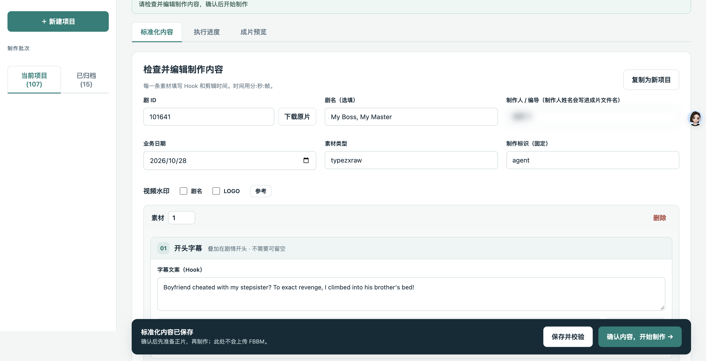
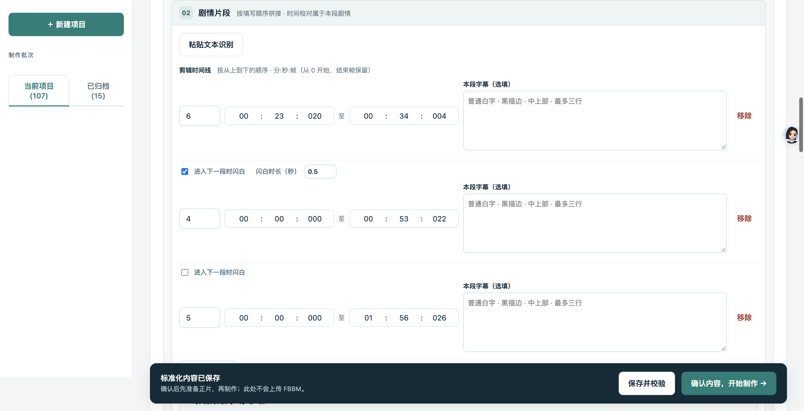
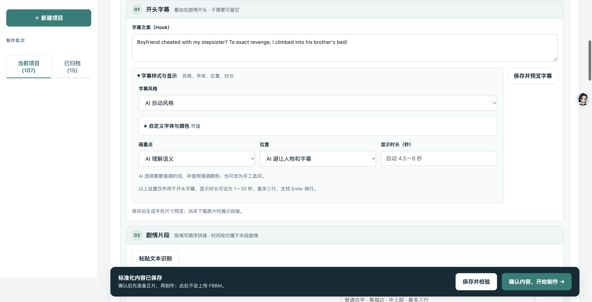
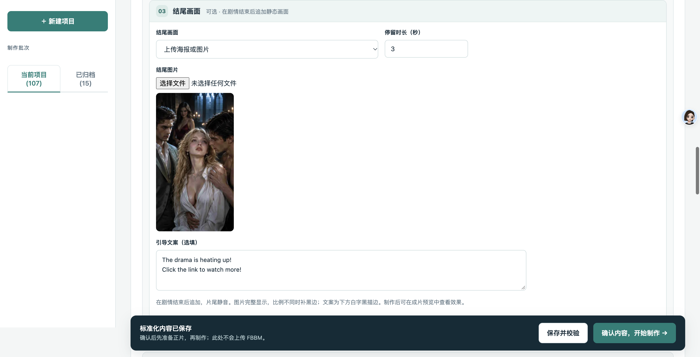
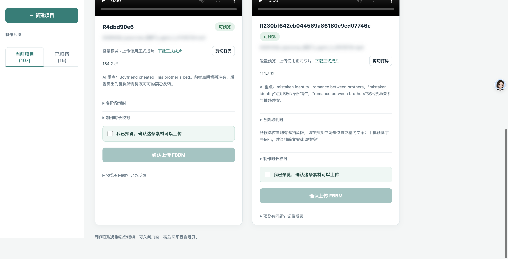

# 素材工作台操作说明（2026-10-28 界面快照）

> 历史归档（2026-11-04）。正文保留当时的方案或执行状态，不代表当前版本；日常操作见[文档入口](../README.md)。

> 版本范围：2026-10-30 归档整理。本说明按截至 2026-10-27 的正式发布记录及 2026-10-28 的界面截图编写，保留当时的操作流程。原片可用性提示已于 10 月 28 日晚间另行发布；10 月 29–30 日的校验定位、资源忙恢复和中文字幕预览仍属待发布候选，未混入以下历史操作步骤。后续差异分别见[原片可用性发布验证](verification/originals-availability-2026-10-28.md)及[发布准备清单](verification/release-preparation-2026-10-30.md)。

更新日期：2026 年 10 月 28 日｜适用对象：编导、素材制作人、审核人员

本说明结合截至 2026 年 10 月 27 日的正式发布记录与对应界面整理，介绍从网页新建项目到成片交付的完整操作流程。

## 1. 入口与操作流程

正式入口：[打开素材工作台](https://autocut.creativefitting.ai/home/)

使用管理员发放的个人账号登录，建议使用 Chrome。普通制作人只查看自己的项目；原片与 FBBM 素材库共用。忘记密码或账号停用时联系管理员。

**新建项目 → 填写制作内容 → 保存并校验 → 确认制作 → 逐条预览 → 按需剪切打码 → 确认上传 FBBM → 等待已入库。**

首次登录会进入默认项目；以后通常恢复上次打开的项目。在网页直接填写制作内容。需要新的制作批次时，点击左侧「＋ 新建项目」。同一部剧可以建立多个项目。

| 页面位置 | 用途 |
| --- | --- |
| 左侧「当前项目 / 已归档」 | 切换、归档和复原项目 |
| 「标准化内容」，部分项目显示「编辑内容」 | 填写基础信息、字幕、剧情片段和结尾 |
| 「执行进度」 | 查看准备原片、制作、检查及排队状态 |
| 「成片预览」 | 播放、下载、反馈、剪切打码和上传 |
| 顶部「制作助手 / 反馈汇总」 | 查看操作帮助或已记录的问题 |

## 2. 填写项目与素材信息

图1｜项目填写：核对剧 ID、业务日期和素材类型；底部先保存并校验，再确认制作。姓名和无关项目列表已隐藏。

先核对项目顶部信息，再编辑每条素材。

| 项目 | 填写说明 |
| --- | --- |
| 剧 ID | 填写本次制作的真实剧号，确认与所需原片一致 |
| 剧名 | 选填，方便查找项目；剧 ID 必须正确 |
| 制作人 / 编导 | 核对实际姓名；该姓名会进入成片文件名 |
| 业务日期 | 核对本批素材对应的日期 |
| 素材类型 | 按业务要求填写或沿用已有值 |
| 制作标识 | 固定为小写 agent |
| 素材序号 | 每条成片的编号，避免同批重复 |

一张素材卡片对应一条成片。点击「＋ 添加素材」（部分项目显示「＋ 添加一条成片」）可继续增加。每条素材分别设置开头字幕、剧情片段和结尾画面。

成片文件名示例：`20261028_typezxraw_张三_agent_1_#101606#.mp4`。其中日期、姓名、序号和剧 ID 仅用于示范，正式制作请替换为真实信息。遇到重名提示应先核对现有素材，不要通过反复新建同名项目绕过。

## 3. 编辑剧情片段

### 3.1 按顺序填写集号和时间

图2｜剧情时间线：从左到右填写集号、开始和结束时间；本图使用分:秒:帧，按从上到下顺序拼接。

每个片段填写来源集号、开始时间和结束时间。需要多段时继续添加，系统按页面排列顺序拼接；回溯、倒叙和重复片段会保留，不会自动按集数排序。

例如，先用第 4 集的一段，再用第 2 集的一段，就按「第 4 集 → 第 2 集」的顺序填写。保存后检查「时间解析校对」，确认每段来源、起止点和预计时长。

**先看时间输入框的单位，不能沿用旧说明把最后一组一律理解为毫秒。**

| 页面标注 | 含义与示例 |
| --- | --- |
| 分:秒:帧 | 新版帧时间编辑方式。`00:05:012` 表示第 5 秒内第 12 帧；帧从 0 开始，结束帧保留。可用帧数以原片帧率校验为准 |
| 分:秒:毫秒 | 旧项目可能保留此格式。`00:05:500` 表示 5.5 秒 |
| 分:秒 | `01:22` 表示 1 分 22 秒 |

不要把帧数当作毫秒，也不要自行按固定帧率换算所有原片。起止时间超出实际片长时，根据页面提示修正。

### 3.2 粘贴文本识别

已有编导文字需求时，可在对应素材的剧情片段区使用「粘贴文本识别」。

1. 一次只粘贴当前这一条成片的集号和时间范围。
2. 选择「追加到已有片段后」或「替换当前成片的全部片段」。
3. 点击「识别并填入」。
4. 核对集号、时间单位、片段数量和先后顺序，再保存。

建议写清楚「第 4 集 00:05 到 00:20」这类完整区间。需要帧精度时，按弹窗的分:秒:帧提示填写。不要依赖 `1.52s` 等容易产生歧义的简写。

识别失败时先补齐或澄清文本，也可直接手动填写。AI 识别结果必须人工核对；替换操作可能清除原片段的字幕和闪白设置，应阅读确认提示。需要撤回刚填入的结果时使用「撤销本次填入」。

### 3.3 旧项目中的整集和片尾写法

旧项目若仍显示文本时间线，`EP4` 表示整集，`EP5 01:22` 表示从 01:22 到该集片尾；过渡字卡可使用 `字卡|One hour earlier|1.5s`。片尾需在原片就绪后按实际时长核对。

这些是旧时间线的兼容写法，不要直接填进新版的分、秒、帧数字框。新项目优先按当前表单输入。

## 4. 设置字幕、结尾与水印

### 4.1 开头字幕（Hook）

图3｜开头字幕：展开字幕样式与显示，调整风格、画重点、位置和时长，再点击保存并预览字幕。

在「开头字幕」填写文案，不需要时可留空。字幕叠加在剧情开头，不会单独增加一段剧情。

展开「字幕样式与显示」，按需要设置风格、位置、显示时长，以及字体和颜色。显示时长可设为 1～20 秒，最多三行，按 Enter 换行。提供「画重点」选项的项目可选择 AI 理解语义、手工选词或不强调。

点击「保存并预览字幕」，重点检查文字是否完整、重点词是否正确、是否挡住人物或原片字幕。修改文案、风格或位置后重新预览。字幕过长或指定字号放不下时，缩短文案、调整换行或恢复自动字号。

部分片段还可填写「本段字幕」和设置片段衔接效果；它们只作用于对应片段。不要把本段字幕与开头 Hook 混淆。

### 4.2 结尾画面

图4｜静态结尾：选择结尾画面、停留时长和图片，可填写引导文案；图片中的项目内容仅用于说明界面。

每条素材的「结尾画面」可选择：

- **不添加**：剧情结束即结束。
- **素材最后一帧**：将剪辑后剧情的末帧定格。
- **上传海报或图片**：追加指定静态图片，支持 PNG、JPEG、WebP，最大 4 MB。

静态结尾默认 3 秒，可设置为 1～15 秒，结尾静音。图片完整显示，比例不同时补黑边。可另填引导文案，最多 200 字；海报已带文字时可留空。

上传图片后还需保存设置并确认制作。预计总时长包含静态结尾；制作完成后检查停留时长、文案和最终画面。

### 4.3 剧名与 LOGO 水印

项目表单提供独立的「剧名」「LOGO」开关，默认关闭。需要品牌水印时开启，并可查看参考样式。

新开启的剧名水印使用该剧封面提取的艺术字，显示在画面左上方；LOGO 位于底部中央。水印作用于剧情，静态结尾不加水印。字幕不会为水印自动挪位，重叠时字幕在上层，因此成片预览时要检查遮挡。

若封面或剧名提取报错，按错误提示处理；若本条不需要水印，可返回编辑关闭对应开关后重新制作。

## 5. 保存、校验与开始制作

1. 点击「保存并校验」。
2. 检查剧 ID、姓名、业务日期、素材数量和序号。
3. 对照每条素材检查片段顺序、起止时间、字幕、结尾和水印。
4. 修正红色错误。黄色提醒用于核对，不一定阻止制作；剧名和 Hook 可以留空。
5. 点击「确认内容，开始制作 →」，在弹窗中核对后点击「确认，开始制作」。

**此步骤只开始准备原片和制作，不会自动上传 FBBM。**

系统会复用已有原片，并根据需求准备缺少的剧集。进入「执行进度」查看当前阶段、完成数量及队列情况。排队、下载、合成字幕和编码都可能需要等待，以页面实际进度为准。

制作在服务器后台执行，可以关闭网页，稍后回来继续查看。关闭浏览器不等于暂停；确实需要暂停时使用「暂停执行」，恢复时点击「继续执行」。

制作失败或中断时，先查看该条错误，再使用「重试未完成制作」。填写内容有误则先修改，不要持续重试相同错误。

## 6. 逐条预览与下载

进入「成片预览」，播放每条已通过格式与时长检查的素材。技术检查通过后仍需人工审核内容。

| 核对项 | 重点看什么 |
| --- | --- |
| 剧情与剪辑 | 集数、顺序、首尾是否正确，是否误删对白或动作 |
| 声音 | 有无缺音、异常静音、衔接不自然 |
| 字幕 | 文案、换行、强调词、位置和显示时长 |
| 水印 | 剧名是否正确，有无挡住人物或字幕 |
| 结尾 | 海报、引导文案、静音和停留时长 |
| 总时长 | 是否符合预期，是否包含追加的静态结尾 |

使用「下载正式成片」保存文件。若页面标注「轻量预览」，该视频用于快速检查，正式下载和上传使用正式成片。遇到画质判断困难时下载正式成片核对。

需要重新改文案、时间线或结尾时，使用页面提供的「修改后重新制作」；需要独立版本时使用「复制为新项目 / 复制为新草稿」。重新制作后务必审核新成片。

## 7. 剪切打码：处理成片后再替换

需要从已制作的视频中删除片段，或遮挡人物、物体、字幕和角标时，在对应素材打开「剪切打码」。这里处理的是当前成片中的时间位置。

### 7.1 添加与检查处理片段

可以点击「识别整段视频」获得疑似时间段和目标区域，也可以点击「＋ 添加片段」手工指定。

对每个待处理片段选择：

- **删除**：去掉该时间段，处理后视频会相应缩短。
- **打码**：保留时间段，对指定画面区域添加遮挡。

AI 给出的只是待核对建议，不代表必须处理，也不保证覆盖所有问题。逐段查看后决定删除、打码或取消选择。

### 7.2 调整时间、区域和效果

1. 选中右侧片段，打开「调整时间 / 区域」。
2. 设置开始和结束时间，按「分:秒:帧」填写；结束帧包含在范围内。可播放、逐帧查看，或将当前帧设为开始、结束。
3. 打码时拖动框调整位置和大小；需要遮挡多个区域可继续「＋ 添加」。
4. 字幕、角标等选「固定位置」；移动人物、物体按需要选「跟随目标」。
5. 在片段效果中选择方块马赛克、硬边模糊、柔边模糊或纯色，并调整强度和范围扩大。
6. 保存修改，逐段检查遮挡是否覆盖完整，特别留意目标移动和遮挡变化的位置。

### 7.3 生成、检查、替换

点击「生成处理后视频」，完成后对照「处理前 / 处理后」查看。生成中暂不可编辑，需要调整时先停止生成。

**生成新视频后，还必须点击「替换项目成片」，处理结果才会成为项目后续播放、下载和上传使用的版本。**

替换前核对处理效果、剪切衔接、声音和总时长。替换成功后回到成片预览，再检查一次当前版本。旧成片在后台保留，不代表页面提供任意一键回退功能。

已入库的远端素材不会因本地重新生成视频而自动更新；需要对已交付内容做修改时，先核对交付状态与页面允许的操作。

## 8. 上传 FBBM 与完成判断

图5｜成片操作区：上方可下载正式成片或进入剪切打码；完整预览后勾选确认，再点击上传 FBBM。文件名已模糊处理。

每条素材分别操作：

1. 完整预览当前版本，确认剪辑、字幕、水印及打码效果。
2. 勾选「我已预览，确认这条素材可以上传」。
3. 点击「确认上传 FBBM」。
4. 等待队列处理，可继续提交其他已审核素材，不要重复点击同一条。

| 显示状态 | 含义 / 下一步 |
| --- | --- |
| 已提交 / 上传排队 | 已收到任务，等待处理 |
| 文件上传 | 正在传输视频 |
| 平台处理 | 文件或记录已提交，仍在等待 FBBM 结果 |
| 已就绪 / 已入库，且有 Facebook 视频 ID | 交付完成，可在 FBBM 使用 |
| 继续查询 FBBM | 按钮用于继续查询既有提交的结果 |
| 重试交付 FBBM | 查看错误后使用原素材的重试入口 |
| 待管理员核实 | 联系管理员核对远端状态，避免重复提交 |

**提交成功、文件传完、出现视频 ID，都不能单独作为最终完成依据。应同时确认已就绪 / 已入库状态和 Facebook 视频 ID。**

如果上传按钮不可点，检查是否已预览勾选、是否存在未保存修改、项目是否暂停或归档，以及素材是否正在上传、已经入库或需要管理员核实。

## 9. 下载原片到电脑

需要查看或另行使用剧集原片时，在项目剧 ID 旁点击「下载原片」。

1. 核对剧号及弹窗中的集数列表。
2. 选择电脑上的保存文件夹。
3. 下载单集、勾选多集或下载全部。
4. 支持选择目录的浏览器会保存到所选文件夹下的剧号目录，例如 `101606/EP1.mp4`。

列表显示云端已有原片，未上架的集会另作标记。不同浏览器的保存方式可能不同；Safari、Firefox 按浏览器下载提示操作。

这是下载到自己电脑的功能，与服务器准备剪辑用原片是两个操作。正常制作不要求你先把所有原片下载到电脑。临时下载链接失效时重新打开下载入口获取。

## 10. 反馈、归档与删除

发现问题时，在对应素材展开「预览有问题？记录反馈」，选择类别并写清时间点、问题和期望效果，例如：“00:12 对白被截断，希望保留后半句话。”点击「保存反馈」，之后可在素材下方或顶部「反馈汇总」查看。

反馈用于记录，不会自动修改或重新制作视频。

| 操作 | 结果 |
| --- | --- |
| 暂停执行 | 保留进度；已经发往外部平台的请求可能仍会完成 |
| 继续执行 | 恢复或等待调度继续执行 |
| 归档项目 | 移入「已归档」，保留文件和记录；执行中的项目同时暂停 |
| 复原项目 | 移回当前项目；原来暂停的任务仍需手动继续 |
| 永久删除 | 仅用于已归档项目，删除本批文件和记录，不设回收站 |

归档项目可以查看与预览，但不能直接开始制作或上传。左侧项目卡片悬停可查看快捷操作。永久删除不会删除共用原片，也不会撤回已经上传 FBBM 的素材。

## 11. 常见问题

| 问题 | 处理方法 |
| --- | --- |
| 看不到别人的项目 | 普通账户内容隔离属于正常行为；请使用自己的账号 |
| 时间与旧说明对不上 | 检查页面标注是帧还是毫秒，不要混用 |
| 片长待核对或提示超出范围 | 等原片就绪后查看实际时长，再修正起止点 |
| 字幕不完整或遮挡人物 | 调整文案、字号、位置或换行，重新预览字幕及成片 |
| 排队较久 | 查看执行进度与全局队列，不要重复创建相同任务 |
| 视频缓冲慢或播放失败 | 等待加载、检查网络；使用「重试预览」或「重试画面」，必要时下载正式成片核对 |
| 打码生成完成，但成片未变化 | 检查是否已执行「替换项目成片」 |
| 上传后一直平台处理中 | 等待自动更新；出现「继续查询 FBBM」时使用该入口，不要另建同名素材重复上传 |
| 页面还是旧版样式 | 先保存编辑，再刷新页面加载新版；仍异常时联系管理员 |

问题持续时，向管理员提供：项目名称或剧 ID、素材序号、发生时间、操作步骤、完整错误文字或截图。不要发送密码。

## 12. 上传前最后检查

- 剧 ID、业务日期、制作人、素材序号与命名正确。
- 已核对片段顺序及时间单位，完整播放当前成片。
- Hook、本段字幕、水印、静态结尾符合需求。
- 剪切打码已生成、检查并替换到项目成片。
- 勾选的是当前版本，未对同一素材重复提交。
- 上传后继续确认「已入库 / 已就绪」和 Facebook 视频 ID。

## 版本与参考

旧版参考：[操作说明.md（2026-09-28）](https://welltop.feishu.cn/file/Dz6nbjEsAoyKmCxAfeQcu4KnnUd)；[原操作包文件夹](https://welltop.feishu.cn/drive/folder/MkI2fWUatlRXXsdlaMBcQoAVnVb)。

本版主要更新：正式访问地址、网页直接建项目、帧时间与旧毫秒时间的区别、字幕样式与静态片尾、剪切打码及替换步骤、剧名与 LOGO 水印、原片下载，以及上传完成和异常处理规则。

编写依据为当时的界面实现及正式发布记录。编写时尚未发布的原片可用性提示未纳入正文；该功能已于 2026-10-28 晚间发布，详见上方版本说明。本次编写及归档整理未执行真实素材制作或 FBBM 上传；后续发布新功能时，应另行更新适用版本和操作说明。
