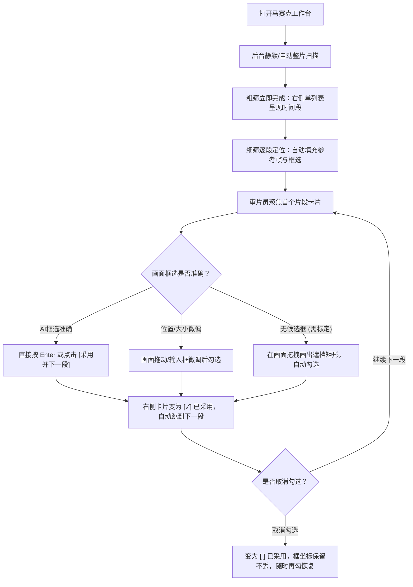
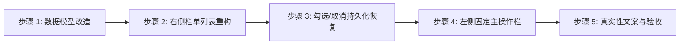

> agy 原始建议，非实施规范。部分现状诊断引用了已经被覆盖的旧样式，部分交互未经采用。以同目录 mosaic-redesign-reviewed 为准。

# 视频马赛克工作台交互重构方案与实施计划

> [!IMPORTANT]
> **设计基石与铁律**：
> 1. **独立于剪切**：马赛克工作台（`#mosaicDialog`）保持独立入口、独立弹窗与独立会话，严禁与剪切删除（`#cutDialog`）产生任何界面与代码耦合。
> 2. **能力边界真实诚信**：当前首阶段技术能力仅为 `Gemini参考帧识别 + 人工调整与确认 + 本地草稿保存`。尚未接入 SAM2 跨帧跟踪与 FFmpeg 像素化导出。界面必须明确声明“框仅对应参考帧，尚未进行动态跟踪与成片合成”，严禁将未勾选说成“无风险/已合规”，严禁将勾选说成“已生成成片”，严禁捏造置信度或风险评分。
> 3. **单主方案实施**：不提供多套方案供选，严格遵循用户反馈聚焦单一高可用方案：右侧全高单滚动区、单份清单、直接卡片勾选、取消后保留复原能力、平实专业文案。

---

## 一、 当前实现具体问题诊断（Pain Points Audit）

经过对 `source/exactcut/web/mosaic.js`、`source/exactcut/web/index.html` 以及近期设计与验证记录的只读检查，当前实现存在以下 5 个核心结构与交互问题：

| 编号 | 现有问题 | 根本技术与结构原因 | 用户体验后果 |
| :--- | :--- | :--- | :--- |
| **P1** | **右侧上下堆叠与嵌套滚动** | `.mosaic-side` 内部同时承载了标题栏、全局清空、扫描按钮、扫描状态文本、`#mosaicTargets` 和 `#mosaicScanEvents`。在之前版本中还有折叠的 `#mosaicSaved`，多层 `overflow: auto` 导致已采用区域高度被挤压至不足 100px。 | 用户必须在多个局促的滚动条间来回翻找，列表内容被腰斩。 |
| **P2** | **破坏性取消采用（无复原能力）** | `mosaic.js:240` 在取消勾选时直接调用 `targets.splice(i, 1); resetCandidate(); save();`。目标对象被彻底从内存与本地草稿中物理删除。 | 用户一旦取消勾选，卡片退回未采用状态且勾选框完全消失；若想重新恢复，必须重新点击卡片并重新点击“采用此区域”，若曾手工微调像素，微调数据全部丢失。 |
| **P3** | **卡片视觉冗余与大块绿色干扰** | 当前采用了 `.mosaic-event-card.adopted`（边框变色）、嵌套 `.mosaic-target-row`（大深绿底色 `#163a32`）、重复渲染时间范围和区域标签。 | 界面杂乱，已采用卡片和未采用卡片视觉不一致，右侧空间被大量无用色块占用。 |
| **P4** | **概念术语晦涩、认知负荷大** | 界面充斥“候选框”、“采用此区域”、“待跟踪目标”、“已定位”、“需复核”等技术内部黑话，缺乏符合短剧审片员直觉的动宾语义。 | 审片员理解成本高，误以为“采用”等于“打好码导出”，操作不知所措。 |
| **P5** | **左侧舞台与控制区纵向跳动** | 左侧视频下方放置了 `<details id="mosaicAdjust">` 和 `<section id="mosaicReview">`。当用户展开“调整区域”时，面板撑开达 180px，导致播放舞台直接被压缩或发生页面纵向跳动。 | 连续审片时的视觉重心严重不稳定，操作按钮位置漂移。 |

---

## 二、 核心任务模型与主流程设计

### 2.1 任务模型：连续审看流（Continuous Review Model）

审片员进入马赛克工作台的唯一目标是：**“快速检视整片疑似遮挡点 → 确认/修正遮挡位置 → 勾选保存”**。



---

## 三、 桌面端工作台布局草图（Desktop Layout Architecture）

工作台保持与现有系统一致的专业暗色风格（底色 `#15191e`，工作区 `#1a2027`，主激活色翡翠绿 `#47dbc4`）。

```
+-----------------------------------------------------------------------------------------------------------------------+
| [顶栏]  视频马赛克 · 101626-EP6.mp4 (1080x1920 · 30fps)    [阶段: ① 区域标定 (当前) › ② 跟踪 › ③ 导出]        [ 关闭 ✕ ] |
+-----------------------------------------------------------------------------------+-----------------------------------+
| 【左侧：视频舞台与固定控制区 (~64% 宽度，自适应)】                                   | 【右侧：整片清单全高单滚动区 (~36%)】|
| +-------------------------------------------------------------------------------+ | +-------------------------------+ |
| |                                                                               | | | [清单头] 疑似片段 (4) · 已采用 2/8| |
| |                        画面参考舞台 (#mosaicStage)                             | | | 状态: 扫描完成 · [清空已采用] | |
| |                 <video> (播放时) / 高清准确帧  (暂停时)                    | | +-------------------------------+ |
| |                                                                               | | | 【唯一垂直滚动区 (100% 满高)】  | |
| |   [ 画面覆盖交互层 #mosaicOverlay ]                                             | | |                               | |
| |     - 激活框：翡翠绿实线 2px + 8点拉伸控制柄                                   | | | ┌ 卡片 1 (当前选中) ───────┐ | |
| |     - 浮动标签：[🏷️ 敏感身体部位]                                             | | | │ 01  00:03:12 – 00:07:00   │ | |
| |                                                                               | | | │     领口较低，需遮挡      │ | |
| |                                                                               | | | │                   [✓ 已采用]│ | |
| +-------------------------------------------------------------------------------+ | | └─────────────────────────────┘ | |
| | [走带栏] 00:03:12 (96帧) / 01:51:27             [⏮ 上一帧] [ ▶ 播放 ] [下一帧 ⏭]  | | ┌ 卡片 2 ─────────────────────┐ | |
| +-------------------------------------------------------------------------------+ | | │ 02  00:15:00 – 00:18:24     │ | |
| | [时间轴条] ------------------[===段1===]------[===段2===]------------------- | | │     露骨动作 (需标定区域) │ | |
| | 游标:   ------------------------▼-------------------------------------------- | | │     [提示: 请在画面画框]      │ | |
| +-------------------------------------------------------------------------------+ | | │                   [  已采用]│ | |
| | 【固定主操作栏 (高度固定 48px，无滚动、不跳动)】                                 | | └─────────────────────────────┘ | |
| | [‹ 上一段] [下一段 ›] │ [＋ 手动画框] [⚙️ 调整范围与像素 ▾]  │ [✓ 采用并下一段] | | ┌ 卡片 3 (多区域示例) ────────┐ | |
| +-------------------------------------------------------------------------------+ | | │ 03  00:32:10 – 00:36:00     │ | |
| | 【抽屉式微调面板 (默认收起，展开时浮层或固定高度吸附，不挤压视频)】             | | │     同段检出 2 处遮挡   │ | |
| |  开始: [00:03:12] [用当前帧]  结束: [00:07:00] [用当前帧]                       | | │     • 区域1(领口)     [✓ 已采用]│ | |
| |  坐标: X[320] Y[180] 宽[120] 高[80]  [识别当前帧]                               | | │     • 区域2(纹身)     [  已采用]│ | |
| +-------------------------------------------------------------------------------+ | | └─────────────────────────────┘ | |
|                                                                                   | | ┌ 卡片 4 ─────────────────────┐ | |
|                                                                                   | | │ 04  01:10:00 – 01:14:05     │ | |
|                                                                                   | | │     道具商业标识        │ | |
|                                                                                   | | │                   [✓ 已采用]│ | |
|                                                                                   | | └─────────────────────────────┘ | |
|                                                                                   | | [底部] [＋ 手工添加片段]        | |
+-----------------------------------------------------------------------------------+-----------------------------------+
| [底栏] 说明：当前阶段仅确认参考帧静态遮挡；框仅对应参考帧，SAM 动态跟踪与成片导出将在后续阶段开放。草稿已保存在本机。 |
+-----------------------------------------------------------------------------------------------------------------------+
```

---

## 四、 关键交互机制详解

### 4.1 右侧栏“单份清单 + 全高单滚动区”设计

1. **结构精简**：
   - 彻底废除多级滚动容器。右侧只包含两部分：
     - **固定头部（Fixed Header, ~52px）**：展示总片段数、已采用进度（如 `已采用 2 / 8`）、扫描状态及弱化的 `清空已采用` 链接。
     - **弹性滚动列表容器（`#mosaicCardList`, flex: 1, overflow-y: auto）**：整列只有一个垂直滚动条，由顶部直至底部，卡片不设最大高度，自然撑开。
2. **卡片信息结构与极简“已采用”勾选框**：
   - 卡片采用左右双栏布局：
     - **左侧信息区**：序号 + 时间段（如 `01  00:03:12 – 00:07:00`）作为主标题；第二行展示客观事实原因（`reason`，如“领口偏低”），不显示未经实现的置信度或风险评分。
     - **右侧操作区**：仅保留单个勾选框与极简文案：`<label><input type="checkbox"> 已采用</label>`。
   - **去除所有多余视觉噪声**：
     - 严禁在卡片内再次重复输出时间、参考帧号或冗余的“区域名”。
     - 彻底去除已采用卡片的大深绿背景色（`#163a32`）与粗重高亮框，仅保留卡片选中态的高亮外边框（`border-color: #47dbc4`）与勾选框本身的勾选状态。

### 4.2 勾选、取消与无损恢复机制（Non-destructive Toggle）

用户反复强调的核心诉求：**取消采用后勾选框必须保留，能重新勾选恢复之前的区域，不能要求重新选框**。

1. **底层数据架构设计**：
   - 废除现有取消勾选即物理 `splice` 删除目标数组的逻辑。
   - 引入双层持久化模型：
     - **草稿总览模型（`workbenchState`）**：以片段 ID / 时间段为主键，持久记录每个片段所关联的遮挡框定义（包含模型识别的初始框、用户调整后的像素坐标、参考帧 `seed_frame`，以及用户是否激活 `adopted: true/false`）。
     - **导出契约映射（`targets`）**：仅由 `workbenchState` 中 `adopted === true` 的有效条目投影生成（严格保证不超过 8 个，且 100% 满足现有 `localStorage` 数据契约）。
2. **交互行为闭环**：
   - **首次采纳**：用户点击卡片右侧的 `[ ] 已采用`，状态变为 `[✓] 已采用`。该区域被纳入待处理清单（计数 `+1`）。
   - **取消采纳**：用户再次点击取消勾选，变为 `[ ] 已采用`：
     - 勾选框**原位保留**，绝对不消失。
     - 卡片与内存中完整保留该框的全部几何参数（$x, y, w, h$）及用户历史修改。
     - 待处理清单计数 `-1`。
     - 左侧画面上的遮挡框由“确认实线”变为“预选虚线”，不被清空。
   - **再次恢复**：用户随时重新勾选 `[✓] 已采用`，立即无缝激活之前保存的框，无需重新定位或重新框选！

### 4.3 一段多区域（Multiple Regions）的极简处理

某些片段可能同时存在多处需遮挡目标（例如：主角暴露 + 背景商业 Logo）：
- **设计规则**：避免为每个区域创建臃肿的整行大卡片，而是在所属时间段卡片内部以微型子行展示：
  ```html
  <div class="mosaic-event-card">
    <div class="card-main">
      <div class="card-time">03  00:32:10 – 00:36:00</div>
      <div class="card-desc">检出 2 处疑似区域</div>
    </div>
    <div class="card-regions">
      <div class="region-row" data-region="0">
        <span class="region-label">区域 1 (身体部位)</span>
        <label class="adopt-check"><input type="checkbox" checked> 已采用</label>
      </div>
      <div class="region-row" data-region="1">
        <span class="region-label">区域 2 (商业标识)</span>
        <label class="adopt-check"><input type="checkbox"> 已采用</label>
      </div>
    </div>
  </div>
  ```
- **画面联动**：
  - 点击“区域 1”，左侧舞台激活框 1，输入框呈现框 1 坐标；
  - 点击“区域 2”，左侧舞台切换激活框 2；
  - 勾选框各自独立，互不影响；已采用总数按勾选的区域个数计算（最多 8 个）。

### 4.4 无候选框 / 需手动标定的优雅降级

- **场景**：Gemini 整片粗筛识别到该时间段有风险，但在参考帧上未能成功定位到具体的边界框（或定位服务超时/无结果）。
- **交互设计**：
  - 卡片左侧标注：`02  00:15:00 – 00:18:24 · 露骨动作 (需标定区域)`。
  - 卡片右侧：显示为虚线禁用态勾选框 `[┄] 已采用`（鼠标悬停提示：“请先在左侧画面框选”）。
  - 点击该卡片时：
    - 走带自动跳转至该片段的中位参考帧。
    - 画面中央悬浮温和提示：“模型检测该段有风险，但未精确定位；请在画面中直接拖拽框选”。
    - 舞台自动进入“就绪画框”状态（光标呈十字准星）。
  - **画框即勾选**：用户在画面上拉出矩形的一瞬间，系统完成坐标校验，右侧勾选框**自动亮起并直接勾选 `[✓] 已采用`**，将操作链路缩短为一步！

### 4.5 固定主操作栏与连续审片体验

视频正下方设立固定操作行（无须折叠、永不滚动遮挡）：
1. **`[ ‹ 上一段 ]` 与 `[ 下一段 › ]`**：快速切换片段，左侧画面与右侧卡片焦点同频滚动切换。
2. **`[＋ 手动画框]`**：随时在当前画面重画或新增遮挡框。
3. **`[⚙️ 调整范围与像素 ▾]`**：点击在下方平滑滑出（Drawer）微调面板（开始/结束时间、X/Y/W/H 输入框），不破坏视频舞台纵横比。
4. **`[✓ 采用并下一段]`（核心高频主按钮）**：
   - 翡翠绿强化显示。
   - 快捷键支持：按键盘 `Enter` 即可直接触发。
   - 动作：将当前片段/区域标为已采用 $\to$ 自动保存草稿 $\to$ 列表自动滚入下一张卡片 $\to$ 视频跳转到下一段参考帧。10 秒内即可高效审完一条视频！

---

## 五、 文案与状态机映射表

### 5.1 术语重构对照表（彻底清除歧义黑话）

| 现有旧术语 | 存在问题 | 重新设计的统一标准术语 | 说明与心理预期 |
| :--- | :--- | :--- | :--- |
| **候选框 / 候选区域** | 听起来像“待选举”，用户不理解为什么还要自己选一次 | **识别区域** / **遮挡框** | 直观告知这是模型找到的框或用户画的框 |
| **采用此区域 / 采用** | 词义生硬；且旧界面既有按钮又有列表又有勾选 | **已采用**（单一 Checkbox） / **确认采用** | 勾选即代表采用，取消即代表不采用 |
| **待跟踪清单 / 目标列表** | “跟踪”让用户以为视频已经自动跟踪完了，产生误解 | **已采用区域** / **待处理清单** | 配合底栏提示，清晰认知为当前确认的集合 |
| **已定位** | 偏底层技术状态 | **已有建议框** | 说明模型已经给出了现成的矩形 |
| **需复核** | 语意模糊，不知道具体要干什么 | **需手动标定** | 明确告知用户需要手动在画面上画框 |

### 5.2 全生命周期状态流转矩阵

| 业务场景 | 列表卡片表现 | 画面与走带表现 | 主操作栏状态 | 提示与引导文案 |
| :--- | :--- | :--- | :--- | :--- |
| **后台整片扫描中** | 展示时间段骨架屏，勾选框禁用置灰 | 走带可用，显示扫描进度条 | `[采用并下一段]` 禁用 | “正在分析整段视频疑似遮挡片段，已发现 N 段…” |
| **整段抽样无风险** | 列表为空，显示平实空态卡片 | 正常播放原片 | 支持 `[＋ 手动添加片段]` | “整段抽样未发现疑似敏感片段。如有特定局部需遮挡，可手动添加。” |
| **定位成功 · 未勾选** | 显示时间与原因，右侧 `[ ] 已采用` | 画面显示青色虚线框，8点把手就绪 | `[采用并下一段]` 可用 | “AI 已定位建议区域。请检查画面位置，无误后勾选采用。” |
| **定位成功 · 已勾选** | 显示时间与原因，右侧 `[✓] 已采用` | 画面显示翡翠绿实线框 | 显示 `[保存调整]` / `[下一段]` | “已采用该遮挡区域；草稿已在浏览器保存。” |
| **取消采用（保留状态）** | 右侧保留 `[ ] 已采用`（未选中） | 画面框线变为弱化灰青色，数据不丢失 | `[采用并下一段]` 变为可勾选 | “已取消采用；框选参数已保留，随时勾选即可恢复。” |
| **无定位框（需标定）** | 卡片标注 `需手动标定`，勾选框虚线禁用 | 画面呈十字准星，显示引导蒙层 | `[采用并下一段]` 禁用，提示画框 | “该片段疑似有敏感画面，请在左侧画面拖拽画出遮挡区域。” |
| **手动拉框完成** | 勾选框立即变为 `[✓] 已采用` | 画面生成绿色矩形框，可调节大小 | `[采用并下一段]` 立即高亮可用 | “已标定手动区域并自动采用。” |
| **达到 8 个上限** | 未勾选的卡片勾选框置灰禁用 | 正常展示 | 悬停提示上限 | “最多采用 8 个遮挡区域。如需添加，请先取消其他片段。” |

---

## 六、 数据兼容性与恢复设计（LocalStorage Strategy）

### 6.1 兼容旧版数据的双写模型
- **旧存储 Key**：`exactcut.mosaic.targets.v1.<user>.<batch>.<session>.<sha>.<reset>`
  - 旧结构：`Array<{ label, reason, x, y, w, h, start, end, seed_frame }>`（只存被采用的目标，且长度 $\le 8$）。
- **新工作台草稿 Key**：`exactcut.mosaic.workbench.v2.<user>.<batch>.<session>.<sha>.<reset>`
  - 新结构：
    ```json
    {
      "events": {
        "evt_001": {
          "regions": [
            {
              "id": "reg_1",
              "x": 320, "y": 180, "w": 120, "h": 80,
              "seed_frame": 96,
              "adopted": true,
              "source": "model"
            }
          ]
        }
      },
      "custom_events": []
    }
    ```
- **读取加载策略（Hydration）**：
  1. 优先读取 `workbench.v2` 草稿。
  2. 若不存在 `v2` 但存在 `v1`，直接将 `v1` 中的全部条目平滑导入为 `adopted: true` 的区域，历史坐标与微调 100% 继承，绝不丢失用户过往配置。
- **持久化写回策略（Dual Persistence）**：
  1. 状态变更时，将完整状态（包括未勾选但保留的框坐标）写入 `v2`。
  2. 同时提取所有 `adopted === true` 的区域（至多 8 个），严格按 `v1` 格式序列化写入 `v1` Key，确保系统其他组件或回退读取完全兼容。

---

## 七、 实施步骤与验收清单（Implementation Roadmap & Verification）

### 7.1 最小实施顺序（Minimal Implementation Order）



1. **步骤 1：状态与持久化解耦（`mosaic.js`）**
   - 建立 `workbenchState`，解耦“列表展示条目”与“已采用目标”。
   - 改造 `save()` 与 `open()`，实现 `v1` 数据兼容导入与 `v2` 状态双写。
2. **步骤 2：重写右侧栏 DOM 与样式（`index.html`）**
   - 彻底移除右侧嵌套的 `#mosaicTargets` 独立块与多重滚动条。
   - 统一为单个 `#mosaicCardList`，设置 `flex: 1; overflow-y: auto;`。
   - 实现精简卡片结构与统一的 `[✓] 已采用` 勾选框样式。
3. **步骤 3：交互事件重绑（`mosaic.js`）**
   - 绑定勾选框的 `change` 事件：勾选 $\to$ 激活且加入已采用；取消 $\to$ 停用但完整保留框选与微调数据，勾选框常驻。
   - 实现“一段多区域”子行渲染与独立勾选。
4. **步骤 4：左侧固定主操作栏与快捷键优化（`index.html` + `mosaic.js`）**
   - 将“上一段”、“下一段”、“采用并下一段”固化在走带条下方（高度 48px，flex 固定）。
   - 将像素微调与入出点调整折叠为平滑 Drawer 面板，避免挤压视频舞台。
   - 支持键盘 `Enter` 快捷触发“采用并下一段”。
5. **步骤 5：文案净化与边界异常验证**
   - 替换所有黑话为直观词汇。
   - 确认无虚构置信度，确认底栏与顶栏明确标注阶段边界。

### 7.2 验收清单（Acceptance Checklist）

- [ ] **全高单滚动体验**：在 1440×900 和 1024×768 屏幕下，右侧仅存在一个统一直立滚动条，无任何内嵌局部滚动，已采用项不再被挤压。
- [ ] **无 Tab 切换**：右侧全流程单列表呈现，不存在任何 Tab 页切换控件。
- [ ] **精简卡片**：已采用状态仅表现为右侧 `[✓] 已采用` 勾选框，无重复时间、无重复区域名、无大深绿背景色块。
- [ ] **取消勾选保留与恢复**：
  - 点击取消勾选后，勾选框依然原位存在（呈未勾选态）。
  - 画面上保留该遮挡框（弱化样式），已微调的像素坐标不丢失。
  - 再次点击勾选框，立即恢复为已采用，无需重新选框。
- [ ] **无定位框降级**：当模型返回未定位框时，卡片显示“需手动标定”；画面拖拽画框后，卡片自动打勾并被采用。
- [ ] **一段多区域**：一个时间段内有多个区域时，卡片内部以紧凑子行分别勾选，互不干扰，无版面爆炸。
- [ ] **连续处理流**：点击“采用并下一段”或敲击 Enter，当前项打勾并自动平滑切换至下一段。
- [ ] **边界诚信**：底栏与顶栏清晰告知“当前仅标定参考帧静态遮挡；框仅对应参考帧，SAM 跟踪与导出后续接入”。界面全无虚构置信度或风险评级。
- [ ] **数据兼容性**：已有旧版 `localStorage` 草稿打开后能正常载入，已有微调数据完好无损。
