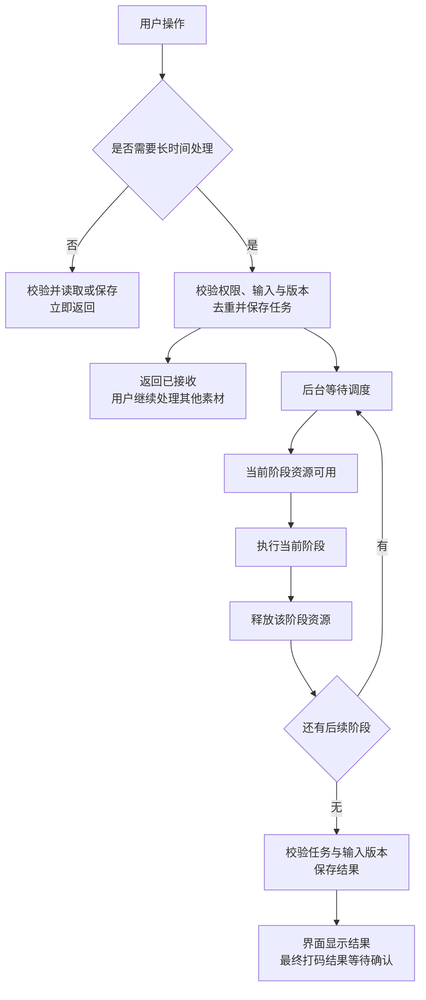

# 前台操作与后台任务：统一方案

状态：待实现的唯一业务方案。D1 已停止；本次只整理文档，不更新 18883，不发布生产。

本文件取代此前讨论中“直接移除全部执行限制”“dev各阶段固定1”等实施口径。代码事实与风险证据见 [调查记录](interactive-admission-resource-scheduling.md)；调查记录中的技术备选和参数不是已批准的实施配置。

## 1. 目标

后台已有任务时，用户仍能创建项目、保存编辑、提交下一条任务。提交被可靠保存；服务器按资源能力执行，不因忙碌要求用户反复提交，不无限启动重计算。

## 2. 唯一业务规则

|用户操作/功能|规则|
|---|---|
|创建项目、浏览、保存编辑、播放已有结果|不等待模型调用或视频处理；短状态事务不覆盖长计算。|
|提交普通制作、识别、效果预览、Hook预览|先接收并保存任务。执行额度不足显示等待，不返回名额已满；重复提交复用同一任务。|
|普通视频制作|全实例最多3个普通制作任务同时执行；额外任务等待。|
|剪切打码最终生成|独立持久队列，全实例同时1个；离开页面继续，重新打开恢复状态。|
|中文字幕|同时2个，最多30个等待任务。满额明确提示未接收，只影响该次字幕提交，不影响编辑。|
|普通任务提交数量|取消等待+运行累计10个的统一拒绝门槛，包括自动准备源素材的同类判断。|
|下载、制作、上传、平台状态查询|独立调度，不被一个跨阶段总名额串行化；同一任务按依赖顺序执行。保留生产既有阶段配置，不以dev临时覆盖值替代。|
|Gemini请求|不使用原共享应用请求频率预算。供应商错误如实处理；本地视频准备仍受后台资源调度。|
|AI文本/Excel解析|不使用全局单槽及原共享OpenAI请求预算；计算不持全局写锁。|
|其他OpenAI能力|本轮不扩大取消预算范围。|
|制作小助手|只隐藏入口，不删除后端和共用代码。|
|同一素材最终提交后的修改|已提交素材冻结，取消完成后可修改；其他素材照常编辑。完成结果须显式确认替换或放弃。|
|dev与生产|同版本业务规则、队列额度、调度及模型处理配置一致；端口、数据、凭据、设备适配和外部写入开关等必要差异显式记录，不能隐藏覆盖业务参数。|

“允许提交”不等于“所有请求立即计算”。“不同素材可操作”不等于“同一份已提交输入可以随意修改”。

## 3. 任务流程

任务状态应区分等待、执行、取消中、完成、失败、取消和输入已过期。页面关闭不是任务取消；页面恢复查询服务端状态。请求响应丢失后可通过任务身份找回，不重复执行。

## 4. 后台实现必须满足的约束

1. **按实际工作控制资源。** FFmpeg编码、全片帧索引、SAM推理、输入复制及上传等有后台执行控制；普通读取和保存不进入这些队列。
2. **短操作不等长操作。** 编辑取帧与长片制作分开安排，优先复用缓存；实际取帧仍受控，不能无限起进程。
3. **阶段用完即释放。** 等待云端识别时不持有已经结束的视频处理额度。嵌套子进程不重复申请同一额度导致死锁。
4. **交互和最终处理都能推进。** A最终生成时，B识别/预览应实际执行；两个用户交互不能因全站单槽完全串行。执行数量由集中配置控制，不能散落各功能自行叠加。
5. **公平且不浪费。** 同账号可提交多个素材，后台轮转安排；同一素材尚未开始的过期预览可被新版本替代，不替代其他素材任务。
6. **保护数据而非阻塞全站。** 同缓存/同对象去重，原子发布，结果按版本验收；不在全局写锁内等待模型、编码或上传。
7. **恢复有依据。** 复用已有普通、字幕及最终队列权威状态；交互补齐持久等待与恢复。云端已发出但结果未知的请求不能承诺恰好一次；失败/重试明确记录。
8. **配置可核对。** 比较最终生效配置，不只比较模板。业务配置差异阻止“已验证同版本生产行为”的验收结论；本地硬件差异不当作生产容量证据。

新增资源执行额度由实现前的资源路径核实和隔离混合负载测试确定，记录依据，不要求用户猜参数，也不以旧的“2路/每账号1路”拒绝用户提交。普通3、打码最终1、字幕2是不同业务组的上限，不保证在资源不足时所有组始终满额；不得长期饿死任一组或隐性把普通制作降为1。

## 5. 验收清单

|场景|必须观察到的结果|
|---|---|
|后台繁忙时创建/编辑/保存|请求及时返回，用户输入保留；没有被长时间全局写锁阻塞。记录延迟分布。|
|同用户/多用户连续提交|任务持久接收，重复点击不重复；资源满时显示等待而非容量429。|
|超过10个普通任务|正常接收，自动源素材准备不被隐藏门槛挡住。|
|普通制作与其他阶段|实际达到3路制作；下载/上传/查询可同时推进，同任务依赖不乱序。|
|A最终生成，B识别和预览，继续C|A未被暂停；B真实模型和媒体处理推进，能编辑并入最终队列；C可打开和操作。|
|字幕边界|2个执行+30个等待；第31个等待请求明确未接收，其他功能正常。|
|连续修改预览设置|旧任务结果不覆盖新设置，过期等待任务不无限堆积。|
|同资源/不同资源|同key只有一个有效生产者，不同key可并行；缓存命中不被无关任务挡住。|
|取消/异常/进程退出|不误取消其他素材，不留孤儿进程，不提前释放仍占用的资源。|
|离开页面/服务重启|队列和结果可恢复，输入版本重新校验，不重复确认替换。|
|混合负载|记录FFmpeg/SAM进程数、CPU、内存、磁盘、等待时间；验证受控和公平，不只验证HTTP成功。|
|配置一致性|业务有效配置与版本基线一致，环境差异有明细；不能用dev各1证明生产制作3。|

测试使用隔离本地dev和独立数据；关键媒体链路使用真实FFmpeg及适量真实Gemini/SAM。外部上传用明确标注的隔离替身，不发布生产。专项、完整回归及独立review通过后，才安排用户试用dev正常更新，保留现有数据与任务。

## 6. 当前边界

已完成代码路径调查及本业务方案，未完成新调度实现和混合负载验收。旧D1分支不整批合入；只逐项复用符合本方案的改动。现在不重启18883、不继续D1、不新增生产操作。
