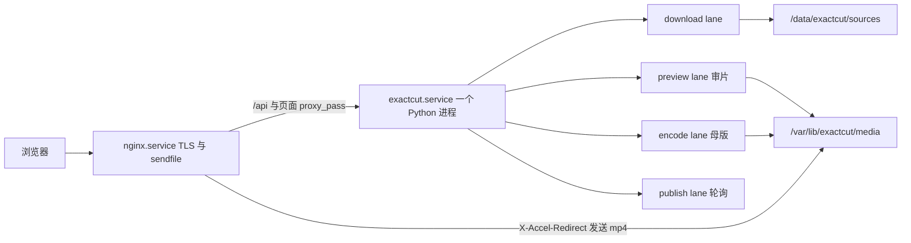
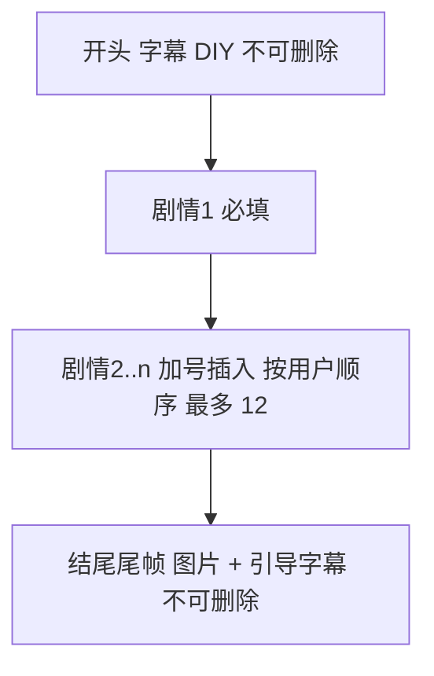
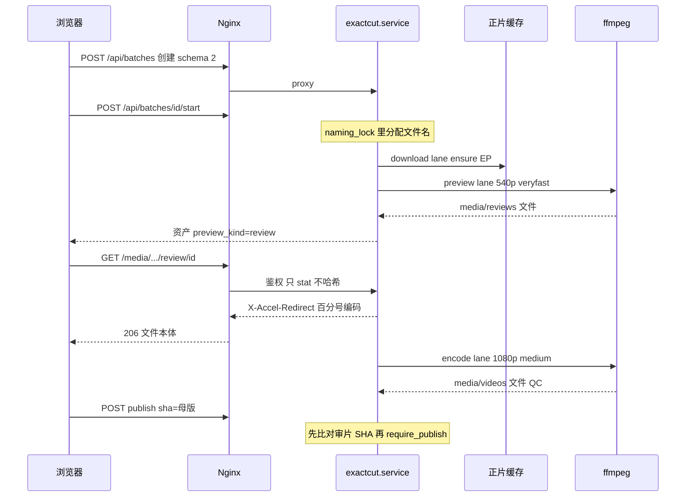

# Exact Cut FBBM：Linux 单服务部署与结构化成片编辑器

> 此文保留早期设计草案。当前部署准备采用 Docker、单一可迁移部署根和 schema 1；实际配置与验收以 [Linux 运行边界](linux-portability.md) 和 [部署与迁移](linux-migration.md) 为准，不执行本文草案的宿主 systemd/venv、密钥路径或 schema 2 步骤。

> 2026-10-09 提交前审查：应用进程控制已改为跨平台 `ps` 与每次启动的唯一标识；本文的 `/proc`、starttime 与 Mac 跳过真实进程测试的方案已废弃。审片先出、分 lane 与 schema 2 仍是草案，尚未实现或部署。

| 项 | 值 |
| --- | --- |
| 作者 | （待填写） |
| 日期 | 2026-10-08 |
| 状态 | Draft |
| 基线 | 交接库 `main` @ `32c4360`（`/Users/matao/code/exact-cut-fbbm-handoff`） |
| 现行生产身份 | `v0.3.3-phase4`，commit `23e303c`，`127.0.0.1:8791`，Cloudflare Tunnel。本设计不要求这台 Mac 继续开机 |
| 数据 schema | 现为 `source/deploy/data-schema.json` 的 `{"version":1,"readable":[1]}`。本变更为 schema 2，`readable` 为 `[1, 2]` |
| 负载 | 今天约 10 条成片/天；按 100 条/天、20 个同时登录的会话设计。不是多租户 SaaS |
| 修订 | 设计评审已落入正文。2026-10-08 产品负责人定稿：不拷 Mac 历史批次；生产上线即接通物料命令。60 秒 / 240 秒仍是目标，不是仓库里已测得的结果 |

## Overview

Exact Cut 今天是一台常开 Mac 上的单进程网页：`exactcut.webserver.main` 听 `127.0.0.1`，唯一的 `worker()` 每次 tick 最多启动一个子进程，串行执行下载、三次 libx264 成片编码和预览转码，再把发布轮询占在同一条槽上。制作人用 Excel 上传，`llm_intake.interpret` 把表变成草稿。正片落在 `~/Downloads/auto-cut`，物料脚本在 `~/.openclaw`。公网靠 Cloudflare Tunnel。这些都绑在那台个人机器上，不能原样装进容器就算完成。

本设计把产品迁到一台 Linux 服务器上的**一个** systemd 服务 `exactcut.service`，前面只用 Nginx 做 HTTPS 和文件发送。可播放的 mp4 放在 `EXACTCUT_MEDIA_ROOT`，不放进每次启动都被 `os.chmod(..., 0o700)` 的 `.web-state`。网页不再收 Excel，也不再调用 `llm_intake.interpret`。一条成片在页面上做成固定结构：不可删除的开头字幕、至少一个剧情片段、不可删除的结尾尾帧。审片文件用低成本参数先做完并可播放；上传仍只接受 QC 通过的 1080×1920 母版 SHA-256。下载、母版编码、审片编码、发布轮询分成四条 lane，每条 lane 有自己的 job 记录；发布轮询不占编码槽。缺集只失败当前批次。schema 1 的旧批次保持原样可读，不能走新编辑器的写路径。

## Background & Motivation

现行生产路径（交接库源码，与 `23e303c` 的行为一致）的瓶颈是真实的，不是推测：

1. **Hub 下载占住唯一的启动名额。** `webserver.worker_tick` 的返回条件是下面这段，不是「`owned` 非空就 return」：

```python
running = batch_control.reconcile(workflow.BATCHES)
running |= bool(owned and any(not job.get('batch_id') for job, _, _ in owned.values()))
if running:
    return
```

`reconcile()` 为真，或 `owned` 里存在没有 `batch_id` 的 job 时，本轮不再 `Popen`。一个带 `batch_id` 的活 job **本身不会**让 `running` 为真。全局仍然最多新启动一个子进程，因为循环末尾有 `break`。再加上 `reconcile()` 认为已有运行树时直接返回，第二个 workflow 子进程通常起不来。

`workflow._produce` **不是**每次渲染前都调用 `workflow.download`。它先看 `projects/<drama_id>/source/videos` 里所需集是否都在，并且 `validate_downloaded_video` 是否通过。通过则写 `reused_local_episodes`，不调 Hub。只有缺文件或校验失败才调用 `download`。`download` 调 `material_download.run_download`，命令在 `Path.home() / '.openclaw/...'`，输出在 `~/Downloads/auto-cut/projects/#<drama_id>#/source/videos`。Hub 会写 OSS 并通知飞书。Hub **真的跑起来**的那一次，仍然占住这唯一的启动名额，其他批次不能编码，也不能轮询 FBBM。拆 lane 的理由是这一条，不是「`owned` 里任意 job 都 return」。

2. **成片被编码三遍，预览还要等母版。** `renderer._render_episode_unit`、`_concat_units`、`_apply_hook` 都使用 `config/default.json` 的 libx264 `medium`、CRF 18、1080×1920、30fps。`orchestrator.execute_batch` 在 QC 之后才调用 `preview.make_preview`，把母版再转成宽 540、`veryfast`、CRF 30、24fps。审片人要等这四次编码。
3. **Python 把 Range 切成 2MB。** `Handler.stream_video` 把任意 Range 收成 `end = min(end, start + 2 * 1024 * 1024 - 1)`。播放器拖动一次高码率母版要很多次请求，而且字节经过 `BaseHTTPRequestHandler`。今天这条路径**不**对整文件做 SHA-256。新的鉴权路径也不许为了每次 Range 重读整文件。
4. **进程身份靠 `ps` 文本。** `batch_control.processes` 解析 `ps -axo pid=,ppid=,lstart=,stat=,command=`，`roots` 用正则匹配 `-m exactcut.workflow`。Linux 的 `ps` 列宽和 `lstart` 格式不同，会认错或漏认，暂停时可能信号打到被复用的 PID。
5. **复制依赖 APFS clone。** `material_download.mirror_videos` 调用 `/bin/cp -c -p`。GNU `cp` 没有 `-c`，失败后虽有 `shutil.copy2` 兜底，但每次都先付一次必然失败的进程，而且项目路径仍然是「先下载到家目录再镜像」。
6. **外部写入是一把开关。** `runtime.require_external` 要求 `EXACTCUT_ENVIRONMENT=production` 且 `EXACTCUT_ALLOW_EXTERNAL_WRITES=1`。`OssPublisher.upload`、`FeishuClient.__init__`、`CfAdsClient.__init__`、`workflow.download`、`llm_intake.interpret` 都走它。staging 要么全关（连真实下载语义都和渲染绑在一起思考），要么一开就能上传。
7. **Cookie 绑死域名。** `Handler.cookie` 只在 `Host` 为 `cut.oulagrowth.com` 时加 `Secure`。换域名或经反代终止 TLS 时，HTTPS 会话会变成可被窃听的非 Secure cookie，HTTP 开发口如果 Host 碰巧是这个名字又会错误地加 Secure。
8. **Excel / AI 是产品入口。** `POST /api/batches/import` → `workflow.import_excel` → `llm_intake.read_excel` → `interpret`。页面 `importFile` 把按钮文案设为「AI 正在理解表格」。确定性校验 `intake.validate_draft` 已经存在，但产品路径绕过了它，先付一次外网模型调用。仓库里没有 `textutil`，也没有 `.doc` 读取器。

账号、隔离和上传不变量已经可用，本设计保留：`accounts.sqlite3` 本地用户、HttpOnly 会话、`access.json` 归属、`accounts.allowed`、不可变 `confirmed.json`（`save_draft` 在文件存在或状态不是 `draft` 时拒绝，文案是 `已确认批次不可修改；请复制为新草稿后调整`）、`queue_publish` 把上传绑到 `output_sha256`、`_publish` 在已有 `publication` 时复用飞书记录、确认时在 `naming_lock` 下分配的全局文件名唯一、QC 不过不进入 `SAFE` 就不能播母版或上传、片段按用户顺序、空与数字 0 的差别（见 `docs/标准剪辑Excel_分秒毫秒填写说明.md` 与 `intake.expand_split_segments`）。

`finish_job` 今天把一个批次当成一个 job。非发布子进程退出后，若 `runtime.status in workflow.ACTIVE`，就写成 `interrupted`：

```python
elif workflow.runtime(path)['status'] in workflow.ACTIVE:
    workflow.update(path, 'interrupted', message)
```

`ACTIVE` 含 `downloading` 和 `producing`。下载子进程以 0 退出时，审片还没开始，这句就会打断整批。`execution()` 在进入时清掉该批次 `runtime.json` 的 `stage`、`stage_started_at`、`execution_started_at`，退出时把 `executor_running` 设为 false。两条 lane 叠在同一份 runtime 上会互相抹掉 60 秒 / 240 秒要用的时钟。

## Goals & Non-Goals

### Goals

- 一台 Linux 主机、一个应用单元 `exactcut.service`，用户 `exactcut`，数据盘上的正片缓存，Nginx 终止 TLS 并发送视频文件。
- 可发送的 mp4 不在 `0700` 的 `.web-state` 里。`os.chmod(STATE, 0o700)` 不覆盖媒体目录。
- 网页创建 schema 2 成片：开头字幕 DIY、剧情 1..n、结尾尾帧加引导字幕。一条批次 1..30 条成片，一条成片最多 12 个剧情片段。
- 审片在母版完成前可播放；上传只接受母版 SHA-256。
- 下载、母版编码、审片、发布轮询四条 lane，每条 lane 独立 job。4 vCPU 上母版并发默认 2，可用环境变量改。一条 lane 成功退出不得在另一条仍要跑时把整批标成 `interrupted`。
- schema 1 文件原样可读；新编辑器不能写它们；代码回滚不删除、不降级这些文件。
- staging 用 ffmpeg 色块夹具渲染和审片，外部客户端在发布开关关闭时抛错。staging 与单测的 `EXACTCUT_ALLOW_MATERIAL_FETCH` 为 `0`，不访问网络。
- 生产上线接通物料命令。`secret.env` 同时设置 `EXACTCUT_ALLOW_MATERIAL_FETCH=1` 与 `EXACTCUT_MATERIAL_FETCH_CMD`。Exact Cut 不 import Material Hub。缺集只失败该批次。
- 每个行为变更都有测试文件、fixture 和断言（见「行为变更与测试对照」和 PR Plan）。

### Non-Goals

- 播放器里的可视化修剪。入点/出点只做表单。
- 违规帧删除、打码、模糊。`safety.py` 的 `editorial_preflight` 今天就不在 `workflow._produce` 里，schema 2 也不接入。
- 公司 SSO、多租户、多套 OSS / 飞书 / CF-Ads 凭证。
- 把 Mac LaunchAgent、`deploy/install.py`、8790/8791 双服务、Cloudflare Tunnel、边缘 IP 覆盖原样搬到 Linux。
- 用 `deploy/ops.py` 发布本分支，或把本分支部署到 Mac 的 `127.0.0.1:8791`。
- 容器化现有 Mac 脚本并称为完成。
- 要求生产 Mac 在迁移期间保持开机，或做在线双写。
- 切 DNS 之前拷贝 Mac 历史批次。以后的只读拷贝不在本设计范围内。
- 为字幕拖动实时重编码视频。字幕预览只走 PIL。
- Word / `.doc` 导入。仓库没有这条路径，也不新增。

## Proposed Design

### 主机、用户与路径

生产应用只有 **`exactcut.service`**。Nginx 是系统 Web 服务器，不是第二个 Exact Cut 服务，不听业务端口，也**不**以用户 `exactcut` 运行。不要 port `com.oulagrowth.exactcut.web` LaunchAgent，不要 port `deploy/install.py` 里那句 LaunchAgent 拒绝逻辑的「再生成一份 plist」，也不要 8791。

`webserver.main` 里的 `STATE = data_root() / '.web-state'`，每次启动 `os.chmod(STATE, 0o700)`。这只 chmod `STATE` 这一个目录，**不** chmod `data_root()`，**不** chmod `EXACTCUT_MEDIA_ROOT`。媒体文件若放在 `.web-state/batches/.../production/` 下，Nginx 工人（Debian/Ubuntu 上是 `www-data`）穿不过 `0700`，重启还会把放宽过的模式改回去。让 Nginx 改跑 `exactcut` 则会读到 `secret.env`（`0640 root:exactcut`）和 `accounts.sqlite3`。两条都不做。

| 路径 | 用途 | 属主与模式 |
| --- | --- | --- |
| `/opt/exactcut/releases/<version>/` | 只读发布树（源码 + `.venv`） | `root:exactcut`，目录 0755，文件去掉写位 |
| `/opt/exactcut/current` | 指向当前 release 的符号链接 | `root` |
| `/var/lib/exactcut` | `EXACTCUT_DATA_ROOT`。只给他人执行位，便于 Nginx 穿越到媒体目录，不能列出 `.web-state` | `exactcut:exactcut`，`0751` |
| `/var/lib/exactcut/.web-state` | `accounts.sqlite3`、`jobs/`、`batches/<id>/*.json`（`draft`、`confirmed`、`runtime`、`control`、`publications`、`results`）、`lanes/*.lock`、`naming.lock` | `exactcut:exactcut`，`0700`。`os.chmod(STATE, 0o700)` 的对象就是这里 |
| `/var/lib/exactcut/projects` | `cache/render-base` 等中间文件。含烧录字幕，见安全一节 | `exactcut:exactcut`，`0700` |
| `/var/lib/exactcut/feedback` | 反馈 | `exactcut:exactcut`，`0700` |
| `/var/lib/exactcut/media` | `EXACTCUT_MEDIA_ROOT`。可发送的审片、母版，以及尾帧 JPEG | 见下 |
| `/data/exactcut/sources/<drama_id>/EPn.mp4` | `EXACTCUT_SOURCE_ROOT`。正片缓存，按剧 + 集，不在家目录 | `exactcut:exactcut`，目录 `0750` |
| `/etc/exactcut/secret.env` | OSS / 飞书 / CF-Ads，以及上线时的 `EXACTCUT_ALLOW_MATERIAL_FETCH=1` 与 `EXACTCUT_MATERIAL_FETCH_CMD`。不进 Git | `0640 root:exactcut` |
| `/var/log/exactcut/service.log` | 单元标准输出 | `exactcut` |
| `/etc/nginx/sites-available/exactcut.conf` | 公网入口 | `root` |
| `/etc/letsencrypt/live/cut.oulagrowth.com/` | TLS 证书。certbot，不是 Cloudflare | `root` |

组 `exactcut-media` 的成员是 `exactcut` 和 Nginx 工人用户。Debian/Ubuntu 上这个用户是 `www-data`。`install.sh` 用 `ps` 以外的办法取工人用户：读 `nginx` 主配置里的 `user` 指令，读不到则用 `www-data`。不要把 Nginx 工人加进 `exactcut` 组。

媒体目录：

| 路径 | 模式 |
| --- | --- |
| `/var/lib/exactcut/media` | `2750` `exactcut:exactcut-media`（setgid，新建文件继承组） |
| `media/batches/<id>/reviews`、`videos`、`assets` | 同上 `2750` |
| `os.replace` 之后的 mp4 和 jpg | `0640` `exactcut:exactcut-media` |

`2750` 是属主可写、组可读可执行、其他人不可进入。`www-data` 能读 mp4，不能写，也不能进入 `0700` 的 `.web-state`。服务进程的 umask 是 `0027`（见 unit），`os.replace` 之后仍显式 `os.chmod(path, 0o640)`，避免测试或 CLI 的 umask 把文件收成 `0600`。

系统用户 `exactcut`，`nologin`，home 就是 `/var/lib/exactcut`。因此 unit **不能** 设 `ProtectHome=true`：那会把 home 藏起来，数据根一起消失。`ProtectHome=false`。数据盘单独挂载；正片不要放在系统盘的 home 里。`runtime.data_root()` 继续读 `EXACTCUT_DATA_ROOT`。新增：

- `runtime.source_root()`：`EXACTCUT_SOURCE_ROOT`，绝对路径，解析后不得等于 `Path.home()`，路径中不得出现 `.openclaw` 或 `Downloads/auto-cut`。staging/test 仍走 `protect_path`。
- `runtime.media_root()`：`EXACTCUT_MEDIA_ROOT`，绝对路径，解析后不得位于 `.web-state` 之下。

监听：`ThreadingHTTPServer((os.environ.get('EXACTCUT_BIND', '127.0.0.1'), int(os.environ.get('EXACTCUT_PORT', '8790'))))`。生产 unit 把 `EXACTCUT_BIND=127.0.0.1`、`EXACTCUT_PORT=8790`。不提供 8791。staging 单元 `exactcut-staging.service` 使用 `/var/lib/exactcut-staging` 和 `127.0.0.1:8792`，**不**配进公网 Nginx，也**不**加载 `/etc/exactcut/secret.env`。这是隔离验收进程，不是当年 8790/8791 两套生产执行器。

`deploy/install.py` 保持现有拒绝 stub，Linux 安装不调用它。`deploy/ops.py` 的 `main` 在 `sys.platform != 'darwin'` 时 `SystemExit(2)`，消息指向 `deploy/linux_ops.py`。本分支不由 `ops.py` 发布。新入口是 `source/deploy/linux/install.sh`：`uname` 为 Darwin 时退出码 2；否则创建用户和组、目录、安装 unit 和 Nginx 站点，不启动 Tunnel。生产 unit 在 `secret.env` 同时含 `EXACTCUT_ALLOW_MATERIAL_FETCH=1` 和非空的 `EXACTCUT_MATERIAL_FETCH_CMD` 之前不 enable。staging unit 三个开关为 `0`，不加载这份文件。

#### 包与发布树

目标发行版安装：`python3.11`、`python3.11-venv`、`ffmpeg`、`nginx`、`certbot`、`python3-certbot-nginx`。`ffmpeg` / `ffprobe` 在 `/usr/bin`，unit 的 `PATH` 含 `/usr/bin`。

发布树构建（`install.sh` 和 `linux_ops.py` 使用同一段）：

```bash
python3.11 -m venv /opt/exactcut/releases/<version>/.venv
/opt/exactcut/releases/<version>/.venv/bin/pip install -r /opt/exactcut/releases/<version>/requirements.lock.txt
```

`source/requirements.lock.txt` 由 PR 8 从当前 `pyproject.toml` 的依赖锁出并提交。解释器是这个 venv 里的 `python`，不是发行版上别的 `python3`。

证书：`certbot --nginx -d cut.oulagrowth.com`（HTTP-01）。续期用发行版的 `certbot.timer`，不经过 Cloudflare。证书路径：

- `/etc/letsencrypt/live/cut.oulagrowth.com/fullchain.pem`
- `/etc/letsencrypt/live/cut.oulagrowth.com/privkey.pem`

Nginx 1.25.1+ 拒绝 `listen 443 ssl http2`。站点写成 `listen 443 ssl;` 加 `http2 on;`。

#### 生产 unit

文件 `source/deploy/linux/exactcut.service`：

```ini
[Unit]
Description=Exact Cut FBBM
After=network-online.target
Wants=network-online.target

[Service]
Type=simple
User=exactcut
Group=exactcut
SupplementaryGroups=exactcut-media
WorkingDirectory=/opt/exactcut/current
Environment=EXACTCUT_BIND=127.0.0.1
Environment=EXACTCUT_PORT=8790
Environment=EXACTCUT_DATA_ROOT=/var/lib/exactcut
Environment=EXACTCUT_SOURCE_ROOT=/data/exactcut/sources
Environment=EXACTCUT_MEDIA_ROOT=/var/lib/exactcut/media
Environment=EXACTCUT_ENVIRONMENT=production
Environment=EXACTCUT_ALLOW_PUBLISH=0
Environment=EXACTCUT_ALLOW_MATERIAL_FETCH=1
Environment=EXACTCUT_ALLOW_AI=0
Environment=EXACTCUT_ENCODE_SLOTS=2
Environment=EXACTCUT_FFMPEG_THREADS=2
Environment=PATH=/opt/exactcut/current/.venv/bin:/usr/bin
EnvironmentFile=-/etc/exactcut/secret.env
ExecStart=/opt/exactcut/current/.venv/bin/python -m exactcut.webserver
Restart=on-failure
RestartSec=2
KillMode=control-group
TimeoutStopSec=30
ProtectHome=false
ProtectSystem=strict
ReadWritePaths=/var/lib/exactcut /data/exactcut/sources /var/log/exactcut
NoNewPrivileges=true
PrivateTmp=true
UMask=0027

[Install]
WantedBy=multi-user.target
```

`EnvironmentFile=` 写在所有 `Environment=` **之后**。systemd 按出现顺序覆盖同名变量。`EnvironmentFile=-` 的减号表示文件可以暂时不存在，便于尚未拿到命令的主机先装上 unit 文件；这台主机不是已启用的生产。发布和 AI 在 unit 里是 `0`。生产要上传时，由 `secret.env` 把 `EXACTCUT_ALLOW_PUBLISH` 写成 `1`。物料开关在生产 unit 示例里是 `1`，不是 `0`。命令不写在 unit 的 `Environment=` 里，只作为下面这份 EnvironmentFile 的值。启用 `exactcut.service` 之前，`secret.env` 必须同时有 `EXACTCUT_ALLOW_MATERIAL_FETCH=1` 和非空的 `EXACTCUT_MATERIAL_FETCH_CMD`。契约是三个参数：`drama_id`、`episode`、`dest_path`。二进制由运维在安装时提供，审查通过之前不 enable。不要把 `~/.openclaw` 或 `~/Downloads/auto-cut` 写进 unit 或 `secret.env`。空命令加开关 `0` 只适用于 staging，以及尚未拿到命令的主机。staging unit 不引用这份文件，三个开关在 unit 里写死 `0`。验收和单测不访问网络。Exact Cut 不 import Material Hub，也不 import 这条命令。缺集只失败该批次。

```
# /etc/exactcut/secret.env
EXACTCUT_ALLOW_PUBLISH=1
EXACTCUT_ALLOW_MATERIAL_FETCH=1
EXACTCUT_MATERIAL_FETCH_CMD=<reviewed command supplied by ops>
```

子进程使用 `start_new_session=True`，因此不在 Python 的进程组里，但**仍在这个服务的 cgroup**。`KillMode=control-group` 会在 `systemctl stop/restart` 时向 cgroup 里的 ffmpeg 发信号。`TimeoutStopSec=30` 之后是 SIGKILL。重启**会**打断正在写的 mp4。恢复规则见进程模型：按每个子进程 adopt 或只中断那一条 lane；哈希还没随 `os.replace` 落盘的半成品不重放成成功，`.part` 删除。不要假设 `start_new_session` 能让子进程躲过 `KillMode=control-group`。

staging unit 与上面相同，除了：`Environment=EXACTCUT_PORT=8792`、`EXACTCUT_DATA_ROOT=/var/lib/exactcut-staging`、`EXACTCUT_SOURCE_ROOT` 指向 staging 缓存、`EXACTCUT_MEDIA_ROOT=/var/lib/exactcut-staging/media`、`EXACTCUT_ENVIRONMENT=staging`、三个外部开关都是 `0`（含 `EXACTCUT_ALLOW_MATERIAL_FETCH=0`），以及**没有** `EnvironmentFile=`。

PR 8 改写 `source/docs/开发发布与回滚.md` 和 `source/docs/项目暂停与归档.md`：生产入口是 `exactcut.service` + Nginx，端口 `8790`，发布器是 `deploy/linux_ops.py`；暂停信号打到该批次每一个记录在案的子进程，而不是一个 LaunchAgent 进程树。两篇文档不再把 `8791`、Tunnel 或 `deploy/ops.py` 写成现行发布步骤。

### 进程模型



`webserver.main` 仍拿 `STATE/worker.lock` 的 `LOCK_NB`，禁止同一数据根起第二个执行器。锁内不再只起一个 `worker` 线程。`exactcut/lanes.py` 的 `LaneSupervisor` 起四条守护线程。每条线程只监督本 lane 的子进程。子进程入口仍是 `python -m exactcut.workflow <command>`，这样 ffmpeg 崩溃不会杀掉网页进程，也和今天的 `start_new_session=True` 一致。

要删的是 `worker_tick` 里的 `if running: return`（`running` 的定义见 Background 第 1 条），以及循环末尾「启动一个就 `break`」。不是「`owned` 非空就返回」。一个带 `batch_id` 的 job 在跑，不再阻止其他 lane 启动。

| Lane | 子命令 | 默认并发 | 环境变量 | 占用 |
| --- | --- | --- | --- | --- |
| download | `workflow download <batch_id>` | 2 | `EXACTCUT_DOWNLOAD_SLOTS` | 网络与磁盘。不拿 encode flock |
| preview | `workflow review <batch_id> <request_id>` | 1 | `EXACTCUT_PREVIEW_SLOTS` | 审片 ffmpeg |
| encode | `workflow master <batch_id> <request_id>` | 见下 | `EXACTCUT_ENCODE_SLOTS` | 母版 ffmpeg |
| publish | `workflow publish <batch_id> <request_id>` | 4 | `EXACTCUT_PUBLISH_SLOTS` | OSS 上传一次，然后 `sync_record_once` 睡眠。不拿 encode flock |

4 vCPU 上母版槽默认 **2**：`ENCODE_SLOTS = min(2, max(1, os.cpu_count() // 2))`。4 核得到 2。`EXACTCUT_ENCODE_SLOTS` 若设置则用该正整数，不再套公式。每个母版 ffmpeg 带 `-threads`，默认 `EXACTCUT_FFMPEG_THREADS=2`。审片默认 1 槽、同样 `-threads 2`。最坏是 2 个母版加 1 个审片同时跑，线程数约 6，短时超订 4 核。这是为了 100 条/天的重叠，不是为了让三条重活都挤在 60 秒指标里。60 秒和 4 分钟的指标假定审片槽空闲、且该次测量时另一母版槽空闲。若压测抢占严重，把 `EXACTCUT_ENCODE_SLOTS` 改成 1，不用发版。

跨进程真正的帽是 flock，不是只靠父进程信号量（否则 CLI 能绕开）：

```python
# exactcut/lanes.py
@contextmanager
def lane_slot(name: str, capacity: int, root: Path):
    """在 root/.web-state/lanes/<name>-<i>.lock 上非阻塞试探，
    占到一个空槽后用 LOCK_EX 持有到退出。容量满则等待并写 checkpoint。
    锁随进程退出释放，不把「锁文件还在」当成占用。
    publish 与 download 使用各自的名字，不能打开 encode-*.lock。"""
```

网页监督者在 `Popen` 之前不持有这把锁。监督者用同一组锁做 `count_free(name)`，空闲数小于 1 就不启动新的子进程。同一进程里的线程共享 flock，所以单测并发帽用**子进程**，不用同进程多线程抢同一把 flock。

`workflow.__main__` 今天只认 `produce` / `preview` / `publish`。拆成 `download`、`review`、`master`，保留 `publish`。网页在 PR 7 之后不再调用整体 `produce`。在 PR 4 到 PR 6 之间，`review` / `master` 仍可调用现有 `render_request` 和 `make_preview`，schema 1 的网页 `start` 也仍能跑完；这段分支**不部署**，也不用 `deploy/ops.py` 推到 Mac。PR 6 换成审片先于母版。PR 7 起，schema 1 的网页 `start` 返回 409，schema 1 只由 CLI `exactcut execute` 渲染。

CLI `exactcut execute` 仍在一个进程里顺序调用渲染，不经过网页队列。schema 2 走 `render_review` 然后 `render_master`；schema 1 走 `render_request`。它同样调用 `lane_slot('encode')`。CLI 不是产品路径，但是 schema 1 在 PR 7 之后的**唯一**渲染入口。

一条 schema 2 成片的依赖：`download` 成功后按 `requests` 顺序为每条入 `review`；该条 `review` 把可播放文件 `os.replace` 进 `media/batches/<id>/reviews/` 并写下 `review_ready_at` 之后，才入 `master`。同一条的母版不会和自己的审片并行。不同批次的 download 与这条的 master 并行。同一批次里，请求 N 的审片可以和请求 N-1 的母版并行，所以它们不能共用一份会被清掉的 `execution_started_at`。

`batch_control.reconcile` 今天在有任意运行树时最多续上一个暂停树。改为按 lane 续上，直到该 lane 的空闲槽用尽。一条正在跑的 encode **不**阻止 publish lane 续跑。`workflow.ACTIVE` 与 `batch_control.ACTIVE` 仍是 `{'queued', 'downloading', 'indexing', 'producing', 'publishing'}`。`indexing` 今天没有赋值点，常量里**留下**这个词，`web/app.js` 的 `activeStatuses` 也留下。不要在这次改动里删掉它。

#### 每条 lane 一个 job

一个批次同时有多份 job。文件是 `.web-state/jobs/<id>.json`：

```json
{
  "id": "<job id>",
  "batch_id": "<batch id>",
  "request_id": "R001",
  "lane": "review",
  "pid": 123,
  "pgid": 123,
  "starttime": 998877,
  "status": "running"
}
```

`lane` 是 `download`、`review`、`master`、`publish` 之一。`download` 的 `request_id` 为空。`status` 是 `queued`、`running` 或 `exited`。同一 `batch_id` 可以同时有一条 `running` 的 `review` 和一条 `running` 的 `master`。

`finish_job` 不再用「非发布子进程退出且批次状态仍在 `ACTIVE` 就 `interrupted`」：

- 退出码 0：把这份 job 标成 `exited`。若这条 lane 有后继，则入队后继（`download` 成功 → 为每条请求入 `review`；该条 `review` 成功 → 入 `master`；`master` 成功不自动入 `publish`）。只要该批次还有 `queued` 或 `running` 的 job，或刚刚入队了后继，**不**把批次标成 `interrupted`，也**不**把 `executor_running` 设成 false。
- 退出码非 0：只把该 `request_id` 标失败（download 没有 `request_id` 时，整批的下载阶段失败）。不杀其他 lane 的子进程。批次变成 `failed` 或 `partial` 的条件是：该批次已经没有 `queued` / `running` 的 lane 子进程，且至少一条请求失败。全部成功且没有剩余子进程时，批次仍是今天的 `review`（待确认上传）或发布路径上的状态。
- 发布子进程失败时，保留今天对 `publications.json` 的 `publish_failed` 分支。发布子进程成功退出同样不得触发上面的 `interrupted` 分支。

`workflow.execution()` 不再给会重叠的 lane 用。新的 `lane_execution(path, request_id, lane)`：

- 只写该请求在 `results.json` 里的 `lane_clocks[lane].execution_started_at` 和 `execution_ended_at`。
- 不清除其他 lane 的时钟，不清除批次级 `stage_started_at`。
- 批次级 `executor_running` 为真，当且仅当该批次还有任意 job 的 `status` 是 `queued` 或 `running`。

60 秒从 `review_ready_at - lane_clocks.review.execution_started_at` 读。240 秒从 `master_completed_at - lane_clocks.master.execution_started_at` 读。两个时间戳都在该请求的结果记录上，不在会被另一条 lane 清掉的批次 `runtime.execution_started_at` 上。

暂停、归档、删除：对该批次每一份 `running` job，若 `/proc/<pid>` 的 starttime 仍与记录一致，就向该 pid 的进程组发信号。这些子进程是各自 `start_new_session=True` 的会话，**不是**一棵树。只停 encode 的 pid 会留下 review 的 ffmpeg。`control.json` 的 `children` 是这个列表，不是单个 root。

`recover_jobs` 不再用 `roots()` 的命令行文本去认领。对每一份 `status==running` 的 job：

- `/proc/<pid>` 的 starttime 与记录一致：标 `adopted_after_restart`，不重新 `Popen`，不重放。
- 进程已死：若该 lane 的成片已经 `os.replace` 并且 `review` 或 `output_sha256` 里的字节数与 inode 已写入，则这条 lane 算完成，不重编码。否则只把**这一条** lane 标为中断（该请求失败或 download 阶段失败），不把同一批次里另一条已经完成的 lane 改掉。哈希还没写入的 `.part` 删除。

测试：

- `source/tests/test_lanes.py::test_download_exit_does_not_interrupt_before_review`：download 子进程退出码 0，批次状态不是 `interrupted`，review job 进入 `queued` 或 `running`。
- `source/tests/test_lanes.py::test_pause_stops_review_and_master_of_same_batch`：同一批次的 review 与 master 两个假子进程都在跑，暂停之后两个 pid 都收到信号；starttime 不符的第三个 pid 不收到信号。

### 子进程身份，不再解析 `ps`

删除 `batch_control.processes` 以及 `ps -axo`。`roots` 不再扫命令行。`test_release_safety.py::test_process_discovery_only_sees_its_data_instance` 今天构造一份假的 `ps` 快照交给 `roots(snapshot)`。PR 2 改写它：job 文件里带本数据根的 instance marker；marker 不属于当前 `EXACTCUT_DATA_ROOT` 的 job 不被 adopt，也不被发信号。断言不再依赖命令行字符串。

`Popen(..., start_new_session=True)` 之后，父进程立刻把身份写入上面的 job 文件，并把同一份 `{pid, pgid, starttime, lane, request_id}` 放进批次 `control.json` 的 `children`。

`starttime` 来自 Linux `/proc/<pid>/stat` 第 22 字段（`comm` 可能含空格，从最后一个 `)` 之后再切）。发信号前核对 PID + `starttime`，不一致则不调用 `os.kill` / `os.killpg`。这保留今天 `test_pid_reuse_is_never_signalled` 的不变量，只是身份字段从 `ps` 的 `born` 换成内核 `starttime`，并且信号打到该批次的**每一个**仍匹配的子进程。

生产只承诺 Linux。Darwin 上没有 `/proc` 时，`LinuxProcTable` 不存在；单测注入 `FakeProcTable`。`test_actual_process_tree_suspends_and_continues` 改为：有 `/proc` 才跑真进程组，否则用 fake 断言「记录了每个子 PID、starttime 不符时 `os.kill` 未被调用」。不要为了让 Mac 开发机读到 `ps` 文本而保留解析器。

### 正片缓存

新模块 `exactcut/source_cache.py`。键是 `(drama_id, episode)`，不是批次。

```
/data/exactcut/sources/101573/EP1.mp4
/data/exactcut/sources/101573/EP1.json   # sha256, bytes, fetched_at, complete
/data/exactcut/sources/101573/EP1.mp4.part
/data/exactcut/sources/101573/EP1.lock  # flock 的承载文件，不是「文件存在即上锁」
```

`drama_id` 必须落在 `101050`..`999999`（与 `intake.validate_draft` 相同）。`episode` 必须是 `EP1`..`EP500`。不接受 `^\d{6}$` 放进来的 `000000`，也不接受 `EP999`。`BatchManifest.drama_id` 对 schema 1 仍只要求 `isdigit()`，这样旧文件还能 `model_validate`。schema 2 的界线在 `compile_composition` 和 `source_cache.ensure`，不靠收紧 schema 1 的字段校验器。

集锁是 `fcntl.flock`，和 lane 槽一样，进程退出（包括被信号杀死）时 fd 关闭，锁释放。`.lock` 文件留在磁盘上**不**表示有人占用。

```python
@contextmanager
def episode_lock(drama_id: str, episode: str):
    path = source_root() / drama_id / f'{episode}.lock'
    path.parent.mkdir(parents=True, exist_ok=True)
    with path.open('a+') as handle:
        fcntl.flock(handle, fcntl.LOCK_EX)
        try:
            yield
        finally:
            fcntl.flock(handle, fcntl.LOCK_UN)
```

`ensure(drama_id, episodes) -> dict[str, Path]` 在持有该集 flock 期间：

- 已有完整文件：`material_download.validate_downloaded_video` 通过则直接返回，不调用外部命令。download lane 此时写批次 `runtime.json` 的 `reused_local_episodes`（跳过的集列表）。这是今天 `_produce` 在本地校验通过时写的同一个字段，搬到 download lane，这样缓存命中不再依赖 `_produce`。
- 缺失：先 `storage.require_space(source_root(), estimated_bytes)`。`RESERVE` 仍是 `storage.py` 的 `5 * GIB`。确认时除了对数据根调用 `require_space`，也对 `EXACTCUT_SOURCE_ROOT` 调用一次，避免源盘已经低于 5GiB 却确认成功、写到一半才失败。
- 若 `shutil.disk_usage(source_root()).free < 20 * GIB`，先调用 `source_cache.evict_oldest()`，再做上面的 `require_space`。
- 若 `EXACTCUT_ALLOW_MATERIAL_FETCH=1` 且 `EXACTCUT_MATERIAL_FETCH_CMD` 非空，对每一集执行 `cmd drama_id episode dest_part`。这是生产上线的配置。命令退出码 0 且校验通过后，`os.replace` 到正式名。Exact Cut 不 import Material Hub，也不 import 这条命令。
- 命令未配置或开关关闭：不访问网络。只使用盘上已有文件。这条路径属于 staging、单测，以及尚未拿到命令的主机，不是已启用的生产。`catalog.refresh` 的外部命令用同一把 `require_material_fetch`。开关为 0 时 `refresh` 不 `importlib` Hub，也不执行命令。
- 任一必需集最终仍缺失：抛 `RuntimeError('缺少剪辑必需正片：EP12')`，由 `workflow download` 把**该批次**标为 `failed`。不杀监督线程，不影响其他批次的 lane。
- 禁止路径：`catalog.HUB_SCRIPT`、`HUB_PYTHON`、`Path.home()/'.openclaw'`、`Downloads/auto-cut` 从产品路径删除。`workflow.download` 不再调用它们。目录仍是 `.web-state/catalog.json`。staging 把夹具剧目写进 catalog JSON，不跑命令。

`.part` 的清理不只有「命令非 0」一条。`try` / `finally` 在异常和正常失败时删除 `.part`。另外注册 `SIGTERM` 处理：删除 `.part` 后 `SystemExit`。`KillMode=control-group` 发来的 SIGTERM 因此不会留下半截文件占着集。flock 在进程退出时释放，不依赖这个处理函数。

`evict_oldest()` 按剧号 + 集号决定去留，不读 sha256。`BatchManifest` 没有正片 sha 字段，`start_batch` 写入 `confirmed.json` 时文件往往还没下载，淘汰也不改写已有的 `confirmed.json`。今天的 sha 在 `renderer.source_fingerprints` 和渲染缓存 identity 的 `sources` 里，折叠进 `orchestrator._request_fingerprint` 后落在 `results.json`。这些都不是 manifest。按「`confirmed.json` 里没有这枚 sha 就删」会把已确认时间线仍点名的集删掉。开关为 0（staging，或尚未拿到命令的主机）时，删掉的集不会再被取回。生产上线时开关为 1，缺集由审查过的命令去取；命令仍拿不到文件时，只失败该批次。

保留集合 `named_episodes()` 只认未归档批次（`control.json` 的 `archived` 不为真）。暂停但仍未归档的批次算在内。已归档的批次不占缓存。取消归档之后若文件已经不在，生产上由物料命令补取；开关为 0 或命令为空时不访问网络。缺集只失败这一批。集合是这些名字的并集，读的时候不写回任何批次文件：

- schema 1 和 schema 2 的 `confirmed.json`：`drama_id`，加上每条 `requests[].timeline[]` 里 `type=='episode'` 的 `episode`。不查找、不要求 `sha256` 字段。`download_plan` 的 `preferred`（前 10 集）不占名额，只有时间线点到的集才占。
- 尚未确认的 schema 1 草稿没有 `timeline`。集号从 `draft.rows[].timeline_text` 里匹配 `EP1`..`EP500`，剧号用草稿的 `drama_id`。这只是读出已有文本里的集号，不把草稿编译成新的 timeline，也不改文件。
- schema 2 草稿：`draft.drama_id` 加上 `outputs[].plots[].episode`（空字符串不算）。确认之后时间线已经写在 `confirmed.json` 里，两处一起读。

排队或 `running` 的 job 若属于未归档批次，它的集号就是上面这一份，不另做一份「计划里的前 10 集」。

可选的 sha 只写在新渲染的 schema 2 请求上：`results.json` 的 `requests[<id>].sources`，元素是 `{episode, sha256}`，来自当次 `source_fingerprints`。这是结果记录，不是 `confirmed.json` 的字段，也不回写旧的 schema 1 文件。淘汰**先**用上面的集号引用。`sources` 缺了、或整份 `confirmed.json` 没有 sha，只要未归档批次点了这个集，文件就留下。sha 只用于渲染缓存失效，不用于决定删除。

`ensure()` 里的 flock 在函数返回时释放，盖不住后面的 ffmpeg。`review` / `master` 子进程在打开 `EPn.mp4` 之前对该集加 `fcntl.LOCK_SH`，持有到本进程退出。下载仍用 `LOCK_EX`。`evict_oldest` 对候选集试 `LOCK_EX|LOCK_NB`，拿不到就跳过。因此正在被渲染读着的文件不会因为归档刚好发生在编码途中而被删掉。

同时满足下面三条才删除：`EP*.json` 的 `complete` 为真；`(drama_id, episode)` 不在 `named_episodes()` 里；`LOCK_NB` 能拿到排他锁。删的是 `EPn.mp4` 和 `EPn.json`，不删别的剧，也不改 `confirmed.json`。手动管理走同一个函数：`python -m exactcut.source_cache evict`。不另写一套删除规则。

`media.resolve_episode_video` 的查找顺序改为：

1. `source_root() / <project.drama_id> / <EP>.mp4`
2. 旧的 `project/source/videos/<EP>.mp4`（schema 1 夹具和已有测试）

产品路径不再把整集 `mirror` 进 `projects/<id>/source/videos`。`mirror_videos` 保留给仍需要「目录到目录」的测试和 CLI，但复制实现换成 `place_file`（下一节）。两集同时被两个批次使用时，第二个批次只做校验，不再下一份多 GB 文件，并写 `reused_local_episodes`。

物料命令若内部仍会写 OSS 或飞书，那是命令自己的副作用。Exact Cut 不 import 该脚本，也不 import Material Hub，也不把 OpenClaw 家目录传给它。生产命令由运维在安装时写入 `secret.env`，不写进仓库，也不写死 `~/.openclaw` 或 `~/Downloads/auto-cut`。staging 的夹具命令是 `deploy/linux/fixture-fetch`：把 `EXACTCUT_SOURCE_FIXTURES/<drama_id>/<episode>.mp4` 复制到 `dest_part`。验收脚本也可以把文件预先放进缓存、不配置命令。staging unit 与单测强制 `EXACTCUT_ALLOW_MATERIAL_FETCH=0`，不访问网络，所以验收默认不执行这条命令。

缺集与「Hub 部分成功」：今天 `workflow.download` 在报告不完整时整批失败，这点保留，但失败范围仍是这一批的 `runtime.json`。缓存里已经校验通过的集保留，下一次同一集不重下。

### 复制：不用 `/bin/cp -c`

```python
# exactcut/material_download.py
def place_file(source: Path, destination: Path) -> str:
    """把完整文件放到 destination。
    返回 'reflink' 或 'copy'。
    禁止 os.link：共享 inode 会让项目侧写入损坏缓存，也违反 AGENTS.md 对可写生产文件硬链接的禁令。
    禁止 subprocess '/bin/cp' 以及参数 '-c'。
    Linux 上若 fcntl.FICLONE 可用则先 reflink（写时复制，不是共享可写 inode），
    失败则 shutil.copy2。临时名 .part，校验后 os.replace。"""
```

`mirror_videos` 里现在的 `subprocess.run(['/bin/cp', '-c', '-p', ...])` 删掉，改为 `place_file`。相同 SHA-256 仍跳过；SHA 不同且目标能通过 `validate_downloaded_video` 时仍拒绝覆盖（现有 `test_download_bridge_deduplicates_and_never_overwrites`）。

### 反代发送视频，Python 不再切 2MB

删除 `Handler.stream_video` 以及 `do_GET` 里 `video/`、`preview/` 两个会调用它的分支。`deploy/ops.py` 不再承担 Linux 上的 Range 自检。

Nginx 站点 `source/deploy/linux/nginx-exactcut.conf`：

```nginx
server {
    listen 80;
    server_name cut.oulagrowth.com;
    return 301 https://$host$request_uri;
}

server {
    listen 443 ssl;
    http2 on;
    server_name cut.oulagrowth.com;

    ssl_certificate     /etc/letsencrypt/live/cut.oulagrowth.com/fullchain.pem;
    ssl_certificate_key /etc/letsencrypt/live/cut.oulagrowth.com/privkey.pem;

    client_max_body_size 16m;

    location /internal-media/ {
        internal;
        alias /var/lib/exactcut/media/batches/;
        add_header Cache-Control "private, no-store" always;
        add_header Accept-Ranges bytes always;
    }

    location / {
        proxy_pass http://127.0.0.1:8790;
        proxy_set_header Host $host;
        proxy_set_header X-Forwarded-Proto $scheme;
        proxy_set_header X-Forwarded-For $remote_addr;
        proxy_buffering off;
    }
}
```

`alias` 与 `location` 都以 `/` 结尾。URI `/internal-media/<batch_id>/reviews/<file>` 映射到 `/var/lib/exactcut/media/batches/<batch_id>/reviews/<file>`。Nginx 在映射前解码百分号。不要把 alias 指到 `.web-state`。

`GET /media/batches/<batch_id>/review/<request_id>` 和 `.../master/<request_id>` 仍进 Python，但只做鉴权，**不对整文件做 SHA-256**：

- 要会话，且 `accounts.allowed(batch_dir, user)`。无权限返回 404，文案与今天的「项目不存在或无权访问」一致。
- 文件必须在 `media_root()/batches/<batch_id>/reviews/` 或 `videos/`。`output_filename` 来自已确认 manifest，不来自 URL。`realpath` 必须仍在该目录下。拒绝 `..`、符号链接、`assets/` 以及其他任何子目录。Python 不给尾帧 JPEG 发 `X-Accel-Redirect`。
- `os.replace` 落盘时写入 `review` 或母版记录：`sha256`、`bytes`（`st_size`）、`inode`（`st_ino`）、`mtime_ns`（`st_mtime_ns`）。请求路径只 `stat`：三者任一不一致则 404。不调用 `file_sha256`，也不为 Range 再读文件。大小不符视为文件被换掉。
- `review` 路由还要求记录里已有 `review.sha256`（落盘时写的那份）。`master` 路由还要求 `record['status']` 属于 `workflow.SAFE`。`review_ready` **不**在 `SAFE` 里。schema 1 没有 `review` 对象时，只走 master 路由；`SAFE` 且 stat 与记录一致就重定向。
- 若 schema 1 的字节仍在批次目录的 `production/videos/<output_filename>`（Mac 布局，位于 `0700` 之下），而媒体根里还没有该文件：鉴权通过后用 `place_file` 复制到 `media/batches/<id>/videos/`，`chmod 0640`，写入 `bytes` / `inode` / `mtime_ns`，**不**改 `confirmed.json`。然后重定向到媒体根。禁止把 `X-Accel-Redirect` 指进 `.web-state`。
- 成功时响应体为空，状态 200。头的值是百分号编码后的 URI，不是原始文件名：

```python
from urllib.parse import quote
name = quote(output_filename, safe='')
# review: /internal-media/<batch_id>/reviews/<name>
# master: /internal-media/<batch_id>/videos/<name>
```

`quote(..., safe='')` 把 `#` 编成 `%23`，把作者名按 UTF-8 百分号编码。`naming.build_material_filename` 总会写出 `#<drama_id>#`，`clean_token` 只拒绝 `_`、`/`、`\`，所以中文作者是合法文件名，但不是合法的未编码头值。Nginx 解码后再按文件系统名打开。

示例文件名 `20261008_typezxraw_徐明飞_agent_1_#101573#.mp4` 的头里含有 `%23` 和 `%E5%BE%90%E6%98%8E%E9%A3%9E`，并且不含原始字符 `#`。

Python 不写视频字节，因此不存在 2MB 上限。Range、`206`、`416` 由 Nginx `sendfile` 处理。`+faststart` 仍然要写，否则播放器要等 moov。

本地单测不断言 Nginx。它们断言编码后的 `X-Accel-Redirect`、空 body、stat 不一致时 404、以及 `GET` 期间哈希函数未被调用。大于 2MB 的 Range 由验收脚本对 Nginx 发送。脚本还要用 Nginx 工人的 uid `open()` 媒体文件，不能只在 root 的 shell 里看 `curl` 206。

`workflow.detail` 里资产 URL 改为：

- 审片文件就绪（不必等 `SAFE`）：`preview = /media/batches/<id>/review/<request_id>`，`preview_kind = 'review'`，`review_sha256` 单独字段。
- 母版 QC 通过：`master_url = /media/batches/<id>/master/<request_id>`，`sha256` **只**放 `output_sha256`。不要把审片哈希放进 `sha256`。

### Cookie 跟随 TLS 终止

```python
def cookie(self, token):
    proto = (self.headers.get('X-Forwarded-Proto') or '').split(',')[0].strip().lower()
    secure = '; Secure' if proto == 'https' else ''
    self.response_cookie = (
        f'exactcut_session={token}; Path=/; HttpOnly; SameSite=Strict; Max-Age=604800{secure}'
    )
```

不再读取 `Host`，不再出现 `cut.oulagrowth.com`。Nginx 必须发送 `X-Forwarded-Proto $scheme`。直连 `127.0.0.1:8790` 的 HTTP 开发请求不加 Secure。公网经 Nginx 的 HTTPS 会加 Secure。不要设置 `Domain=`。

`X-Exactcut-Request: 1` 的 CSRF 检查保持。会话仍是 `accounts.py` 的随机令牌，库里只存摘要，7 天，HttpOnly。

### 外部写入拆成独立开关

`runtime.require_external` 保留为兼容壳，但产品客户端不再调用它。新函数：

| 函数 | 环境变量 | 调用者 |
| --- | --- | --- |
| `require_publish` | `EXACTCUT_ALLOW_PUBLISH=1` | `OssPublisher.upload`（非 dry-run 的实际上传之前）、`FeishuClient.__init__`、`CfAdsClient.__init__`。网页 publish 动作在比对审片 SHA **之后**调用它 |
| `require_material_fetch` | `EXACTCUT_ALLOW_MATERIAL_FETCH=1` | `source_cache` 在执行外部命令之前；`catalog.refresh` 的外部命令 |
| `require_ai` | `EXACTCUT_ALLOW_AI=1` | `hook_emphasis.responses_json`、`llm_intake.interpret`、`production_helper.ask`。schema 2 渲染不调用这些函数 |

只设置旧的 `EXACTCUT_ALLOW_EXTERNAL_WRITES=1` **不**打开上述任何开关。staging 单元三个新开关都是 `0`，单测同样保持 `0` 且不访问网络。生产 unit 示例把 `EXACTCUT_ALLOW_MATERIAL_FETCH` 写成 `1`，命令只出现在 `secret.env`。渲染函数 `render_review` / `render_master` / `render_request` 不读取这些变量。

网页 `POST .../publish` 的顺序固定，两处失败都**不**创建 `publications.json`：

1. 若提交的 `sha256` 等于该条 `review.sha256` 且不等于 `output_sha256`：400，正文 `不能使用审片文件的校验值上传，请确认正式成片`。此时即使 `EXACTCUT_ALLOW_PUBLISH=0` 也返回这句，而不是开关那句。
2. 然后 `require_publish()`。失败：400，正文含 `EXACTCUT_ALLOW_PUBLISH`。
3. 然后 `queue_publish`。`queue_publish` 再做一次同样的审片 SHA 拒绝，避免 CLI 绕过网页顺序。现有「`sha256 != output_sha256` 或磁盘哈希不符 → 成片版本已变化」保留。磁盘哈希这一次发生在**上传动作**里，不发生在播放的 Range 上。

`publish_to_queue(..., dry_run=True)` 仍不得构造会联网的飞书或 CF-Ads 客户端。`OssPublisher.upload(dry_run=True)` 在 `upload` 入口若 `dry_run` 则只算本地 SHA 和 key，不实例化真实 bucket。

飞书重试语义不变：`workflow._publish` 若 `entry['publication']` 已有 `feishu_record_id`，不再调用 `publish_to_queue`，只调用 `sync_record_once`。`FeishuClient.create_or_reuse` 仍按 OSS URL 搜索。开关关闭时这两种客户端在 `__init__` 就抛 `RuntimeError`，异常文本包含 `EXACTCUT_ALLOW_PUBLISH`。`require_ai` 的异常文本包含 `EXACTCUT_ALLOW_AI`。`require_material_fetch` 的异常文本包含 `EXACTCUT_ALLOW_MATERIAL_FETCH`。

`POST /api/help` 保留。`production_helper.ask` 走 `require_ai`。`GET /api/me` 增加 `features.ai`（以及 `features.publish`、`features.material_fetch`），只反映开关是否为 `1`，不返回命令或密钥。页面在 `features.ai` 为假时隐藏帮助按钮。有人仍 POST 时，响应是含 `EXACTCUT_ALLOW_AI` 的错误，而不是一次外网调用。

### 审片先于母版

schema 2 不调用 `preview.make_preview`，也不再把母版当预览源。`make_preview` 留给 schema 1 CLI 回放。

配置写在 `source/config/default.json` 的新键 `render.profiles`。原有 `render.crf` 等键保留，schema 1 的 `render_request` 继续读它们。这不是批次 schema，不要去改 `deploy/data-schema.json` 来表示编码器配置。

审片 profile `review`：

| 参数 | 值 |
| --- | --- |
| 分辨率 | 540×960（1080×1920 的一半，仍是 9:16） |
| 帧率 | 30 |
| 视频 | libx264，`-preset veryfast`，`-crf 28`，`yuv420p`，`-video_track_timescale 90000` |
| 音频 | AAC LC（`-profile:a aac_low`），44100 Hz，立体声，**`-b:a 64k`** |
| 线程 | `-threads` = `EXACTCUT_FFMPEG_THREADS`（默认 2） |
| 容器 | `-movflags +faststart` |
| seek | `-ss` 在 `-i` 之前且 `-accurate_seek` |

母版 profile `master`：

| 参数 | 值 |
| --- | --- |
| 分辨率 | 1080×1920 |
| 帧率 | 30 |
| 视频 | libx264，`-preset medium`，`-crf 18`，`yuv420p`，`-video_track_timescale 90000` |
| 音频 | AAC LC，44100 Hz，立体声，**`-b:a 192k`**。不再省略 `-b:a`。省略时结尾卡和切段的码率会不一致，`-c copy` 接不上 |
| 线程 | 默认 2 |
| 容器 | `+faststart` |
| seek | `-ss` 在 `-i` 前，`-accurate_seek` |

两条 profile 的滤镜与今天相同：`scale=W:H:force_original_aspect_ratio=increase,crop=W:H,setsar=1,fps=FPS,format=yuv420p`，音频 `aresample=async=1:first_pts=0`。切段和结尾卡使用**同一条** profile 的 `-c:v`、`-c:a`、`-b:a`、`-ar`、`-ac`。

schema 2 不再使用 `_concat_units` 的 `filter_complex` 重编码。新函数 `renderer._concat_copy`：

- 每个片段先单独编码成该 profile。
- 每个单元落盘后用 ffprobe 比较：`codec_name`、音频 `profile`（AAC LC）、`width`、`height`、`pix_fmt`、`avg_frame_rate`（容差 0.05）、`sample_rate`、`channels`。任一项不同则拒绝拼接，不静默退回重编码。
- 拼接用 concat demuxer：`-f concat -safe 0 -i list.txt -c copy -movflags +faststart`。
- 开头字幕是整片上的 overlay，只能再编码一次。这次编码使用同一 profile，含同一个 `-b:a`。

结尾卡**不**调用 `_render_card_unit(item['text'])`。那个函数是黑底字卡，而且 `anullsrc` 不带 `-b:a`。schema 2 用 `_render_end_card`：

```text
ffmpeg -f lavfi -i anullsrc=channel_layout=stereo:sample_rate=44100 \
  -loop 1 -i <card.jpg> -t <seconds> \
  -vf <与切段相同的 scale/crop/fps/format> \
  -c:v libx264 -preset <profile.preset> -crf <profile.crf> -pix_fmt yuv420p -r 30 \
  -c:a aac -profile:a aac_low -ar 44100 -ac 2 -b:a <64k 或 192k> \
  -video_track_timescale 90000 -movflags +faststart
```

时长只靠 `-t <seconds>`，不靠 `-shortest`，也不靠 `-to`。`anullsrc` 是无限流，输出选项 `-t` 把它和循环静帧一起截断。`test_ffmpeg_policy.py::test_renderer_has_no_forbidden_ffmpeg_options` 继续禁止源码里的 `shortest=1` 和 `-to`，结尾卡不例外。

开头 overlay 的 PNG 仍是整幅透明图，ffmpeg 位置仍是 `overlay=0:0`。字在 PNG 内部的垂直位置见编辑器一节。`enable` 用的时长是 `min(opening.duration_ms, plot_duration_ms) / 1000`，其中 `plot_duration_ms` 是本条成片全部剧情片段时长之和（`full_episode` / `to_end` 在 `resolve_full_episodes` 之后）。因此开头字不会画到结尾卡上。若开头时长大于剧情总长，结果记录写 `opening_clamped: true`，不因此拒绝成片。表单预填的 3000ms 可以大于一段很短的剧情。

测试 `test_review_master.py::test_opening_does_not_cover_end_card`：`opening.duration_ms` 为 3000，剧情总长更短。传给 ffmpeg 的 `enable` 使用剧情时长（例如 `lt(t,1)`），不使用 `lt(t,3)`。

QC：只有母版进入 `qc.inspect_output`。分辨率断言仍是 1080×1920，不能把 540p 审片送进去。审片用 `renderer.inspect_review`：有视频流、宽 540、高 960、**有音频流**、声道数等于 profile（2）、采样率 44100、时长与计划值相差不超过 `duration_tolerance_ms`（500）、`ffprobe` 能读到 `format`。缺音频则失败，不能让审片通过而母版在 `inspect_output` 上报 `missing audio stream`。通过后 `os.replace` 到媒体根的 `reviews/<output_filename>`，写 `record['review'] = {sha256, bytes, inode, mtime_ns, duration_ms, ready_at, profile:'review'}`，`checkpoint(path, 'review_ready')`。批次状态在母版未完成前保持 `producing`。资产状态使用新值 `review_ready` 和 `master_encoding`。母版 QC 通过后资产变为 `qc_passed`。批次在全部请求结束且没有剩余 lane 子进程时变为 `review` 或 `partial`。

`output_sha256` 仍只在母版 QC 通过后写入。`preview_file` 继续只返回母版，供 `_publish` 上传。播放走 review 媒体路由。

`results.json` 的 `stage_seconds` 增加 `review_encode`、`review_overlay`、`master_encode`、`master_overlay`、`qc`。请求记录上的 `lane_clocks`、`review_ready_at`、`master_completed_at`（ISO-8601）用于指标。`workflow.detail` 已经把 `stage_seconds` 合并进资产。页面 `stageNames` 补：审片编码、审片字幕、母版编码、母版字幕。

`orchestrator._new_results` 里的 `"schema_version": 1` 是结果文件自己的版本，**不是**批次 schema。不要把它改成 2，也不要把它写进 `deploy/data-schema.json` 的迁移。

`orchestrator.execute_batch` 把 `model_dump` 写到 `resolved.manifest.json`。那不是 `confirmed.json`。谁都不许为了「修一下字段」把这份 dump 写回 `confirmed.json` 或 `draft.json`。

#### 性能指标与测量

样本：输出约 20 秒 = 两个 8 秒切段 + 2 秒尾帧。正片已在缓存。机器是 4 vCPU。测量时该批次独占 encode 槽（另一槽空闲），preview 槽空闲。这不是「两路母版 + 一路审片同时进行」的指标。

仓库里**没有**计时夹具证明这台机器一定能在 60 秒或 240 秒内完成。下面两个数是目标，不是已测结果。验收脚本用 lane 时间戳判定，不用 `POST start` 的墙钟，也不把轮询循环的等待算进目标。

| 指标 | 目标 | 从哪读 |
| --- | --- | --- |
| 审片可播放 | ≤ 60 秒 | 该请求的 `review_ready_at` 减 `lane_clocks.review.execution_started_at`。不含下载和排队。`stage_seconds.review_encode + review_overlay` 应小于这个差 |
| 母版完成 | ≤ 240 秒 | `master_completed_at` 减 `lane_clocks.master.execution_started_at`。QC 包含在内。不含审片那一段 |
| 另一剧的下载可与母版重叠 | 时间区间相交 | 批次 B 的 download checkpoint `stage_started_at` 落在批次 A 母版的 `stage_started_at` 与 `master_completed_at` 之间，且 A 的 encode flock 仍被持有。B 的 runtime 含 `reused_local_episodes` |

做不到时的旋钮，按顺序，不先改母版 CRF：审片槽内把切段改为最多 2 路并行且每路 `-threads 1`；确认 `+faststart` 没有在 540p 上再引入第三次编码；最后才考虑把审片 CRF 调到 30。母版默认保持 medium / CRF 18。若 4 分钟在目标机器上失败，把失败的 `stage_seconds` 和两个 lane 时间戳记进验收记录，再把母版 preset 作为**显式**配置 `render.profiles.master.preset` 改为 `fast`，不要在代码里偷偷改默认值。

### 字体

macOS 的 Arial / Impact / Didot 不随部署走。`hook_visual._FONT_PATHS` 和 `renderer._font` 改为只问 `exactcut/fonts.py`。禁止再把 `/System/Library/Fonts` 或发行版的 DejaVu 当作成功路径；文件缺失时抛 `ValidationError('部署缺少字体：...')`，不要 `ImageFont.load_default`。

字体随包放在 `source/exactcut/fonts/`，`pyproject.toml` 的 `package-data` 列入，`fonts/manifest.json` 记录文件名和 SHA-256。许可都是 OFL。中文一律用 Noto，因为 Impact / Didot 的替代品没有 CJK 字形。

| 样式 id | 今天的拉丁字体 | 无 CJK 时的替代 | 含 CJK（任一汉字）时 |
| --- | --- | --- | --- |
| `neon_reversal`、`cold_mystery` | Arial Narrow Bold | `Oswald-Bold.ttf` | `NotoSansSC-Bold.otf` |
| `danger_warning`、`raw_conflict` | Impact | `Anton-Regular.ttf` | 同上 |
| `ceo_luxury` | Didot | `PlayfairDisplay-Bold.ttf` | 同上 |
| `emotional_diary` | Arial Rounded Bold | `Nunito-Bold.ttf` | 同上 |
| `plain` 以及字卡 / 尾帧底 | Arial Bold、PingFang | `NotoSansSC-Bold.otf` | 同上 |

`face_for(style_id, text) -> Path`。schema 1 的 Hook 若含中文也走 Noto。配色仍用 `hook_visual._STYLE_PALETTES`，不改色值。

没有 `.doc`，也没有 `textutil`。Excel 从产品路径删除后，不增加 Word 转换器。

### 编辑器与成片模型

磁盘上的 schema 2 草稿就是保存接口的那一个对象，不是另一套拆开的 `Composition`。`validate_composition` 接受骨架；`compile_composition` 才要求能开做。

一条批次（一个 `draft.json` 里的 `draft`）包含 **1..30** 条成片（`outputs`）。一条成片的 `plots` **最多 12** 条。这两个上限写在编辑器里，不只有模型知道。一条成片编译成一个 `CutRequest`。结构固定：



开头替换今天的 Hook overlay，不是黑底字卡，也不是 `title_card`。它盖在剧情部分开头的一段时间上，不盖结尾卡。用户选：

- **style**：`plain` 或现有六个 id（`neon_reversal`、`danger_warning`、`ceo_luxury`、`emotional_diary`、`cold_mystery`、`raw_conflict`）。
- **size**：`s` / `m` / `l`，在 1080 宽上对应 64 / 84 / 112 px。审片按 `输出高度/1920` 缩放。
- **length**：空间范围和换行，**不是**时长。`short` = 宽度比 0.62、最多 1 行；`standard` = 0.86、最多 2 行（对齐今天 `HOOK_WIDTH_RATIO`）；`long` = 0.92、最多 3 行。放不下就校验失败，文案 `字幕超出所选长度，请缩短文案或改用更长的换行`，不要像 `_wrap_lines` 那样从 78px 一路缩到 32px。
- **duration_ms**：在屏时长。开头允许 500..12000。表单预填 3000。与 length 分两个字段。可以大于剧情总长；渲染时夹到剧情总长（见上）。
- **position**：`top`、`middle`、`bottom`。不是自由坐标。PNG 仍是整幅透明图，ffmpeg `overlay=0:0`。字块在 PNG 里的位置，按帧高的比例：`top` = 字块顶边在 `0.08 * height`；`middle` = 字块垂直居中；`bottom` = 字块底边在 `0.82 * height`。开头表单预填 `top`，结尾预填 `bottom`。颜色只来自 `style` 的调色板。

剧情片段：`episode`（`EP1`..`EP500`）、`start_ms`、`end_ms`。草稿阶段 `episode` 可以为空字符串。JSON `null` 或省字段 = 空白；数字 `0` = 0 毫秒。映射到现有 `TimelineItem`，不发明新语义：

| `start_ms` | `end_ms` | 结果 | 对应今天的表 |
| --- | --- | --- | --- |
| null | null | `full_episode=True` | 头尾都空 = 全集 |
| null | 正数 | `start_ms=0`，`end_ms` 为该数，既不是全集也不是 to_end | 头空尾填 = 从片头到该点 |
| 0 或正数 | null | `to_end=True`，起点为该数 | 头填尾空 = 剪到片尾。起点写 0 也是 to_end，**不是** `full_episode` |
| 数字 | 数字，且终点大于起点 | 显式区间 | 头尾都填 |
| null | 0 | 拒绝：`终点 0 不是片尾，且不能小于等于片头` | 文档：「数字 0 不等于空白」 |
| 任意 | ≤ 起点 | 拒绝 | `TimelineItem` 已有 `end_ms <= start_ms` |

`media.resolve_full_episodes` 继续在执行前把 `full_episode` / `to_end` 收成具体 `end_ms`。确认前片尾未知时，`timing_explanation` 仍显示「待读取片尾」。页面不提供播放器修剪。复选「全集」写入双 null，而不是写入 `0`。

顺序就是 `plots` 数组顺序。`compile_composition` 禁止按集数排序。`EP5` 在 `EP1` 前面必须仍在 `timeline[0]`。

结尾对象 `ending` 与开头是同一类字幕字段，再加 `image`。尾帧时长 = `ending.duration_ms`，允许 1000..8000，表单预填 2000。图片来源：

- `upload`：`POST /api/batches/<id>/outputs/<request_id>/ending-image`，原始字节上限 8MB，这一路由的 JSON 上限 12MB（base64）。PIL 解码，拒动画和损坏文件，转 RGB，最长边 4096，JPEG quality 90，去掉 EXIF。磁盘名是输出字节的 SHA-256，放在 `media/batches/<id>/assets/<sha256>.jpg`，模式 `0640`。
- `frame`：`POST .../ending-frame`，body `{episode, timestamp_ms}`。只接受缓存里已经能 `validate_downloaded_video` 的集。ffmpeg 抽一帧，同一套入库。集不在缓存时 409，文案 `该集尚未入缓存，请上传海报`，不要因此触发整部剧下载。

`validate_composition`（保存、`detail`）允许骨架：`ending.image` 为 `null`，剧情 `episode` 为空，`plots` 可以为空数组。它仍要求 `opening` 与 `ending` 两个对象都在，`outputs` 长度 1..30，每条 `plots` 长度 ≤ 12。缺开头或结尾对象：`开头不能删除` 或 `结尾不能删除`。

`compile_composition(draft, author, business_date)` 在 `start` 时调用，骨架不能过：

- `drama_id` 是整数且在 `101050`..`999999`。
- 每条成片至少一段剧情，且 `episode` 匹配 `EP1`..`EP500`。否则 `至少需要一个剧情片段`。
- `ending.image` 非空，否则 `结尾尾帧缺少图片`。
- 按用户顺序生成 `timeline`：每段剧情一个 `type='episode'`，最后一项 `type='end_card'`，`image_sha256` 来自 `ending.image.sha256`，`duration_ms` 来自 `ending.duration_ms`，`text` 可以为空。
- 开头**不**进 timeline，留在 `opening`，给 overlay 用。
- 本函数**不**分配 `output_filename`，也**不**调用 `allocate_sequences`。

`detail()` 和 `start_batch` 在函数开头分支，不再无条件调用 `intake.validate_draft`：

- schema 1：`detail` 走 `intake.validate_draft`（它要求 `rows` 1..200）。`start_batch` 在 PR 7 返回 409，不调用 `validate_draft` 之后的渲染。
- schema 2：`detail` 走 `validate_composition`。`start_batch` 走 `compile_composition`。

文件名只在确认时生成。`start_batch(batch_id, user)` 对 schema 2：

1. `author` 取 `accounts` 里这个登录用户的 `name`，不取客户端草稿里的 `author`。
2. `business_date = compiler.production_date()`，时区 `Asia/Shanghai`。即使草稿是昨天保存的，日期也是确认这一天。保存时不写 `business_date`，也不分配序号。
3. 在 `naming_lock()` 里调用 `allocate_output_filenames(draft, batch_id, author, business_date)`。它读 `outputs[].seq`，不读 `rows`。序号冲突时改序号。然后 `naming.build_material_filename` 写入 `output_filename`。
4. 然后 `compile_composition`，写 `confirmed.json`（仅当文件还不存在）。已存在的 `confirmed.json` 不改写。

schema 2 的 `save_draft` 把 `draft.author` 设成账号 `name`，然后存盘。它**不**调用 `allocate_sequences`，也**不**调用 `allocate_output_filenames`。因此隔夜不会在保存时冻住昨天的日期。

schema 1 的 `save_draft` 在 PR 7 之前保持今天的行为：读 `rows`，保留客户端传来的 `author`。`test_workflow.py::test_new_intake_reads_director_and_uses_lowercase_agent` 仍看到 `徐明飞`。PR 5 只拒绝「把带 `outputs`、没有 `rows` 的 schema 2 body 写进 schema 1 批次」，409 文案 `旧批次不能用新编辑器保存`，文件哈希不变。PR 7 起，schema 1 的任何保存（含 `rows`）都 409，同一 PR 改 `test_workflow.py`。

已确认批次（存在 `confirmed.json`，或状态不是 `draft`）不论 schema，都先返回今天的 `已确认批次不可修改；请复制为新草稿后调整`。这句优先于 `旧批次不能用新编辑器保存`。

`creator2` 固定 `agent`。

确认后的 `confirmed.json` 仍不可变。修改必须 `clone_batch`。schema 2 的克隆只复制 `draft.json`，不要求 `source.xlsx`；`all_new=True` 在下次确认时重新分配序号，不在克隆时分配。schema 1 的克隆仍是 schema 1。若 `source.xlsx` 不存在，跳过复制，不抛异常。

字幕预览 `POST /api/batches/<id>/subtitle-preview`：只调用 PIL，返回 PNG data URL。不调用 ffmpeg，不调用 `require_ai`，不写 `cache/render-base`。拖动字号或长度时禁止发制作请求。今天的 `HOOK_PREVIEWS` 信号量和 `hook_preview.compute` 不用于 schema 2。

### 网页产品路径删除 Excel 与 AI 整理

| 今天 | 之后 |
| --- | --- |
| `POST /api/batches/import` | 410，`Excel 导入已关闭，请在页面创建成片`。`workflow.import_excel` 删除 |
| `GET /template.xlsx` | 404。`index.html` 的模板下载链接删除 |
| `POST /api/upload` 和 `job_command` 的 xlsx `compile` / `execute` | 410。管理页不再上传表 |
| `llm_intake.interpret` | `workflow.py` 不得 import `llm_intake`。函数可留在模块里供历史单测，但请求路径到不了它 |
| `POST /api/batches` | 创建 schema 2 草稿，归属 `accounts.assign` |
| 页面 `importFile` / 「新项目」拖放 Excel | 换成「新建成片」 |
| schema 1 `POST .../start` | 409，`旧批次不能在网页上重新制作，请使用命令行 exactcut execute`。CLI `execute` 是 schema 1 的唯一渲染入口。此行在 PR 7 落地；PR 4 到 PR 6 的未发布分支仍可让 schema 1 的网页 start 跑旧渲染，以免 `test_workflow.py` 在编辑器 PR 之前变红 |
| schema 1 `POST .../preview` | 409，`旧批次不能在网页上生成预览`。同样在 PR 7 落地 |
| schema 2 `POST .../preview` | 410，`审片文件在制作时生成，不必单独转码` |

CLI 保留，给运维回放旧表，不是产品路径：

- `exactcut compile`、`exactcut validate`、`exactcut execute`、`exactcut prepare` 仍在 `cli.build_parser`。
- `compile` 仍走 `compiler.compile_workbook`，产出 schema 1 manifest，不走 `llm_intake`。
- `execute --publish` 在网页之外也会撞上 `require_publish`。staging 不加这个开关时，CLI 上传同样失败，渲染可以成功。
- 测试：`source/tests/test_compiler.py` 现有用例保持；新增用例断言解析器子命令仍在，且 `webserver.py` 源码不再包含 `import_excel` 或 `llm_intake`。

`intake.validate_draft` 留下，只给 schema 1 的 `detail` 和 CLI。schema 2 不读 xlsx，不调用模型。

### 请求生命周期



`start_batch` 仍要求 revision 匹配、编译无错误、文件名不与其他 `confirmed.json` 冲突、`storage.require_space(data_root)` 和 `storage.require_space(source_root)` 都通过。schema 2 第一次写入 `confirmed.json` 时带 `schema_version: 2`。已存在的 `confirmed.json` 不改写。

状态标签在 `web/app.js` 的 `labels` 增加 `review_ready: '审片可播放'`、`master_encoding: '正式成片制作中'`。步骤条从「导入 Excel」改为「创建成片」。`activeStatuses` **保留** `indexing`，并保留 `queued`、`downloading`、`producing`、`publishing`。不要把资产级 `review_ready` 放进 `activeStatuses`。批次级 `ACTIVE` 常量也不要删 `indexing`。

### Schema 2 与回滚

`source/deploy/data-schema.json` 改为：

```json
{"version": 2, "readable": [1, 2], "writes": 2}
```

`writes` 只被 `deploy/linux_ops.py` 读取。`deploy/ops.py` 不理解这个字段，也不用来发布本分支。PR 8 里它在非 Darwin 上直接退出码 2。

磁盘标记 `.web-state/data-schema.json` 的 `version` 是**已出现过的最高批次 schema**，不是「当前代码版本」。今天 `deploy/ops.py` 的 `transition_locked` 要求 `target['data_schema']['version'] == disk`，并且成功后把磁盘标记写回旧值。Linux 发布器 `deploy/linux_ops.py` 换成：

1. 磁盘 `version` 必须在本 release 的 `readable` 里，否则拒绝启动，不动文件。
2. 不要求磁盘 version 等于代码 version。schema 2 代码可以在标记仍为 1 时启动并读取旧批次。
3. 回滚只切换 `/opt/exactcut/current` 并 `systemctl restart exactcut`。不复制旧的 sqlite、不覆盖 `batches/`、不把标记从 2 改回 1。
4. 若目标 release 的 `readable` 不含磁盘 version（schema 1 代码对上标记 2），拒绝切换。数据留在原地，服务继续跑能读 schema 2 的上一版。
5. 标记从 1 升到 2 发生在应用内，不发生在发布脚本里。`create_batch` 在写入任何 schema 2 的 `draft.json` **之前**，把标记更新为 2。崩溃窗口是「标记已是 2，但还没有 schema 2 文件」。此时旧代码已不能启动，新代码仍能读所有 schema 1 文件。不允许先写 schema 2 文件再升标记。
6. 读取 schema 1 的 `detail` / `load_manifest` 禁止把 `model_dump` 写回 `confirmed.json` 或 `draft.json`。`execute_batch` 写的 `resolved.manifest.json` 不是 `confirmed.json`。

`source/AGENTS.md` 今天写着 durable schema 保持 version 1。PR 5 把它改成：schema 为 2，`readable` 是 `[1, 2]`；普通代码回滚不恢复数据库；本分支只用 `deploy/linux_ops.py` 发布，不用 `deploy/ops.py`。PR 8 在两篇运维文档里再写一遍同一条。

schema 1 草稿和已确认批次在网页上是只读结构：可以看、可以播已有母版（媒体根或从批次目录 `place_file` 出来的那一份）、可以暂停/归档/反馈、可以按 `output_sha256` 继续上传（`require_publish` 被 patch 成空操作时 `queue_publish` 仍入队）。PR 7 起，`save_draft`、`start`、`preview` 对 schema 1 全部 409，文案见上表。不提供「一键升级成 schema 2」。schema 1 的克隆仍是 schema 1。

`BatchManifest.schema_version` 接受 `Literal[1, 2]`。`TimelineItem.type` 增加 `end_card`，并增加字段 `image_sha256`。校验器按类型分支，`end_card` **不**掉进 `title_card` 的规则。schema 1 文件只有 `episode` 和 `title_card`，用 schema 2 代码 `model_validate` 仍然成功。schema 1 代码的 `Literal["episode","title_card"]` 会拒绝 schema 2；由发布门挡住。

`config/default.json` 顶部的 `"schema_version": 1` 是渲染配置的版本，与批次 schema 无关。加 `profiles` 时不要把它当成数据迁移。

### 账号与隔离

不改登录模型。`accounts.initialize`、PBKDF2、会话摘要、管理员看全部、制作人只看 `access.json` 的 owner，全部保留。新批次在 `new_batch` / `create_batch` 里 `accounts.assign`。历史缺 `access.json` 的批次启动时仍归 `admin`（`webserver.main` 已有这段）。

共享的是剧集文件缓存和 OSS/飞书/CF-Ads 这一套凭证。批次 JSON、成片 URL、反馈仍按人隔离。知道批次 id 不足以通过 `can_access`。尾帧帧抓取只能读缓存里的集，不能接受客户端传来的绝对路径。

## API / Interface Changes

公共前缀不变。写请求仍要 `X-Exactcut-Request: 1` 和 `mutation_lock`。

### 新增

`POST /api/batches`

```json
{
  "drama_id": "101573",
  "drama_title": "可选",
  "material_type": "typezxraw"
}
```

201，body 为 `workflow.detail`。服务端创建一条成片骨架：`opening` 对象、一条 `episode` 为空的剧情、`ending` 对象且 `image: null`。`validate_composition` 不把它当成非法 JSON，但 `compile_composition` 会失败，所以不能 `start`。作者不从 body 取。`outputs` 长度至少 1，至多 30。

`POST /api/batches/<id>/save` 的 body 仍是 `{revision, draft}`。schema 2 的 `draft` 形状只有这一种：

```json
{
  "schema_version": 2,
  "drama_id": "101573",
  "drama_title": "",
  "material_type": "typezxraw",
  "author": "由服务端改成账号 name，文件名仍要等到确认",
  "outputs": [{
    "request_id": "R001",
    "seq": null,
    "title_cn": "",
    "opening": {
      "text": "开头字幕",
      "style": "plain",
      "size": "m",
      "length": "standard",
      "duration_ms": 3000,
      "position": "top"
    },
    "plots": [
      {"episode": "EP5", "start_ms": 5000, "end_ms": 13000},
      {"episode": "EP1", "start_ms": null, "end_ms": null}
    ],
    "ending": {
      "text": "未完待续",
      "style": "plain",
      "size": "m",
      "length": "standard",
      "duration_ms": 2000,
      "position": "bottom",
      "image": {"kind": "upload", "sha256": "<64 hex>"}
    }
  }]
}
```

骨架里 `seq` 为 `null`，`plots[].episode` 可为 `""`，`ending.image` 可为 `null`。没有 `ending_subtitle` / `ending_image` 这一对拆开的字段。

`POST /api/batches/<id>/outputs` 追加一条骨架成片。超过 30 条时 400。`POST /api/batches/<id>/outputs/<request_id>/plots` body `{index}` 在该下标插入空剧情。超过 12 条时 400。`DELETE` 同一路径删除剧情；只剩一条时 400 `至少需要一个剧情片段`。对 `opening` 或 `ending` 的删除路由不存在；body 里缺这两个键时 `save` 返回 400。

`POST .../ending-image`、`POST .../ending-frame`、`POST /api/batches/<id>/subtitle-preview` 见上。

`GET /media/batches/<id>/review/<request_id>` 与 `.../master/...` 见反代一节。

`GET /api/me` 增加 `features`。`GET /healthz` 在现有字段上增加 `lanes`：`{download,preview,encode,publish}` 各自的 `capacity`、`running`、`queued`。任一 lane 线程死掉或心跳超过 30 秒，维持今天的 503 行为。`/healthz` 不返回开关值。

### 删除或改为拒绝

| 方法与路径 | 新行为 | 落地 |
| --- | --- | --- |
| `POST /api/batches/import` | 410，`Excel 导入已关闭` | PR 7 |
| `GET /template.xlsx` | 404 | PR 7 |
| `POST /api/upload` | 410 | PR 7 |
| `POST /api/jobs` 且 action 为 `compile` / `execute` / `validate` / `publish` | 410。`prepare` 与 `refresh_catalog` 也从产品页去掉 | PR 7 |
| `GET /api/batches/<id>/video/<request_id>` 与 `/preview/...` | 410，body 指到 `/media/...`。不再返回视频字节 | PR 7 |
| schema 1 `POST .../start` | 409，`旧批次不能在网页上重新制作，请使用命令行 exactcut execute` | PR 7 |
| schema 1 `POST .../preview` | 409，`旧批次不能在网页上生成预览` | PR 7 |
| schema 2 `POST .../preview` | 410，`审片文件在制作时生成，不必单独转码` | PR 7 |
| schema 1 上写入带 `outputs` 且无 `rows` 的 body | 409，`旧批次不能用新编辑器保存`，文件字节不变。带 `rows` 的保存仍走今天的 `save_draft` | PR 5 |
| schema 1 上的任何 `POST .../save`（含 `rows`） | 409，`旧批次不能用新编辑器保存`。已确认批次仍先返回 `已确认批次不可修改；请复制为新草稿后调整` | PR 7，同一 PR 更新 `test_workflow.py` |

### 保持

`POST .../start`（schema 2）、`publish`、`pause`、`resume`、`archive`、`unarchive`、`delete`、`clone`、`feedback`，以及 `GET /api/batches`、`GET /api/me`、登录登出、账户管理、`POST /api/help`（开关关闭时隐藏按钮并返回错误）。`publish` 的 JSON 仍是 `{request_id, sha256, submission_token}`。`sha256` 必须是母版。

`queue_publish` 今天在批次 `status in ACTIVE - {publishing}` 时拒绝。母版 lane 还在跑时状态是 `producing`，上传会被拒绝。审片已就绪但母版未 QC 时同样拒绝。发布进行中仍允许同一批次的另一条进入 publish lane（`existing_submission` 已按 `request_id` 去重）。

## Data Model Changes

### 批次文件

schema 1 `draft.json` 没有顶层 `schema_version` 的，读取时按 1。不要写回去补这个字段。

schema 2 `draft.json` 外层：

```json
{
  "id": "<32 hex>",
  "schema_version": 2,
  "filename": "网页创建",
  "created_at": "2026-10-08T00:00:00+08:00",
  "revision": 1,
  "draft": { "schema_version": 2, "outputs": [] }
}
```

内层 `draft` 就是 API 那一份 `Schema2Draft`。没有第二份拆开的结尾模型。

```python
class SubtitleDiy(BaseModel):
    text: str = Field(default='', max_length=200)
    style: Literal['plain','neon_reversal','danger_warning','ceo_luxury',
                    'emotional_diary','cold_mystery','raw_conflict'] = 'plain'
    size: Literal['s','m','l'] = 'm'
    length: Literal['short','standard','long'] = 'standard'
    duration_ms: int
    position: Literal['top','middle','bottom'] = 'bottom'

class PlotSegment(BaseModel):
    episode: str = ''
    start_ms: int | None = None
    end_ms: int | None = None

class EndImage(BaseModel):
    kind: Literal['upload','frame']
    sha256: str = Field(pattern=r'^[a-f0-9]{64}$')
    episode: str | None = None
    timestamp_ms: int | None = None

class EndingCard(BaseModel):
    text: str = Field(default='', max_length=200)
    style: Literal['plain','neon_reversal','danger_warning','ceo_luxury',
                    'emotional_diary','cold_mystery','raw_conflict'] = 'plain'
    size: Literal['s','m','l'] = 'm'
    length: Literal['short','standard','long'] = 'standard'
    duration_ms: int = 2000
    position: Literal['top','middle','bottom'] = 'bottom'
    image: EndImage | None = None

class OutputDraft(BaseModel):
    request_id: str
    seq: int | None = None
    title_cn: str = ''
    opening: SubtitleDiy
    plots: list[PlotSegment] = Field(default_factory=list, max_length=12)
    ending: EndingCard

class Schema2Draft(BaseModel):
    schema_version: Literal[2] = 2
    drama_id: str
    drama_title: str = ''
    material_type: str = 'typezxraw'
    author: str = ''
    outputs: list[OutputDraft] = Field(min_length=1, max_length=30)
```

`TimelineItem` 增加 `end_card` 与 `image_sha256: str | None = None`。`validate_item`：

- `episode`：保持今天的分支，然后 `return`。
- `end_card`：`image_sha256` 必须匹配 `^[a-f0-9]{64}$`，`duration_ms` 必须为正。`text` 可以为空。**不**检查 title card 的「text 非空」。然后 `return`。
- `title_card`：保持今天的「text 与正的 duration_ms」。
- 其他类型：拒绝。

schema 1 文件没有 `end_card`，缺省的 `image_sha256=None` 不影响它们。schema 2 的 `end_card` 因此不会在 `model_validate` 时被 title card 规则拒绝。

`CutRequest` 原字段保留。schema 2 的 `hook_text` 为空字符串，`hook_options` 用默认值，不参与渲染。`timeline` 是 `compile_composition` 的结果。`output_filename` 在确认时才有；草稿里的 `OutputDraft.seq` 可以为空，所以 `OutputDraft` 不是 `CutRequest`。

`BatchManifest.schema_version: Literal[1, 2] = 1`。schema 1 的 `drama_id` 校验器仍只要求数字。schema 2 的剧号和集号界线在 `compile_composition`。`source_workbook` 在 schema 2 允许空字符串。`business_date` 仍是 8 位，值来自确认时的 `production_date()`。

`compile_composition` 成功后，`download_plan` 只收集 `type=='episode'`。尾帧图片不触发下载。`end_card` 不参与 `source_fingerprints` 的集哈希。`source_fingerprints` 的 `{episode, sha256}` 仍只进渲染缓存 identity 和（schema 2 新渲染时）`results.json` 的 `requests[<id>].sources`。不写入 `confirmed.json`，也不作为 `evict_oldest` 的依据。图片 SHA-256 写进渲染 identity：

```python
identity = {'version': 2, 'profile': 'review', 'timeline': safe_timeline,
            'opening': opening, 'sources': sources,
            'image': image_sha256, 'render': profile_dict}
```

审片和母版不共用 `cache/render-base/<key>.mp4`。schema 1 的 `render_request` 继续写 `version: 1`。

### 运行记录

`production/results.json` 里每条 request 增加 `review`（含 `sha256`、`bytes`、`inode`、`mtime_ns`）、`lane_clocks`、`review_ready_at`、`master_completed_at`、可选的 `opening_clamped`。schema 2 的新渲染可以在同一条 request 上写 `sources: [{episode, sha256}]`。旧的 schema 1 `results.json` 没有这个键也合法。淘汰不读它。`output_sha256` 仍只在母版 QC 通过后写入。母版记录同样带 `bytes`、`inode`、`mtime_ns`。`publications.json` 的 `approved_sha256` 必须等于 `output_sha256`。

`results.json` 根上的 `schema_version` 保持 `1`。它不是批次 schema。

`control.json` 的 `children` / `suspended` 使用 `{pid, pgid, starttime, lane, request_id}`。旧的 `born` 字段不再写。读取时若只剩历史 `born` 而没有活的 PID 记录，视为没有可信号的进程，不调用 `ps` 去恢复。

job 文件见进程模型。一份批次多份 job。

### 迁移

没有批量迁移脚本。不重写 `batches/*/confirmed.json`。不把 schema 1 的 `timeline_text` 解析成 `outputs`。磁盘标记的升级规则见上一节。

切 DNS 之前不拷贝 Mac 上的历史批次。Linux 以空的数据根启动。进行中的批次在切流之前于 Mac 上做完或放弃。不把 rsync 写成上线步骤。以后的只读拷贝不在本设计范围内。

## Alternatives Considered

### 反代：Caddy 而不是 Nginx

Caddy 的 `file_server` 能处理 Range，证书也自动。但它不能把 Python 鉴权结果里的「真实文件名」映射成根目录内的安全路径，除非再复制一份成片、或把符号链接指到 root 外面。成片是几百 MB，不能为了 URL 上的 `request_id` 再留一份。Nginx 的 `internal` + `X-Accel-Redirect` 是现成的：Python 做 `accounts.allowed` 和落盘时记下的 size/inode/mtime 检查，内核 `sendfile` 发字节。因此选 Nginx。Caddy 只在「完全不要鉴权的公开桶」里更合适，而这和制作人隔离冲突。

### 审片：继续等母版，只把 preset 改成 veryfast

只改 preset 仍是三次全片编码，而且上传文件的画质会掉，QC 的 CRF 18 不变量没了。先出 540p、母版保持 medium/CRF 18，上传哈希仍是母版，审片人不用等母版。代价是两套编码参数和一次「审片看起来和母版差一个 CRF」的观感差，用分辨率和文案 `审片文件，上传使用正式成片` 讲清楚。不采用「审片哈希先占位、母版完成后偷偷替换」。

### 工人：四个 systemd 服务，或一个全局队列加上 nice

四个服务会把今天的 8790/8791 双执行器问题再造一遍（两把 `worker.lock`、暂停时不知道该信哪一棵树）。一个队列即使 `nice` 了发布轮询，`worker_tick` 的 `if running: return`（`reconcile` 或无 `batch_id` 的 job）加上每次只 `Popen` 一个子进程，仍会让一次 Hub 下载堵住后面的编码。同一进程里的四条 lane 加 flock，既满足「一个 app service」，又让发布不占编码槽。

### 正片：每个批次一份硬链接

`os.link` 省空间，但缓存和批次共享 inode，也违反开发规则里「测试视频不得硬链接到可写生产文件」。FICLONE 是写时复制，失败再字节复制。不采用 APFS `cp -c` 的 Linux 模拟开关。

### 权限：把整个 `.web-state` chmod 成 0755，或让 Nginx 以 exactcut 运行

拒绝。`webserver.main` 每次启动都 `os.chmod(STATE, 0o700)`。把整个 `.web-state` 改成 `0755` 会让 `www-data` 读到 `accounts.sqlite3`、`jobs/`、会话和批次 JSON。让 Nginx 的用户等于 `exactcut` 会让它读到 `0640 root:exactcut` 的 `secret.env`。选定的做法是单独的 `EXACTCUT_MEDIA_ROOT`：目录 `2750`、文件 `0640`、组 `exactcut-media`。`os.chmod(STATE, 0o700)` 不覆盖这个目录。

### 控制面：保持今天的 `finish_job` 和一份 `execution()`

拒绝。`finish_job` 在子进程退出码为 0、批次状态仍在 `ACTIVE` 时把整批写成 `interrupted`。下载成功时状态还是 `downloading` 或 `producing`，审片不会开始。`execution()` 进入时清掉 `stage` 和 `execution_started_at`，同一批次里重叠的审片和母版会抹掉对方的时钟，60 秒 / 240 秒无法测量。选定的做法是每条 lane 一份 job，成功退出只在没有后继、也没有其他 lane 在跑时才结束批次，时钟写在该请求的 `lane_clocks[lane]`。

## Security & Privacy Considerations

威胁模型仍是单公司、共享物料、本地账号。攻击者是：未登录的公网用户、已登录但想读他人批次的制作人、以及误把 staging 指到生产密钥的运维。

| 威胁 | 处理 |
| --- | --- |
| 公网直接打到 Python | `EXACTCUT_BIND=127.0.0.1`。防火墙不开放 8790/8792。只有 443 到 Nginx |
| Nginx 工人读到账号库或密钥 | 可播放文件在 `EXACTCUT_MEDIA_ROOT`，组 `exactcut-media`，`2750`/`0640`。`.web-state` 保持 `0700`，`os.chmod` 只作用于 `STATE`。Nginx 不改为用户 `exactcut`，因此读不到 `secret.env`。验收时 `www-data` 能 `open` mp4，`open` `accounts.sqlite3` 失败 |
| 会话被窃听 | HTTPS 上 `X-Forwarded-Proto` 才加 `Secure`。HttpOnly、SameSite=Strict、无 Domain |
| CSRF | 保持 `X-Exactcut-Request` |
| 路径穿越读到别的批次或 `/etc` | 媒体重定向只用 manifest 里的 `output_filename`，`quote(safe='')` 之后 `realpath` 仍限制在该批次的 `reviews` 或 `videos`。不重定向到 `assets/`。尾帧和物料命令都不接受客户端路径 |
| 播放请求重读整文件 | `GET /media` 只比较落盘时的 `bytes`、`inode`、`mtime_ns`。不一致 404。不在 Range 路径上做 SHA-256 |
| `#` 或中文文件名把重定向截断 | `X-Accel-Redirect` 使用百分号编码。`#` 是 `%23` |
| 用审片文件或他人母版上传 | 网页先比对审片 SHA，再 `require_publish`，再 `queue_publish`。两次失败都不写 `publications.json` |
| staging 写生产 OSS / 飞书 / CF-Ads，或单测访问网络 | staging 与单测三个新开关为 `0`，且不访问网络。生产上线时发布与物料为 `1`，AI 仍关。旧的 `EXACTCUT_ALLOW_EXTERNAL_WRITES` 无效。客户端在发 HTTP 前抛错 |
| 尾帧图片里的脚本或超大像素 | PIL 重编码为 JPEG，限制 8MB 和 4096 边长 |
| 物料命令注入 | 命令来自运维环境变量，上线前已审查，参数只有剧 ID `101050`..`999999` 和集 `EP1`..`EP500`，不用 `shell=True`。开关为 0 或命令为空时不执行，也不访问网络 |
| 密钥进 Git 或进日志 | `secret.env` 0640。`error_guidance.redact` 继续用于下载日志和 `/api/jobs/.../log`。健康检查不返回命令行或开关 |
| 暂停信号打错进程或漏掉一条 lane | 对该批次每一份记录核对 `/proc` starttime，不符则不发信号 |
| 账号库被代码回滚覆盖 | `linux_ops` 不恢复 sqlite 或 batches。本分支不用 `deploy/ops.py` 发布 |

不新增 SSO。不拆凭证。制作人仍只能访问自己的批次；管理员除外。

正片缓存里只有 `EPn.mp4` 和它的 json，没有用户文案。`projects/<drama_id>/cache/render-base` **不是**这份缓存：它在数据根上，按剧共享，里面的 mp4 已经烧进开头字幕和尾帧引导句的像素。能渲染该剧的人都能命中这份中间文件。它保持在 `0700` 的 `projects/` 下，不放进 `EXACTCUT_SOURCE_ROOT`，也不放进 Nginx 能读的媒体根。今天的 Hook 缓存有同样的性质；安全说明不能写成「共享缓存里没有用户文案」。

## Observability

已有手段继续用，不引入新的指标服务。

- **日志**：lane 线程在启动和回收子进程时打一行 `batch_id request_id lane pid exit`。ffmpeg 命令失败仍由 `media.run_checked` 把尾部 4000 字符放进 `RuntimeError`，经 `redact` 后进入 `runtime.json` 的 `message`。
- **阶段**：`workflow.checkpoint` 和 `results.stage_seconds`。新阶段名 `review_encode`、`review_overlay`、`master_encode`、`master_overlay`、`review_ready`。`progress.STAGES` 和 `app.js` 的 `stageNames` 补中文。指标用 `lane_clocks`，不用会被清掉的批次级 `execution_started_at`。
- **健康**：`GET /healthz` 增加 `lanes`。Nginx 对 `/healthz` 反代，不缓存。`systemctl show exactcut -p NRestarts` 作为主机级信号。验收脚本把非 200 当失败。
- **发布轮询**：沿用 `publications.json` 的 `stage_seconds.fbbm` 和 `poll_seconds`（默认 15，超时 1800，都在 `config/default.json` 的 `publish`）。轮询不占用 encode 槽用测试证明。
- **磁盘**：`storage.report` 仍只统计 `projects/*/cache/render-base`（含烧录字幕的中间文件）。审片和母版是交付物，不进这 20GiB 的可清理缓存。正片缓存的低水位是另一块盘：空闲小于 `20 * GIB` 时 `evict_oldest`，留下未归档批次按剧号 + 集号点名的文件；确认和下载前都对 `EXACTCUT_SOURCE_ROOT` 调用 `require_space`（储备 `5 * GIB`）。数据根的 `require_space` 照旧，它看不见源盘。

## Rollout Plan

不要求 `23e303c` 那台 Mac 在线。Linux 从空的 `/var/lib/exactcut` 启动。切 DNS 之前不拷贝 Mac 历史批次；进行中的批次在 Mac 上做完或放弃。DNS 仍指向 `cut.oulagrowth.com` 时，由运维把 A/AAAA 改到这台主机；在此之前用 `/etc/hosts` 或临时端口验收。Tunnel 不安装、不恢复、不设边缘 IP。以后的只读拷贝不在本设计范围内。

本分支的 8 个 PR **不**用 `deploy/ops.py` 发布，也**不**部署到 Mac 的 `127.0.0.1:8791`。PR 4 与 PR 6 之间的临时渲染只存在于这条未发布的分支上。

1. 按 PR Plan 的依赖顺序合入 `32c4360` 之后的分支。每 PR 在合入前跑该 PR 列出的 pytest。全部合入后跑 `python -m pytest` 与 `git diff --check`。
2. 在 Linux 上执行 `deploy/linux/install.sh`，先启用 `exactcut-staging.service`（`EXACTCUT_ENVIRONMENT=staging`，三个外部开关为 0，不加载生产 `secret.env`）。
3. 跑 `deploy/linux/staging-acceptance.sh`。失败则不切 DNS。脚本的 60 秒 / 240 秒断言读 lane 时间戳；轮询只是挂起超时。
4. 上线的一部分，不是后续事项：安装并审查物料命令。二进制由运维提供，契约为 `drama_id episode dest_path`，不写死 `~/.openclaw` 或 `~/Downloads/auto-cut`。生产 `secret.env` 同时写入 `EXACTCUT_ALLOW_PUBLISH=1`、`EXACTCUT_ALLOW_MATERIAL_FETCH=1` 和 `EXACTCUT_MATERIAL_FETCH_CMD`。审查完成之前不 enable 生产 unit。空命令加开关 `0` 只留给 staging，以及尚未拿到命令的主机。
5. 切 DNS 之前，Mac 上进行中的批次做完或放弃。不把历史批次拷到 Linux。Linux 数据根是空的。Mac 上的 LaunchAgent 和 cloudflared 在 DNS TTL 之后停掉。停掉 Mac **不是** Linux 启动的前置条件。
6. 回滚：`deploy/linux_ops.py rollback` 把 `current` 指回上一 release 并重启。若磁盘标记已是 2，而上一 release 的 `readable` 只有 `[1]`，命令失败并保持现网进程。不从备份恢复 `accounts.sqlite3` 或 `batches/`。工程备份继续不包含业务目录。Linux 上不再备份 LaunchAgent 或 `cloudflared.yml`。

没有「再打开 Excel」的功能开关。CLI 是运维工具，不是灰度开关。

### Staging 验收脚本

路径：`source/deploy/linux/staging-acceptance.sh`。只使用 ffmpeg `lavfi` 生成的色块，不读生产剧、不读生产 `secret.env`。pytest **不**跑这个脚本。它是 Linux 主机上的门，在 PR 8 的单测之外单独执行。

步骤与必须通过的条件：

1. `ffmpeg` 生成两集 30 秒、1080×1920、30fps、带立体声音频的色块到 `$STAGING_SOURCE/101573/EP1.mp4` 和 `EP2.mp4`。再生成 `101574/EP1.mp4`。命令形态与 `source/tests/test_pure_cut.py` 相同。
2. 环境：`EXACTCUT_ALLOW_PUBLISH=0`、`EXACTCUT_ALLOW_MATERIAL_FETCH=0`、`EXACTCUT_ALLOW_AI=0`。catalog 写入剧 `101573`。不设置 `EXACTCUT_MATERIAL_FETCH_CMD`。不访问网络。
3. 用测试账号 `POST /api/batches`，保存两个 8 秒区间（`EP1` 0..8000，`EP2` 0..8000）和 2000ms 尾帧（上传一张同样由 ffmpeg 抽出的 jpeg）。`POST start`。
4. 轮询 `GET /api/batches/<id>`，挂起超时 300 秒。超时只说明脚本不能无限等，**不是** 60 秒指标。出现 `assets[0].review_sha256` 且 `preview_kind=='review'` 之后，计算 `review_ready_at - lane_clocks.review.execution_started_at`，必须 ≤ 60 秒。`ffprobe` 审片文件宽 540、高 960、有视频流、**有音频流**、时长在 18..22 秒。此时 `sha256`（母版）仍为空。这 60 秒不含 `POST start` 到子进程启动之间的排队。
5. 继续轮询到 `output_sha256` 非空且状态为 `qc_passed`，挂起超时仍是 300 秒。计算 `master_completed_at - lane_clocks.master.execution_started_at`，必须 ≤ 240 秒。这段不含审片时间。`ffprobe` 母版 1080×1920，平均帧率约 30，有音频流。`stage_seconds` 含 `review_encode` 与 `master_encode`。把这两个差和 `stage_seconds` 写进验收记录。超限则失败并保留记录，不在脚本里改 CRF。
6. `POST publish` 提交审片 SHA。断言 HTTP 400，正文含 `不能使用审片文件的校验值上传`，且**不是**先返回开关错误。再提交母版 SHA。断言 HTTP 400，正文含 `EXACTCUT_ALLOW_PUBLISH`。两次之后 `publications.json` 都不存在，响应都不是 202。脚本不使用 `ss` 或 `tcpdump`。
7. 另起一个持有 encode flock 的 `python -c` 睡眠 20 秒。在此期间对剧 `101574` 创建批次并 start。夹具已在缓存且物料开关为 0，所以 download 不执行外部命令。20 秒内 runtime 写下 `reused_local_episodes`，且含 `EP1`。flock 持有者仍活着。这证明下载不需要等编码槽。pytest 覆盖「发布不占编码槽」和同一条 `reused_local_episodes` 断言；脚本只做主机上的这一次。
8. 把 `source/tests/fixtures/schema1_confirmed_batch.json` 放进数据根，母版文件放进媒体根并写上 `bytes` / `inode` / `mtime_ns`。`GET` 批次成功。`POST save` 返回 409，且若批次已确认则正文是 `已确认批次不可修改；请复制为新草稿后调整`。fixture 文件 SHA-256 与放入前相同。`GET` master 媒体得到 `X-Accel-Redirect`，状态属于 `SAFE`。
9. 在审片媒体路径放一个**至少 4000002 字节**的文件。放置时算一次 SHA-256，写入 `results` 的 `review.sha256`、`review.bytes`、`inode`、`mtime_ns`。播放路径不得再算哈希。这个对象不是给 `ffprobe` 的成片。经 Nginx `curl -H 'Range: bytes=0-4000000'` 得到 206，`Content-Length` 为 4000001。然后 `sudo -u www-data python3 -c 'open(媒体文件).read(1)'` 退出码 0，`sudo -u www-data` 打开 `accounts.sqlite3` 失败。未登录得到 401，另一用户得到 404。
10. `GET /healthz` 为 200，`environment` 为 `staging`，`lanes.encode.capacity` 为 2（4 vCPU 默认）或与单元文件里的 `EXACTCUT_ENCODE_SLOTS` 一致。

脚本退出码非 0 即验收失败。它不调用真实 OSS、飞书、CF-Ads 或 Material Hub。

## 行为变更与测试对照

所有新测试放在 `source/tests/`。禁止在测试里请求 `open.feishu.cn`、真实 OSS endpoint、CF-Ads 或 Material Hub。外部客户端用假类，模式同 `source/tests/test_publish_ready.py`。夹具目录 `source/tests/fixtures/`。色块不入库，测试内用 ffmpeg 生成；没有 ffmpeg 的环境沿用现有 `skipif(not shutil.which('ffmpeg'))`。

| 行为 | 测试文件 | Fixture | 断言 |
| --- | --- | --- | --- |
| 缺少剧情不能确认 | `source/tests/test_composition.py::test_rejects_missing_plot` | `fixtures/schema2_missing_plot.json`（`plots: []`） | `compile_composition` 返回错误，匹配 `至少需要一个剧情片段`；不写出 `confirmed.json`。`validate_composition` 仍接受这个骨架 |
| 删除开头被拒绝 | `test_composition.py::test_rejects_deleted_opening` | `fixtures/schema2_no_opening.json`（无 `opening` 键） | 错误匹配 `开头不能删除` |
| 缺少尾帧图片被拒绝 | `test_composition.py::test_rejects_missing_end_image` | `fixtures/schema2_no_ending_image.json`（`ending.image` 为 null） | `compile_composition` 匹配 `结尾尾帧缺少图片`。同一 JSON 能被 `Schema2Draft` 接受 |
| `end_card` 不走字卡规则 | `test_composition.py::test_end_card_allows_empty_text` | 内存中的 `TimelineItem` | `type='end_card'`、`text=''`、合法 `image_sha256`、正的 `duration_ms` 通过。缺 `image_sha256` 失败。schema 1 的 `title_card` 仍然要求非空 text |
| 空白与数字 0 | `test_composition.py::test_blank_versus_numeric_zero` | 四条 plot | 双 null → `full_episode and not to_end`；`start_ms=0,end_ms=null` → `to_end and start_ms==0 and not full_episode`；`start_ms=null,end_ms=15000` → `start_ms==0 and end_ms==15000 and not full_episode`；`end_ms=0` 报错且匹配 `不是片尾` |
| 不按集数排序 | `test_composition.py::test_plot_order_is_user_order` | `fixtures/schema2_valid.json`，plots 为 EP5 然后 EP1 | `timeline[0].episode=='EP5'` 且 `[1].episode=='EP1'`。最后一项 `type=='end_card'` |
| 剧号与集号界线 | `test_composition.py::test_drama_and_episode_bounds` | `drama_id` `101049` 与 `EP501` | `compile_composition` 拒绝。`101050` 与 `EP500` 通过。`source_cache.ensure` 对 `EP999` 拒绝 |
| 开头结尾不可删、至少一段剧情、上限 | `test_editor_api.py::test_structural_deletes` | 临时数据根里的 schema 2 草稿 | 删除唯一剧情得到 400 且匹配 `至少需要一个剧情片段`；去掉 `opening` 匹配 `开头不能删除`；去掉 `ending` 匹配 `结尾不能删除`；第 31 条成片和第 13 条剧情得到 400 |
| Linux 复制不调用 `cp -c` | `source/tests/test_linux_copy.py::test_place_file_never_uses_macos_clone` | `tmp_path` 上的 1 字节源文件 | 目标字节相同；`subprocess.run` 未被以 `'-c'` 或 `'/bin/cp'` 调用；`material_download.py` 不再包含 `'/bin/cp'` |
| 相同内容不覆盖、不同内容拒绝 | 现有 `source/tests/test_webserver.py::test_download_bridge_deduplicates_and_never_overwrites` | `tmp_path/hub/EP1.mp4` | 保持现有断言 |
| 发布轮询不占编码槽 | `source/tests/test_lanes.py::test_publish_poll_does_not_block_encode` | 两个子进程 | cap 为 2 时两个 encode 子进程同时持有 `encode-*.lock`；第三个 publish 子进程在它们退出前写入 `publish-started`；publish 打开的锁路径不含 `encode-` |
| 两路编码尊重帽 | `test_lanes.py::test_two_encodes_respect_cap` | `EXACTCUT_ENCODE_SLOTS=2` | 同时持有 encode 锁的子进程数从来不超过 2 |
| 下载与编码并行 | `test_lanes.py::test_download_runs_during_encode` | 下载函数被替换为写标记 | encode 未退出时 download 已写完 `done`；download 未打开 `encode-*.lock` |
| 下载成功不打断批次 | `test_lanes.py::test_download_exit_does_not_interrupt_before_review` | 一个退出码 0 的 download job | 批次状态不是 `interrupted`；存在 review job |
| 暂停打到每一条 lane | `test_lanes.py::test_pause_stops_review_and_master_of_same_batch` | 同一批次两个假子进程，外加一个 starttime 不符的 pid | 两个匹配 pid 被信号；不符的不被信号 |
| 暂停不依赖 `ps` | `source/tests/test_process_identity.py::test_pid_reuse_is_not_signalled` | `FakeProcTable` | `os.kill` 与 `os.killpg` 都未被调用 |
| 真进程组暂停 | `test_batch_control.py::test_actual_process_tree_suspends_and_continues` | 仅当 `/proc` 存在；否则 skip | `suspended` 里每个子 PID 都带 `starttime` |
| 实例隔离不再看命令行 | `test_release_safety.py::test_process_discovery_only_sees_its_data_instance` | 两份 job，marker 不同 | 只 adopt 本数据根的 job |
| 审片先于母版且可播放 | `source/tests/test_review_master.py::test_review_ready_before_master` | ffmpeg 色块：两段 1 秒加 0.5 秒尾帧。`render_master` 在写文件前等待 `Event` | `review_ready_at` 已写且审片 `ffprobe` 有视频流**和音频流**时，母版文件尚不存在；之后 `output_sha256` 不等于 `review.sha256` |
| 开头不盖住尾帧 | `test_review_master.py::test_opening_does_not_cover_end_card` | 开头 3000ms，剧情总长 1000ms | ffmpeg `enable` 含剧情时长，不含 `lt(t,3)`；记录 `opening_clamped` 为真 |
| 上传拒绝审片 SHA | `test_review_master.py::test_publish_rejects_review_sha` | 两者都完成后 | `queue_publish(..., review_sha)` 抛 `ValueError` 匹配 `不能使用审片文件的校验值上传`；`publications.json` 不存在。`queue_publish(..., master_sha)` 在 `require_publish` 被 patch 成空操作时写入 `approved_sha256==master_sha` |
| HTTP 先看审片 SHA | `test_review_master.py::test_http_publish_checks_review_sha_before_flag` | 开关为 0 | 提交审片 SHA 得到 400 且正文是审片那句，不是 `EXACTCUT_ALLOW_PUBLISH`。再提交母版 SHA，正文含 `EXACTCUT_ALLOW_PUBLISH`。两次后 `publications.json` 都不存在 |
| 母版参数与拷贝拼接 | `test_review_master.py::test_profile_commands` | 短色块 | 审片参数含 `540`、`960`、`veryfast`、`28`、`-b:a 64k`；母版含 `1080`、`1920`、`medium`、`18`、`-b:a 192k`；结尾卡命令含 `anullsrc` 与同一个 `-b:a`，且不调用 `_render_card_unit`；拼接含 `-c copy` 且不含 `filter_complex`。单元之间的 ffprobe 字段不一致时拼接失败 |
| schema 2 不转码母版来做预览 | `test_review_master.py::test_schema2_does_not_call_make_preview` | 短色块 | `preview.make_preview` 调用次数为 0 |
| 发布开关关闭时客户端抛错、渲染仍可跑 | `source/tests/test_external_flags.py::test_publish_flags_block_clients_but_not_render` | 短色块；只设 `EXACTCUT_ALLOW_EXTERNAL_WRITES=1` | `OssPublisher.upload`、`FeishuClient()`、`CfAdsClient()` 都抛 `RuntimeError` 且匹配 `EXACTCUT_ALLOW_PUBLISH`；`requests` 与 `oss2` 调用次数为 0。`render_review` 仍写出可 `ffprobe` 的文件 |
| 旧总开关不能单独放行 | `test_release_safety.py::test_external_clients_and_ai_are_blocked_before_network` | staging 且 `EXACTCUT_ALLOW_EXTERNAL_WRITES=1`，三个新开关不设 | `FeishuClient`、`CfAdsClient`、`llm_intake.interpret` 抛错，文本分别含 `EXACTCUT_ALLOW_PUBLISH` 或 `EXACTCUT_ALLOW_AI`。`requests.post` 不被调用。另有断言：同一环境下 `oss2` 上传不被调用 |
| schema 1 能加载 | `source/tests/test_schema_compat.py::test_schema1_loads_and_write_path_refuses` | `fixtures/schema1_confirmed_batch.json` | `BatchManifest.model_validate` 成功。PR 5：写入 schema 2 body 时 `save_draft` 匹配 `旧批次不能用新编辑器保存`，带 `rows` 的保存仍成功。文件在拒绝路径上哈希不变。`detail()` 不改哈希。`execute_batch` 写的 `resolved.manifest.json` 不是 `confirmed.json` |
| schema 1 网页关闭 | `test_editor_api.py::test_schema1_http_closed` | 同上，外加一条未确认的 schema 1 草稿 | PR 7：`POST start` 409 且匹配 `旧批次不能在网页上重新制作`；`POST preview` 409 且匹配 `旧批次不能在网页上生成预览`；带 `rows` 的 `POST save` 409 且匹配 `旧批次不能用新编辑器保存`。已确认批次的保存仍匹配 `已确认批次不可修改；请复制为新草稿后调整` |
| 克隆缺 xlsx 不崩 | `test_editor_api.py::test_schema1_clone_without_xlsx` | schema 1 批次，无 `source.xlsx` | 克隆成功，`schema_version` 仍是 1，不抛 `FileNotFoundError` |
| 标记先于文件，回滚不删数据 | `test_schema_compat.py::test_marker_bumps_before_schema2_file_and_rollback_is_a_symlink_switch` | 临时 ops 根，一个 schema 1 批次 | `create_batch` 返回后标记 version 为 2。`linux_ops.rollback` 不改变 `batches/` 的哈希；目标 `readable==[1]` 且磁盘为 2 时符号链接不变 |
| Cookie | `source/tests/test_cookie_secure.py::test_secure_follows_forwarded_proto` | 与 `test_webserver.py` 相同的密码长度 | 没有 `X-Forwarded-Proto` 时 `Set-Cookie` 不含 `Secure`。`https` 时含。`http` 时不含。不读取 Host |
| 媒体鉴权、编码、不哈希 | `source/tests/test_media_auth.py::test_accel_redirect_not_python_stream` | 文件名 `20261008_typezxraw_徐明飞_agent_1_#101573#.mp4` | 属主 GET 状态 200，body 长度 0。头含 `%23` 与 `%E5%BE%90%E6%98%8E%E9%A3%9E`，不含 `#`，不含 `..`。GET 期间 `file_sha256` 未被调用。把文件改掉一个字节后 stat 不符，返回 404。他人 404。母版在状态非 `SAFE` 时 404。`webserver.py` 源码不含 `2 * 1024 * 1024` |
| schema 1 母版仍可重定向 | `test_media_auth.py::test_schema1_safe_master_redirects` | `SAFE` 的 schema 1 记录，文件在媒体根 | `X-Accel-Redirect` 以 `/internal-media/<id>/videos/` 开头。文件若只在批次目录的 `production/videos/`，响应前被 `place_file` 到媒体根，`confirmed.json` 哈希不变 |
| chmod 不覆盖媒体根 | `test_linux_ops.py::test_state_chmod_does_not_cover_media` | 临时数据根，媒体目录先设成 `0o2750` | 调用与 `main` 相同的 chmod 之后，`STATE` 是 `0o700`，媒体目录仍是 `0o2750` |
| Excel 与 AI 离开产品路径 | `source/tests/test_product_path.py::test_excel_and_llm_not_on_request_path` | 无 | `POST /api/batches/import` 为 410 且正文含 `Excel 导入已关闭`。`GET /template.xlsx` 为 404。schema 2 的 `POST .../preview` 为 410。`workflow.py` 源码不含 `llm_intake`。`cli.build_parser` 仍包含 `compile` 和 `execute` |
| CLI 旧表仍能编译 | 现有 `source/tests/test_compiler.py` | 该文件里的 openpyxl 工作簿 | 现有断言保持 |
| 字体不走 macOS 路径 | `source/tests/test_fonts.py::test_faces_are_bundled` | `exactcut/fonts/manifest.json` | `face_for('danger_warning','危险')` 的文件名是 `NotoSansSC-Bold.otf`。拉丁是 `Anton-Regular.ttf`。删除文件时抛 `ValidationError`，且 `ImageFont.load_default` 未被调用 |
| 字幕预览不编码 | `test_editor_api.py::test_subtitle_preview_is_pil_only` | schema 2 草稿 | 响应含 `image/png`；`subprocess.run` 未被调用；`require_ai` 未被调用 |
| 帮助按钮 | `test_production_helper.py` | `EXACTCUT_ALLOW_AI` 未设置 | `ask()` 抛错且匹配 `EXACTCUT_ALLOW_AI`。`/api/me` 的 `features.ai` 为假 |
| 制作人隔离仍在 | `test_media_auth.py` | 两个用户 | 用户 A 的 `GET /media` 对 B 的批次为 404 |
| 全局文件名在确认时分配 | `test_composition.py::test_filename_uniqueness` | 两个批次，同一作者、同一剧 | 保存时 `output_filename` 仍为空，且不调用 `allocate_sequences`。确认在 `naming_lock` 内分配。硬编码撞名时 `start_batch` 抛出 `素材命名冲突` 或 `素材命名重复`。午夜用例：保存时 `production_date` 为 `20261008`，确认时为 `20261009`，文件名日期是 `20261009`。作者是 `start_batch` 收到的账号 `name`，不是 body 里的作者 |
| schema 1 作者仍由客户端保留到 PR 7 之前 | `test_workflow.py::test_new_intake_reads_director_and_uses_lowercase_agent` | 现有工作区 | PR 5 之后这条测试仍通过，作者为 `徐明飞`。PR 7 改为：产品 `save_draft` 对这份 schema 1 返回 409；夹具文件里原来写入的 `徐明飞` 不被新保存路径改掉 |
| 飞书重试复用记录 | `source/tests/test_publish_ready.py::test_retry_reuses_feishu_record` | 假的 `FeishuClient` / `CfAdsClient` | 已有 `feishu_record_id` 时 `publish_to_queue` 不被调用 |
| 缓存命中写 `reused_local_episodes` | `test_source_cache.py::test_cache_hit_records_reused_local_episodes` | `tmp_path` 下已校验的 `101573/EP1.mp4` | fetch 命令调用次数为 0；runtime 的 `reused_local_episodes` 含 `EP1` |
| 源盘空间与淘汰 | `test_source_cache.py::test_require_space_on_source_root_and_evict_oldest` | 小容量的假 `disk_usage`。一份未归档的 `confirmed.json`：`drama_id` 为 `101573`，`timeline` 里有 `type=='episode'` 且 `episode=='EP1'`，整份文件没有 `sha256` 字段。同剧另有完整的 `EP2.mp4`，没有任何批次点名。另有一条未归档 schema 2 草稿，`plots` 点名 `EP3`，同样没有 sha | 确认路径对 `EXACTCUT_SOURCE_ROOT` 调用 `require_space`。空闲低于 `20 * GIB` 时 `EP1.mp4` 与 `EP3.mp4` 仍在，`EP2.mp4` 与 `EP2.json` 被删。`confirmed.json` 的字节不变。函数源码路径不把 `confirmed.json` 里的 sha 当作保留条件。已归档批次点名的集可以删除。`review` 子进程持有 `LOCK_SH` 时，该集即使不在保留集合里也不删。SIGTERM 后 `.part` 不存在 |
| 集锁是 flock | `test_source_cache.py::test_episode_lock_releases_on_process_exit` | 子进程持锁后被杀死 | 父进程随后能拿到 `LOCK_NB`。锁文件仍可存在 |
| 无真实外部调用 | `source/tests/test_external_flags.py::test_suite_fakes_do_not_need_network` | 假类 | `Session.request` 若被调用则测试失败 |

现有 `source/tests/test_workflow.py::test_authenticated_video_range_and_feedback_http` 在 PR 7 改为走媒体路由：不再断言 Python 返回 `206` 和 7 个字节。反馈那一半断言（201 与 `total==1`）保留。Range 的 206 断言在验收脚本第 9 步。

`test_eight_available_episodes_are_complete_and_missing_required_blocks` 今天在 `w.download` 外包了 `w.require_external`。PR 3 把补丁改到 `require_material_fetch`（或 download 已不再调用 `require_external` 时删掉这层补丁），并把 `reused_local_episodes` 的现有语义保留。

`test_batch_control.py::test_resume_waits_for_other_running_task` 改为：encode 槽已满时不再启动第二条 encode；publish lane 仍可启动。

`test_phase1_performance.py` 在 PR 3 的 pytest 命令里。`test_phase1_download.py::test_mirrored_video_has_independent_inode` 在 PR 2 改掉 `cp -c` 之后仍断言目标 inode 与源不同（reflink 失败时走 `copy2`；测试环境若 reflink 成功，断言改为「不是 `os.link`」，并仍禁止 `'/bin/cp'`）。

## Open Questions

已解决（2026-10-08）。切 DNS 之前不拷贝 Mac 历史批次，Linux 以空数据根启动，进行中的批次在 Mac 上做完或放弃；以后的只读拷贝不在本设计范围内。生产上线即接通物料命令：`secret.env` 同时设置 `EXACTCUT_ALLOW_MATERIAL_FETCH=1` 与 `EXACTCUT_MATERIAL_FETCH_CMD`（契约 `drama_id episode dest_path`），生产 unit 示例中该开关为 `1`，命令来自 EnvironmentFile；staging 与单测保持 `0` 且不访问网络。

## References

- 交接库 `source/exactcut/webserver.py`：`cookie`、`stream_video`、`finish_job`、`worker_tick`、`recover_jobs`、`main` 绑定 `127.0.0.1` 并对 `STATE` `chmod 0o700`
- `source/exactcut/workflow.py`：`ACTIVE`（含 `indexing`）、`execution`、`import_excel`、`download`、`_produce`（本地校验通过则 `reused_local_episodes`）、`queue_publish`、`_publish`、`save_draft`、`allocate_sequences`、`naming_lock`、`start_batch`
- `source/exactcut/renderer.py`：`_render_episode_unit`、`_render_card_unit`、`_concat_units`、`_apply_hook`、`render_request`
- `source/exactcut/preview.py`：`make_preview`
- `source/exactcut/orchestrator.py`：`execute_batch` 在 QC 之后才预览；`_new_results` 的 `schema_version` 为 1；`resolved.manifest.json`
- `source/exactcut/material_download.py`：`mirror_videos` 的 `/bin/cp -c`；`catalog.py` 的 `HUB_SCRIPT`
- `source/exactcut/batch_control.py`：`processes`、`roots`、`reconcile`、`ACTIVE`
- `source/exactcut/runtime.py`：`require_external`、`data_root`
- `source/exactcut/storage.py`：`require_space`、`RESERVE = 5 * GIB`，`disk_usage` 只看传入路径
- `source/exactcut/models.py`：`TimelineItem.validate_item` 的非 episode 分支；`BatchManifest.drama_id` 只检查数字
- `source/exactcut/intake.py`、`source/exactcut/compiler.py`：剧号 `101050`..`999999`、`EP1`..`EP500`、空与 0、`production_date`
- `source/exactcut/naming.py`：`build_material_filename` 含 `#剧号#`，`clean_token` 允许非 ASCII
- `source/exactcut/publish.py`：`OssPublisher`、`FeishuClient`、`CfAdsClient`、`create_or_reuse`
- `source/exactcut/hook_visual.py`：`_FONT_PATHS`、`_wrap_lines`、`HOOK_WIDTH_RATIO`
- `source/exactcut/web/app.js`：`activeStatuses` 含 `indexing`
- `source/config/default.json`、`source/deploy/data-schema.json`、`source/AGENTS.md`
- `source/deploy/ops.py` 的 schema 相等检查与 LaunchAgent；`source/deploy/install.py`；`source/deploy/tunnel_recovery.py`
- `source/docs/开发发布与回滚.md`、`source/docs/项目暂停与归档.md`、`source/docs/账户与制作内容隔离.md`、`source/docs/标准剪辑Excel_分秒毫秒填写说明.md`
- 现有测试：`source/tests/test_batch_control.py`、`test_workflow.py`、`test_webserver.py`、`test_compiler.py`、`test_publish_ready.py`、`test_ffmpeg_policy.py`、`test_release_safety.py`、`test_production_helper.py`、`test_phase1_download.py`、`test_phase1_performance.py`、`test_phase1_health.py`

## Key Decisions

1. **一个 systemd 单元 `exactcut.service`，用户 `exactcut`，只听 `127.0.0.1:8790`。** 四条 lane 是这个进程里的线程加子进程，不是四个服务。不搬 LaunchAgent、不搬 8791、不搬 Tunnel。staging 用单独的数据和 `8792`，不进公网 Nginx。`KillMode=control-group` 会打断 cgroup 里的 ffmpeg；恢复按每个子进程 adopt 或中断，不重放没有哈希的半成品。`ProtectHome=false`。
2. **公网用 Nginx `X-Accel-Redirect`，不用 Caddy，也不再由 Python 发视频字节。** 文件在 `EXACTCUT_MEDIA_ROOT`，不在 `.web-state`。鉴权比较落盘时的 size、inode、mtime，播放路径不做整文件 SHA-256。重定向路径用 `quote(safe='')`。2MB Range 切割删除。
3. **Cookie 的 `Secure` 只看 `X-Forwarded-Proto`。** 不看 Host 名。
4. **发布、物料、AI 三个开关分开。** 旧的 `EXACTCUT_ALLOW_EXTERNAL_WRITES` 不再授权任何客户端。渲染不读这些开关。生产上线时 `secret.env` 把 `EXACTCUT_ALLOW_PUBLISH=1` 与 `EXACTCUT_ALLOW_MATERIAL_FETCH=1`、`EXACTCUT_MATERIAL_FETCH_CMD` 写在一起；AI 保持关闭，直到另有决定。staging 与单测三个开关都是 `0`，不访问网络，仍能编码。空命令加开关 `0` 只适用于 staging 和尚未拿到命令的主机。网页上传先拒绝审片 SHA，再调用 `require_publish`，两步都不写 `publications.json`。
5. **母版保持 libx264 medium CRF 18、1080×1920、30fps。审片是 540×960、veryfast、CRF 28。** 审片音频 `-b:a 64k`，母版音频 `-b:a 192k`，都是 AAC LC、44100、立体声。拼接用 `-c copy`。结尾卡用 `_render_end_card` 和同一套音频参数。开头 overlay 的 `enable` 夹到剧情总长。schema 2 不调用 `make_preview`。`inspect_review` 要求有音频流。
6. **4 vCPU 上母版槽默认 2，审片槽默认 1，下载槽 2，发布槽 4。** 公式 `min(2, max(1, cpu_count // 2))`，可用 `EXACTCUT_ENCODE_SLOTS` 覆盖。60 秒 / 4 分钟是目标，不是本仓库已测得的数。测量用 `lane_clocks`，不含下载和排队，也不从 `POST start` 起算。
7. **正片缓存键是剧 ID + 集，目录 `/data/exactcut/sources`。** 不镜像进每个项目，不使用 `/bin/cp -c`，不硬链接。缺集只失败该批次。集锁是 flock：下载持有排他锁，审片和母版在打开文件期间持有共享锁。下载前对源盘 `require_space`（5GiB）。空闲低于 20GiB 时 `evict_oldest`。保留条件是未归档批次点名的剧号 + 集号（schema 1 的 timeline，schema 2 的 plots；已确认的 schema 2 用编译后的 timeline）。不要求 `confirmed.json` 里有 sha，也不为了淘汰去改写它。schema 2 新渲染可以把 `{episode, sha256}` 写进 `results.json` 的 `sources`，淘汰不读这个字段。生产上线时 `secret.env` 同时设置 `EXACTCUT_ALLOW_MATERIAL_FETCH=1` 与 `EXACTCUT_MATERIAL_FETCH_CMD`，契约是 `drama_id episode dest_path`；生产 unit 示例里该开关为 `1`，命令只作为 EnvironmentFile 的值。二进制由运维在安装时提供，审查通过之前不 enable。不写死 `~/.openclaw` 或 `~/Downloads/auto-cut`。Exact Cut 不 import Material Hub。staging 与单测保持开关 `0`，不访问网络。空命令加开关 `0` 只适用于 staging 和尚未拿到命令的主机。
8. **进程控制使用每条 lane 的 job：pid、pgid、`/proc` starttime。** 暂停向该批次每一个仍匹配的子进程发信号。删除 `ps -axo` 解析。starttime 不符不发信号。
9. **schema 2 是新产品形状；schema 1 字节不改写。** 磁盘标记在写入 schema 2 文件之前升到 2。回滚只切符号链接；读不懂标记的旧代码拒绝启动。`results.json` 的 `schema_version` 保持 1。`indexing` 留在 `ACTIVE`。没有在线迁移，不依赖 Mac 开机。切 DNS 之前不拷贝 Mac 历史批次，Linux 以空数据根启动，进行中的批次在 Mac 上做完或放弃。以后的只读拷贝不在本设计范围内。
10. **开头是 overlay 字幕 DIY，不是字卡，也不是 AI Hook。** 字号三档、换行三档、时长单独字段。位置是帧高的 8% / 居中 / 82%，PNG 仍贴在 `overlay=0:0`。放不下就报错，拖动预览只用 PIL。结尾是 `ending` 对象加可空的 `image`，时长即尾帧时长，表单预填 2 秒。剧情保留全集、到片尾、显式区间，以及空白 ≠ 0。顺序不排序。一条批次最多 30 条成片，一条成片最多 12 段剧情。播放器修剪不做。
11. **尾帧抽帧只读已在缓存中的集。** 否则让用户上传海报。
12. **字体打进发布包。** 中文用 Noto Sans SC Bold；拉丁展示字体用 Oswald、Anton、Playfair Display、Nunito。缺字体就失败。不引入 `textutil` 或 Word。
13. **CLI `compile` / `execute` 保留为运维回放，继续产出和消费 schema 1。** 网页在 PR 7 对 schema 1 的 start、preview、save 返回 409。确认时的日期是上海时区的确认当天。schema 2 的作者以账号 `name` 为准，文件名在 `naming_lock` 里于确认时生成。schema 1 的 `save_draft` 在 PR 7 之前仍保留客户端作者。
14. **上传、QC、飞书复用、全局文件名、制作人隔离、已确认 manifest 不可变，这些语义不改。** 已确认批次的拒绝文案仍是 `已确认批次不可修改；请复制为新草稿后调整`。新代码把「可预览」提前到审片文件，把「可上传的哈希」留在母版。
15. **可发送的 mp4 不放在 `0700` 的 `.web-state`。** 媒体根 `/var/lib/exactcut/media`，组 `exactcut-media`（`exactcut` 与 `www-data`），目录 `2750`，文件 `0640`。数据根 `0751`。`os.chmod(STATE, 0o700)` 只作用于 `.web-state`。不把整个状态目录改成 `0755`，也不让 Nginx 以 `exactcut` 运行。
16. **一条 lane 一份 job，`finish_job` 不再在其他 lane 还要跑时把整批标成 `interrupted`。** 时钟在 `lane_clocks[lane]`。重启对每个子进程 adopt，或只中断那一条 lane。
17. **`output_filename` 在确认时、`naming_lock` 内、用确认当天的 `production_date()` 和账号 `name` 生成。** 读 `outputs`，不读 `rows`。保存不分配序号。
18. **草稿只有一种 JSON：`outputs[].ending` 对象，`image` 可空。** 不拆 `ending_subtitle` 与 `ending_image`。`compile_composition` 在 start 时生成 `timeline` 和 `end_card`。`end_card` 有自己的校验分支。
19. **本分支的发布器不是 `deploy/ops.py`。** 该文件在 Linux 上退出码 2。发布和回滚只走 `deploy/linux_ops.py`。不把中间 PR 部署到 Mac 的 `8791`。`AGENTS.md` 在 PR 5 改为 schema 2、`readable [1, 2]`。

## Risks

| 风险 | 严重性 | 缓解 |
| --- | --- | --- |
| 审片画面与母版因 CRF 不同被误认为剪错 | 中 | 同一组毫秒入点；都用 accurate seek；UI 写明审片不是上传文件。单测比较计划时长与审片时长，容差 500ms |
| 4 vCPU 上 60 秒 / 240 秒达不到。仓库里没有计时夹具，这两个数不是已测结果 | 中 | 指标只读 lane 时间戳。失败时先记下 `stage_seconds`，再降 `EXACTCUT_ENCODE_SLOTS` 或把母版 preset 改成显式的 `fast`。不改默认 CRF，也不把轮询墙钟当成指标 |
| 标记升到 2 之后无法退回 `23e303c` | 高（预期） | 发布门拒绝启动旧代码，文件保持不动。切 DNS 前不要在生产数据根上创建 schema 2 批次，除非已经准备好只向前滚 |
| `X-Accel-Redirect` 被公网客户端伪造，或 `#` 截断路径 | 高 | 只在 Nginx `internal` location 生效。路径百分号编码，`realpath` 不能逃出该批次的 `reviews` 或 `videos` |
| `www-data` 能读到账号库 | 高 | 媒体根与 `.web-state` 分开。验收断言工人 uid 打不开 sqlite |
| 物料命令本身写 OSS | 中 | Exact Cut 不 import 该脚本，也不 import Material Hub。生产 `secret.env` 在上线时把开关设为 `1`，并写上审查过的命令。staging 与单测保持 `0`，不访问网络。缺集只失败该批次 |
| 字体包约 15MB | 低 | 锁 SHA-256。缺文件时渲染失败 |
| 旧测试仍断言 Python Range 206、`ps` 快照或 `require_external` | 中 | 每个 PR 列出要改的现有测试，使该 PR 合入后全量 pytest 仍绿。PR 7 与 `test_workflow.py` 的 409 一起落地 |

## PR Plan

这些 PR 合入的是一条**不**用 `deploy/ops.py` 发布、也**不**部署到 Mac `127.0.0.1:8791` 的分支。PR 4 到 PR 6 之间 `review` / `master` 仍可调用 `render_request` 与 `make_preview`，只因为这段代码不会被部署。不要把中间 PR 合并进会由 `ops.py` 发布的生产 `main`。

合并顺序：PR 1 与 PR 2 可并行；PR 3 依赖 PR 1 和 PR 2；PR 4 依赖 PR 2 和 PR 3；PR 5 依赖 PR 4（两边都改 `workflow.py`）；PR 6 依赖 PR 4 和 PR 5；PR 7 依赖 PR 5 和 PR 6；PR 8 依赖 PR 1、PR 4 和 PR 7。

每个 PR 单独可审。合入前该 PR 列出的 pytest 以及全量 `python -m pytest` 都必须通过。不要把列表合成一个 PR。分支从交接库 `32c4360` 拉出。

### PR 1 — 拆开外部写入开关，Cookie 跟随 TLS

- **标题：** `runtime: split publish, material and AI flags; secure cookie from X-Forwarded-Proto`
- **文件：** `source/exactcut/runtime.py`、`source/exactcut/publish.py`、`source/exactcut/hook_emphasis.py`、`source/exactcut/llm_intake.py`、`source/exactcut/production_helper.py`、`source/exactcut/webserver.py`（只改 `cookie` 和 publish 动作的开关顺序）、`source/tests/test_external_flags.py`、`source/tests/test_cookie_secure.py`、`source/tests/test_publish_ready.py`、`source/tests/test_hook_emphasis.py`、`source/tests/test_release_safety.py`、`source/tests/test_production_helper.py`
- **依赖：** 无
- **内容：** 增加 `require_publish`、`require_material_fetch`、`require_ai`。三个客户端在联网前调用对应函数。只设置 `EXACTCUT_ALLOW_EXTERNAL_WRITES` 不算打开。网页 publish 先比对审片 SHA（此时还没有审片文件的路径可以先留空分支），再 `require_publish`。`Handler.cookie` 按前面的片段改。渲染代码不动。`production_helper.ask` 走 `require_ai`。
- **现有测试必须一起改：** `test_release_safety.py::test_external_clients_and_ai_are_blocked_before_network` 的匹配文本改为含 `EXACTCUT_ALLOW_PUBLISH` / `EXACTCUT_ALLOW_AI`，并保留「只设旧开关时 `requests` 与 `oss2` 不被调用」。`test_production_helper.py` 的三个测试改为 `ask()` 在 `require_ai` 之后才可能打 HTTP；未设 `EXACTCUT_ALLOW_AI` 时抛错。`test_hook_emphasis.py` 的 mock 从 `require_external` 改到 `require_ai`。
- **测试：** `python -m pytest source/tests/test_external_flags.py source/tests/test_cookie_secure.py source/tests/test_publish_ready.py source/tests/test_hook_emphasis.py source/tests/test_release_safety.py source/tests/test_production_helper.py`。合入前全量 pytest 通过。

### PR 2 — 记录子进程身份，复制不再使用 `cp -c`

- **标题：** `linux: record child PIDs and stop using macOS cp -c`
- **文件：** `source/exactcut/batch_control.py`、`source/exactcut/material_download.py`、`source/exactcut/webserver.py`（`recover_jobs` 改读记录的 PID 与 starttime）、`source/tests/test_process_identity.py`、`source/tests/test_linux_copy.py`、`source/tests/test_batch_control.py`、`source/tests/test_webserver.py`、`source/tests/test_release_safety.py`、`source/tests/test_phase1_download.py`
- **依赖：** 无（可与 PR 1 并行开发；合并时注意 `webserver.py`）
- **内容：** 删除 `processes()` 的 `ps` 调用。暂停核对 `/proc` starttime。此 PR 还是单 job；PR 4 把它扩成每条 lane 一份。`place_file` 替换 `/bin/cp -c`。`mirror_videos` 的去重语义不变。
- **现有测试必须一起改：** `test_release_safety.py::test_process_discovery_only_sees_its_data_instance` 不再构造 `ps` 快照。`test_batch_control.py` 的 `test_pid_reuse_is_never_signalled` 与 `test_actual_process_tree_suspends_and_continues` 改为 FakeProcTable / `/proc`。`test_phase1_download.py::test_mirrored_video_has_independent_inode` 改为断言不使用 `os.link` 和 `/bin/cp`。
- **测试：** `python -m pytest source/tests/test_process_identity.py source/tests/test_linux_copy.py source/tests/test_batch_control.py source/tests/test_webserver.py source/tests/test_release_safety.py source/tests/test_phase1_download.py`。无 `/proc` 的机器上真进程组测试 skip，fake 测试仍必须跑。全量 pytest 通过后才能合并。

### PR 3 — 按剧和集的正片缓存

- **标题：** `sources: cache episodes by drama id and drop OpenClaw home paths`
- **文件：** `source/exactcut/source_cache.py`（新）、`source/exactcut/media.py`、`source/exactcut/catalog.py`、`source/exactcut/workflow.py`（`download`）、`source/exactcut/material_download.py`（`main` 不再默认家目录）、`source/exactcut/storage.py`（调用方变化，储备常量不改）、`source/tests/test_source_cache.py`、`source/tests/test_phase1_download.py`、`source/tests/test_phase1_performance.py`、`source/tests/test_workflow.py`
- **依赖：** PR 1、PR 2
- **内容：** `ensure()`、flock、`require_space(source_root)`、`evict_oldest`、`.part` 的 SIGTERM 清理、`reused_local_episodes`、`resolve_episode_video` 的新查找顺序。`evict_oldest` 用 `named_episodes()`：未归档批次的 schema 1 timeline（未确认草稿则读 `timeline_text` 里的集号）和 schema 2 plots / 已确认 timeline。不扫描 `confirmed.json` 的 sha，不改写 schema 1 文件。产品下载不引用 `HUB_SCRIPT`，也不 import Material Hub。缺一集只把该批次标 `failed`。`catalog.refresh` 使用 `require_material_fetch`。单测把 `EXACTCUT_ALLOW_MATERIAL_FETCH` 保持为 `0`，不访问网络。生产命令不写进源码，上线时由 PR 8 的 `secret.env` 提供。
- **现有测试必须一起改：** `test_workflow.py::test_eight_available_episodes_are_complete_and_missing_required_blocks` 不再给 `w.download` 包 `w.require_external`。`test_phase1_performance.py` 与 `test_phase1_download.py` 若仍假设家目录下载路径，改为 `EXACTCUT_SOURCE_ROOT`。
- **测试：** `python -m pytest source/tests/test_source_cache.py source/tests/test_phase1_download.py source/tests/test_phase1_performance.py source/tests/test_linux_copy.py source/tests/test_workflow.py`。断言假命令对已缓存集的调用次数为 0，runtime 含 `reused_local_episodes`；EP12 失败后 EP1 仍在。源码检索：`workflow.py` 不含 `Downloads/auto-cut` 与 `.openclaw`。全量 pytest 通过。

### PR 4 — 四条 lane 与编码帽

- **标题：** `worker: split download, preview, encode and publish lanes`
- **文件：** `source/exactcut/lanes.py`（新）、`source/exactcut/webserver.py`、`source/exactcut/workflow.py`、`source/exactcut/batch_control.py`、`source/exactcut/progress.py`、`source/tests/test_lanes.py`、`source/tests/test_batch_control.py`、`source/tests/test_workflow.py`
- **依赖：** PR 2、PR 3
- **内容：** flock 槽、每条 lane 一份 job、`finish_job` 的新语义、`lane_execution`、暂停打到每一个子进程、`recover_jobs` 按子进程 adopt 或只中断该 lane。子命令 `download` / `review` / `master` / `publish`。此 PR 的 `review` 和 `master` 可以仍调用现有 `render_request` 与 `make_preview`。schema 1 的网页 `start` 在此 PR **仍可用**，因为 `test_workflow.py` 还没改到 409，而且本分支不部署。发布子进程不获取 encode 锁。删除 `if running: return` 和「启动一个就 break」。`/healthz` 增加 `lanes`。`ACTIVE` 保留 `indexing`。
- **现有测试必须一起改：** `test_batch_control.py::test_resume_waits_for_other_running_task`。`test_workflow.py` 里 `test_pause_archive_http_and_execution_guards`、`test_delete_terminates_archived_process_before_removing_files`、`test_can_queue_sibling_while_uploading_and_preserve_both` 改为多 job 语义，而不是单棵进程树。
- **测试：** `python -m pytest source/tests/test_lanes.py source/tests/test_batch_control.py source/tests/test_phase1_health.py source/tests/test_workflow.py`。必须包含 `test_download_exit_does_not_interrupt_before_review` 与 `test_pause_stops_review_and_master_of_same_batch`。全量 pytest 通过。

### PR 5 — schema 2 草稿、确认时文件名、只读边界的第一刀

- **标题：** `schema 2 composition validator; schema 1 batches stay byte-stable`
- **文件：** `source/exactcut/models.py`、`source/exactcut/composition.py`（新）、`source/exactcut/workflow.py`、`source/exactcut/naming.py`（`allocate_output_filenames`）、`source/deploy/data-schema.json`、`source/AGENTS.md`、`source/tests/fixtures/schema1_confirmed_batch.json`、`source/tests/fixtures/schema2_valid.json`、`source/tests/fixtures/schema2_missing_plot.json`、`source/tests/fixtures/schema2_no_opening.json`、`source/tests/fixtures/schema2_no_ending_image.json`、`source/tests/test_composition.py`、`source/tests/test_schema_compat.py`、`source/tests/test_compiler.py`
- **依赖：** PR 4。两边都改 `workflow.py`，不能写成无代码依赖，也不能与 PR 4 并行合并。
- **内容：** 本文的 `Schema2Draft`、`OutputDraft`、`EndingCard`、`end_card` 校验分支、`validate_composition` 与 `compile_composition`。`detail` / `start_batch` 按 schema 分支。schema 2 的文件名只在确认时、`naming_lock` 内分配。schema 1 的 `save_draft` **仍接受 `rows` 并保留客户端作者**。只有把 schema 2 body 写上 schema 1 批次才 409。`detail()` 不回写。`execute_batch` 的 `resolved.manifest.json` 保持不是 `confirmed.json`。磁盘标记的升级函数在此 PR，网页「创建」按钮放到 PR 7。`AGENTS.md` 改为 schema 2、`readable: [1, 2]`，回滚不恢复数据库，并写明本分支只用 `linux_ops` 发布。
- **现有测试必须一起改：** `test_compiler.py` 不得开始要求 `composition`。不要在这个 PR 把 `test_workflow.py` 的 schema 1 保存改成 409；`test_new_intake_reads_director_and_uses_lowercase_agent` 必须仍然通过。
- **测试：** `python -m pytest source/tests/test_composition.py source/tests/test_schema_compat.py source/tests/test_compiler.py source/tests/test_workflow.py`。必须覆盖：缺剧情、缺开头、缺尾帧图、`end_card` 空文案、空白对 0、EP5 在 EP1 前、剧号与集号界线、确认时文件名与午夜日期、schema 1 带 `rows` 的保存仍成功、schema 2 body 被拒绝且哈希不变、标记不会停在「有 schema 2 文件但 version 仍为 1」。全量 pytest 通过。

### PR 6 — 自带字体，审片先于母版

- **标题：** `render: bundled fonts and a review file before the upload master`
- **文件：** `source/exactcut/fonts/`（OFL 字体与 `manifest.json`）、`source/exactcut/fonts.py`（新）、`source/exactcut/hook_visual.py`、`source/exactcut/renderer.py`、`source/exactcut/qc.py`（不改母版规则；`inspect_review` 可放在 `renderer.py`）、`source/exactcut/workflow.py`、`source/exactcut/orchestrator.py`、`source/config/default.json`、`source/pyproject.toml`、`source/tests/test_fonts.py`、`source/tests/test_review_master.py`、`source/tests/test_hook_visual.py`、`source/tests/test_ffmpeg_policy.py`、`source/tests/test_pure_cut.py`
- **依赖：** PR 4、PR 5
- **内容：** `render_review`、`render_master`、`_concat_copy`、`_render_end_card`、`inspect_review`（含音频）、开头 overlay 夹到剧情时长、显式 `-b:a`。schema 1 `render_request` 保留给 CLI。schema 2 不调用 `make_preview` 和 `resolve_emphasis`。字体查找只走包内文件。媒体文件写到 `EXACTCUT_MEDIA_ROOT`，即使公网 Nginx 要到 PR 8 才安装。
- **现有测试必须一起改：** `test_ffmpeg_policy.py::test_renderer_has_no_forbidden_ffmpeg_options` 仍断言整份渲染源码没有 `shortest=1` 和 `-to`，结尾卡用 `-t` 截断，不放宽这条。`test_hook_visual.py` 改为包内字体。`test_pure_cut.py` 若断言命令行，schema 2 profile 多出来的只有成对的 `-b:a`。
- **测试：** `python -m pytest source/tests/test_fonts.py source/tests/test_review_master.py source/tests/test_hook_visual.py source/tests/test_ffmpeg_policy.py source/tests/test_pure_cut.py`。断言审片可 `ffprobe` 且有音频时母版尚未落盘；上传审片 SHA 失败；母版命令含 medium、18 和 `-b:a 192k`；开头 3000ms 不盖住更短的剧情。全量 pytest 通过。

### PR 7 — 结构化编辑器，产品路径去掉 Excel，schema 1 的 HTTP 全部关闭

- **标题：** `editor: structured outputs replace Excel import`
- **文件：** `source/exactcut/webserver.py`、`source/exactcut/web/app.js`、`source/exactcut/web/index.html`、`source/exactcut/workflow.py`、`source/tests/test_editor_api.py`、`source/tests/test_product_path.py`、`source/tests/test_media_auth.py`、`source/tests/test_workflow.py`、`source/tests/test_webserver.py`、`source/tests/test_composition.py`
- **依赖：** PR 5、PR 6
- **内容：** `POST /api/batches`、保存、插入剧情、尾帧上传与抽帧、PIL 字幕预览、媒体鉴权与百分号编码的 `X-Accel-Redirect`、删除 `stream_video`。`import` 与模板改为 410/404。schema 2 的 `POST .../preview` 为 410。schema 1 的 `start`、`preview` 和**任何** `save`（含 `rows`）为 409，文案以本文 API 表为准；已确认批次仍先用旧文案。页面去掉 Excel 拖放。`activeStatuses` 保留 `indexing`。`features.ai` 为假时隐藏帮助按钮。`clone` 对 schema 2 不要求 xlsx；schema 1 缺 `source.xlsx` 时跳过复制。schema 1 的 `SAFE` 母版返回 `X-Accel-Redirect`。
- **现有测试必须一起改：** `test_workflow.py` 全部会调用 schema 1 `save_draft` 或网页 `start` 的用例，包括 `test_new_intake_reads_director_and_uses_lowercase_agent` 与 `test_authenticated_video_range_and_feedback_http`。需要 schema 1 草稿内容的用例直接写夹具 JSON，不再走产品 `save_draft`。反馈 201 保留。`test_webserver.py` 里若还请求 `stream_video` 或 Excel 导入，改为 410 或媒体头。
- **测试：** `python -m pytest source/tests/test_editor_api.py source/tests/test_product_path.py source/tests/test_media_auth.py source/tests/test_composition.py source/tests/test_workflow.py source/tests/test_webserver.py`。全量 pytest 通过。确认没有测试访问真实 OSS、飞书、CF-Ads 或 Material Hub。

### PR 8 — systemd、Nginx、发布门与验收脚本

- **标题：** `deploy: exactcut.service behind nginx without Cloudflare Tunnel`
- **文件：** `source/deploy/linux/exactcut.service`、`source/deploy/linux/exactcut-staging.service`、`source/deploy/linux/nginx-exactcut.conf`、`source/deploy/linux/install.sh`、`source/deploy/linux/fixture-fetch`、`source/deploy/linux/staging-acceptance.sh`、`source/requirements.lock.txt`、`source/deploy/linux_ops.py`（新）、`source/deploy/ops.py`（非 Darwin 退出码 2）、`source/docs/开发发布与回滚.md`、`source/docs/项目暂停与归档.md`、`source/tests/test_linux_ops.py`、`source/tests/test_schema_compat.py`。不删除 `deploy/install.py` 与 `deploy/tunnel_recovery.py`。Linux 入口不 import 它们。
- **依赖：** PR 1、PR 4、PR 7
- **内容：** 本文的完整 unit 与站点，含证书路径、`http2 on`、`ExecStart` 指向 venv 的 `python -m exactcut.webserver`、`EnvironmentFile` 在 `Environment` 之后、`ProtectHome=false`、`KillMode=control-group`。生产 unit 含 `Environment=EXACTCUT_ALLOW_MATERIAL_FETCH=1`。命令不写在 unit 的 `Environment=` 里，而作为 `EnvironmentFile=-/etc/exactcut/secret.env` 的值，与开关 `1` 一起出现。`install.sh` 在该文件同时含开关 `1` 和非空命令之前不 enable 生产 unit。staging unit 三个开关为 `0`，且没有 `EnvironmentFile=`。`install.sh` 创建 `exactcut-media` 并把 Nginx 工人用户加入该组，目录模式按权限表。`linux_ops` 使用 `readable`，不读不懂就拒绝；回滚不改业务文件、不降级标记。`writes` 只在这里被理解。`ops.py` 在 Linux 上退出码 2。两篇运维文档改成 systemd + Nginx，不再把 Tunnel、`8791` 或 `ops.py` 写成现行步骤，也不把拷贝 Mac 历史批次写成上线步骤。验收脚本实现上一节的 10 步，含至少 4000002 字节、一次性哈希、`www-data` 的 `open`、lane 时间戳、以及 publish 的检查顺序。脚本强制三个开关为 `0`、不设置 fetch 命令、不读生产 `secret.env`、不访问网络。
- **测试：** `python -m pytest source/tests/test_linux_ops.py source/tests/test_schema_compat.py`。pytest **不**执行 `staging-acceptance.sh`。断言：unit 含 `ExecStart=/opt/exactcut/current/.venv/bin/python -m exactcut.webserver` 与 `Environment=EXACTCUT_ALLOW_MATERIAL_FETCH=1`；站点含 `ssl_certificate` 与 `http2 on`，且不含 `listen 443 ssl http2`；unit 与站点不含 `cloudflared`、`LaunchAgent`、`launchctl`、`8791`、`.openclaw`、`Downloads/auto-cut`。注释里出现「不要安装 tunnel」是允许的，扫描不要用子串 `tunnel`。staging unit 含 `EXACTCUT_ALLOW_MATERIAL_FETCH=0` 且不含 `EnvironmentFile=`。回滚不改批次哈希；`readable` 不含磁盘 version 时符号链接不变；`install.sh` 在 `uname` 被替成 Darwin 时退出码 2；`secret.env` 缺少开关 `1` 或命令时不 enable 生产 unit；`ops.py` 在平台不是 darwin 时退出码 2；`test_state_chmod_does_not_cover_media` 通过。合并前全量 pytest 通过。Linux 主机上再跑 `bash source/deploy/linux/staging-acceptance.sh`，作为切 DNS 之前的门。

## Owner decisions 2026-10-08

2026-10-08 产品负责人把原先两个未决问题定稿，正文不再把它们留成推荐默认。切 DNS 之前不拷贝 Mac 上的历史批次：Linux 以空的数据根启动，进行中的批次在 Mac 上做完或放弃，rsync 不是上线步骤，以后的只读拷贝不在本设计范围内。生产在上线时接通物料命令：`secret.env` 同时写入 `EXACTCUT_ALLOW_MATERIAL_FETCH=1` 与 `EXACTCUT_MATERIAL_FETCH_CMD`（契约仍是 `drama_id episode dest_path`），生产 unit 示例里该开关为 `1`，命令只作为 EnvironmentFile 的值；二进制由运维在安装时提供，审查通过之前不 enable，不写死 `~/.openclaw` 或 `~/Downloads/auto-cut`。staging 与单测保持开关 `0` 且不访问网络；空命令加开关 `0` 只适用于 staging 和尚未拿到命令的主机。Exact Cut 仍然不 import Material Hub，缺集仍然只失败该批次。上线步骤 4 在装上审查过的命令时把开关设为 `1`，这是上线的一部分。Key Decision 7、生产 unit、默认值说明、Rollout 和 PR Plan 已按这两条改过。
