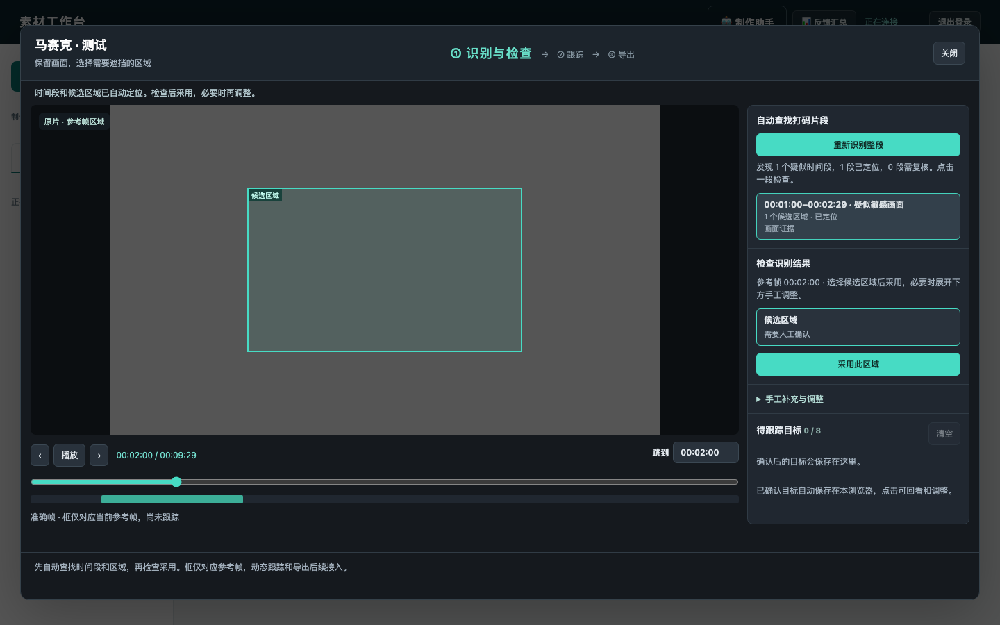

# 马赛克整段识别：时间段与目标区域

本次修正首阶段流程：用户点击“识别整段视频”，Gemini 自动发现疑似时间段，程序再自动选取代表帧定位区域。用户无需先找帧、设范围或画框。

## 实现与边界

- 马赛克继续使用独立入口、会话快照和草稿，不读取或修改剪切任务。
- 后端 `mosaic_scan.py` 复用视频抽样识别函数，先获得时间段及证据，再在区间中点、开始帧、结束帧依次尝试区域定位，获得有效候选后停止该区间的尝试。
- 每次最多自动定位 8 个时间段，每段最多 3 次区域调用；视频识别最多返回 40 段，超出自动定位预算的时间段和定位失败的时间段全部保留为“需复核”。整体处理预算 1200 秒，未完成定位不能当作无风险。
- `GET /api/batches/{bid}/mosaics/{sid}/scan` 返回 `{enabled,report,notice}`；`POST` 接受 `{reset_at,force}`。独立 `scan.json` 保存最新任务，强制重识别有新的任务 ID。
- 每个事件包含 `id,start,end,label,reason,status,candidates,review_note`；定位成功时增加 `seed_frame`。时间范围是源帧 `[start,end)`，候选区域沿用已有单帧契约。
- 缓存绑定原片摘要、会话重置版本、模型配置和提示。保留任务/项目锁、过期结果校验、工作进程中断恢复；新任务不会被旧任务迟到结果覆盖。

## 交互

1. 打开工作台，读取已有整段识别结果或恢复进行中的任务。
2. 主按钮“识别整段视频”，无需手动设置参考帧；状态区分别显示扫描、定位、失败、无发现和部分需复核。
3. 疑似时间段显示在结果列表和时间轴上。点击一段自动填入时间范围、跳到参考帧并呈现候选框。
4. 已定位结果直接显示“采用此区域”；手工范围、换帧识别和画框位于折叠的补充区。需复核片段则展开补充区，保留原时间段。
5. 重新识别不清空已确认的待跟踪目标。关闭重开恢复后台结果，迟到响应不能覆盖新窗口。

## 验证

指定 Python：`~/miniconda3/envs/py3.12/bin/python3.12`。

106 项相关测试全部通过；`node --check` 与 `git diff --check` 通过。规格审查和代码质量审查未留下阻断问题。

相关测试集合包括：`test_mosaic_scan.py`、`test_mosaic_locate.py`、`test_mosaic_ui.py`、`test_cutting.py`、`test_cutting_api.py`、`test_cutting_scan.py`、`test_cutting_replace.py`、`test_cutting_ui.py`。

新增后端验证覆盖 40 个疑似时间段不丢失、最多 24 次区域调用、部分定位失败、缓存/强制重试、权限与重置、独占识别额度、原片校验、过期任务和共享截止时间。前端验证覆盖无需手选帧即可识别并采用、未定位片段保留、进行中任务恢复、失败与空结果区别、重新识别保留目标和迟到结果隔离。

模型响应在自动化测试中模拟；未调用真实 Gemini，未验证真实素材召回率和区域准确度。整段抽样仍可能遗漏短闪帧，单个参考框不代表全段动态覆盖。SAM 2 跟踪及导出尚未接入。本次未部署或重启共享服务。
